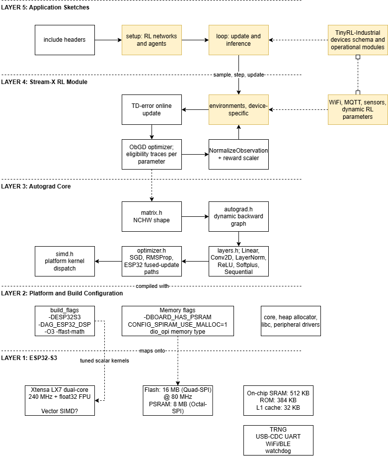

# Architecture & Hardware Notes — TinyRL-Industrial

## TinyRL Functional Block Diagrams

> Diagrams + corresponding source code for [TinyRL](https://github.com/mohmdelsayed/TinyRL) ([docs](https://www.tinyrl.ai/docs/)) on [ESP32-S3](https://www.espboards.dev/esp32/yd-esp32-s3/) N16R8 (16 MB Quad SPI flash plus 8 MB Octal SPI PSRAM)

The **original TinyRL never stores weights in flash and never calls PSRAM APIs directly.** we enable it through `core/persistence.cpp` which saves `net.bin` (network weights) + `model.bin` (stats/theta) so a rebooted node resumes monitoring with zero relearning. That is what makes the node truly plug-and-play.

### Master Architecture (full stack)



Five layers:
- LAYER 5: Application Sketches
  - `examples/stream_x_esp32/src` as template for implementation
- LAYER 4: Stream-X RL Module
- LAYER 3: Autograd Core
- LAYER 2: Platform and Build Configuration
- LAYER 1: ESP32-S3

### Corresponding code — the RL part of `stream_ac_continuous.cpp`

```cpp
void loop() {                                        // 1 full RL step per iteration
    ag::Tensor s(state, false);                      // state tensor, no grad
    ag::Tensor action = agent.sample_action(s);      // actor forward + sample
    auto [next_state, reward, terminated, truncated] = env.step(action.item());
    next_state = agent.normalize_observation(next_state);
    float scaled = agent.scale_reward(reward, terminated || truncated);
    ag::Tensor r(ag::Matrix::Constant(1, 1, scaled), false);
    ag::Tensor sn(next_state, false);
    agent.update(s, action, r, sn, terminated || truncated);  // TD error -> ObGD
    ...
}
```

## Memory Layout (PSRAM + internal SRAM)


**Key:** TinyRL contains *zero* direct `heap_caps_malloc(MALLOC_CAP_SPIRAM)` calls. All memory flows through `std::vector<float>` inside `ag::Matrix` (`matrix.h:44`) → plain `operator new`. The PSRAM utilization is achieved entirely at build time: `CONFIG_SPIRAM_USE_MALLOC=1` makes the Arduino-ESP32 heap allocator transparently place large blocks (network weights, ObGD eligibility traces, CNN frame buffers) into the 8 MB octal PSRAM, while small, hot objects stay in internal SRAM served by the 32 KB L1 cache.

### Corresponding code

**The single storage primitive — `src/matrix.h:44`** (every tensor, weight,
trace and frame ends up here):

```cpp
class Matrix {
public:
    using Shape = std::array<int, 4>;  // {N, C, H, W}
private:
    Shape shape_{1, 1, 1, 1};
    std::vector<Float> data_;          // <- all memory goes through new/delete
```

**PSRAM enablers — `platformio.ini` + board JSON:**

```ini
-DBOARD_HAS_PSRAM
-DCONFIG_SPIRAM_USE_MALLOC=1        ; transparent PSRAM for big allocations
-mfix-esp32-psram-cache-issue       ; S3 PSRAM cache errata workaround
board_build.arduino.memory_type = dio_opi   ; octal (OPI) PSRAM + DIO flash
```

```json
"name": "Freenove ESP32-S3 WROOM N8R8 (8MB Flash / 8MB PSRAM)",
"build": { "arduino": { "ldscript": "esp32s3_out.ld",
                         "partitions": "default_8MB.csv",
                         "memory_type": "dio_opi" },
           "psram_type": "opi", "f_cpu": "240000000L",
           "maximum_ram_size": 327680, "flash_size": "8MB" }
```

**Fragmentation-proof frame storage — `stream_q_atari.cpp`:**

```cpp
// Fixed-size array instead of std::deque  (avoid heap fragmentation on ESP32)
static constexpr int MAX_FRAMES = 4;
ag::Matrix frames_[MAX_FRAMES];   // pre-allocated 42x42 grayscale frames
ag::Matrix frame_hw_;             // reusable reshape buffer
ag::Matrix out_;                  // reusable stack buffer (1, n, h, w)
```

**Runtime monitoring — ESP32 guide:**

```cpp
void print_memory_info() {
    Serial.printf("Free heap: %d\n", esp_get_free_heap_size());
    Serial.printf("Largest free block: %d\n", esp_get_max_alloc_heap());
    Serial.printf("Minimum free heap: %d\n", esp_get_minimum_free_heap_size());
}
```

## Compute Layout (kernel dispatch & vector processing)


**Honest technical note:** the ESP32-S3 LX7 cores expose a 128-bit SIMD vector
ISA (and Espressif ships the ESP-DSP / ESP-NN libraries). TinyRL does **not**
call any Xtensa SIMD intrinsics or esp-dsp functions. `esp32_dsp.h` ships
*hand-tuned pure scalar kernels* whose 2–4x speedup comes from:

1. **4/8-way loop unrolling** — feeds the LX7's dual-issue pipeline (ILP),
2. **cache-blocked GEMM** — `BLOCK = 32` sized for the 32 KB L1 cache,
3. **`-O3 -ffast-math`** — lets GCC auto-vectorize the straight-line loops,
4. **stride-specialized im2col** — `memcpy` fast path for stride 1.

### Corresponding code

**Platform detection + dispatch — `src/simd.h:55-58, 453-469`:**

```cpp
// ESP32-S3 Detection (checked first - most constrained platform)
#if defined(CONFIG_IDF_TARGET_ESP32S3) || defined(ARDUINO_ESP32S3_DEV) || \
    defined(ARDUINO_FREENOVE_ESP32_S3_WROOM) || defined(ESP32S3)
  #define AG_PLATFORM_ESP32 1
#endif
...
#if defined(AG_PLATFORM_ESP32)
  #include "esp32_dsp.h"          // template specializations override generic
#endif

AG_INLINE void matmul(const Float* A, const Float* B, Float* C, int M, int K, int N) {
#if defined(AG_PLATFORM_ESP32)
    matmul_esp32(A, B, C, M, K, N);   // <- ESP32-S3 kernel
#elif defined(AG_PLATFORM_NEON)
    matmul_neon(A, B, C, M, K, N);    // <- Apple-Silicon / ARM64
#else
    ...                               // generic BLOCK=64 fallback
#endif
}
```

**Cache-blocked GEMM — `src/esp32_dsp.h:276-296`:**

```cpp
AG_ESP32_INLINE void matmul_esp32(const Float* A, const Float* B, Float* C,
                                  int M, int K, int N) {
    std::memset(C, 0, M * N * sizeof(Float));
    constexpr int BLOCK = 32;  // Optimized for ESP32 cache (32 KB L1)

    for (int i = 0; i < M; i += BLOCK)
      for (int k = 0; k < K; k += BLOCK)
        for (int j = 0; j < N; j += BLOCK) {
            int imax = std::min(i + BLOCK, M);   // ...
            for (int ii = i; ii < imax; ++ii) {
                for (int kk = k; kk < kmax; ++kk) {
                    Float aik = A[ii * K + kk];
                    fma_scalar(B + kk * N + j, aik, C + ii * N + j, jmax - j);
                }   // whole inner row = one fused multiply-add sweep
            }
        }
}
```

**Instruction-level parallelism — 4-way unrolled dot product, `esp32_dsp.h:158-168`:**

```cpp
template<> AG_ESP32_INLINE Float dot<Float>(const Float* a, const Float* b, size_t n) {
    Float s0 = 0, s1 = 0, s2 = 0, s3 = 0;        // 4 independent accumulators
    size_t i = 0;
    for (; i + 4 <= n; i += 4) {
        s0 += a[i]*b[i];     s1 += a[i+1]*b[i+1];
        s2 += a[i+2]*b[i+2]; s3 += a[i+3]*b[i+3];   // ILP on dual-issue LX7
    }
    Float s = (s0 + s1) + (s2 + s3);             // reduction tree
    for (; i < n; ++i) s += a[i] * b[i];         // tail
    return s;
}
```

**Fused optimizer kernels — `src/optimizer.h:53-62` (`AG_ESP32_DSP` path):**

```cpp
void step() override {
    for (auto* p : params_) {
        if (p && p->requires_grad()) {
#if defined(AG_ESP32_DSP)
            // Use ESP32-S3 optimized SGD update (fused, in-place, unrolled)
            simd::sgd_update(p->value().data(), p->grad().data(),
                             lr_, p->value().size());
#else
            p->set_value(p->value() - p->grad() * lr_);   // generic: extra copies
#endif
        }
    }
}
```

**Streaming-RL eligibility traces — `obgd.h step()` + `simd.h:432`:**

```cpp
// 1. Update traces & compute L1 norm using SIMD kernel
for (size_t i = 0; i < n_params; ++i) {
    ag::Float* trace_data = etraces_[i].data();
    const ag::Float* grad_data = parameters_[i]->grad().data();
    z_sum += ag::simd::trace_update_l1(trace_data, grad_data, gamma_lambda_, size);
}
// 2. Overshooting-bounded adaptive step size (kappa)
const ag::Float bound = delta_bar * z_sum * lr_kappa_;
const ag::Float step_size = (bound > ag::Float(1)) ? lr_ / bound : lr_;
// 3. Parameter update: p += -step_size * delta * e_trace
for (size_t i = 0; i < n_params; ++i)
    ag::simd::fma_scalar(trace_data, neg_update_scale, param_data, size);
```

## Flash & Storage Layout


**Key:** the neural-network weights are **never read from flash** — there is no model file, no `esp_partition_read()`. They are random-initialized at boot from the hardware TRNG and *learned online* (that is the whole point of streaming RL). Flash holds only the firmware image itself; the header-only design compiles the entire framework, the RL agent and the environment physics into one binary.

### Corresponding code

**Board layout — `boards/freenove_esp32_s3_wroom.json`:**

```json
"build": {
  "arduino": { "ldscript": "esp32s3_out.ld",
               "partitions": "default_8MB.csv",
               "memory_type": "dio_opi" },
  "extra_flags": ["-DBOARD_HAS_PSRAM", "-DESP32S3_DEV",
                  "-mfix-esp32-psram-cache-issue"],
  "f_flash": "80000000L", "flash_mode": "dio", "psram_type": "opi"
},
"upload": { "flash_size": "8MB", "maximum_ram_size": 327680,
            "maximum_size": 8388608 }
```

**Size-conscious build — `platformio.ini` / ESP32 guide:**

```ini
-O3
-ffunction-sections
-fdata-sections        ; + linker GC lets the binary keep only used kernels
```

```cpp
// AG_EMBEDDED switches logging to a no-op/serial minimal path (src/log.h)
#define AG_EMBEDDED 1
```

## Runtime: the on-device RL loop & peripheral services


### Corresponding code

**Hardware TRNG bridge — `examples/stream_x_esp32/src/getentropy_dummy.c` (entire file):**

```c
#include <stdint.h>
#include <stddef.h>
#include "esp_random.h"

int getentropy(void *buf, size_t buflen) {
    uint8_t *buffer = (uint8_t *)buf;
    for (size_t i = 0; i < buflen; i++) {
        buffer[i] = (uint8_t)(esp_random() & 0xFF);   // hardware true RNG
    }
    return 0;
}
```

**Kernel benchmarking — `benchmark_kernels.cpp`:**

```cpp
ag::Matrix A = ag::Matrix::Random(1, INPUT_DIM);
ag::Matrix B = ag::Matrix::Random(INPUT_DIM, HIDDEN_DIM);

unsigned long start = micros();                      // esp_timer under the hood
for (int i = 0; i < NUM_ITERATIONS; i++) {
    ag::Matrix C = A.matmul(B);                      // -> matmul_esp32()
    volatile float x = C(0, 0);                      // prevent optimization
}
Serial.printf("MatMul: %lu us per op\n",
              (micros() - start) / NUM_ITERATIONS);
```

**Power management (ESP32 guide, optional):**

```cpp
esp_pm_config_esp32s3_t pm_config = {
    .max_freq_mhz = 80,          // downclock from 240 MHz
    .min_freq_mhz = 10,
    .light_sleep_enable = true
};
esp_pm_configure(&pm_config);
```

## Summary of hardware-utilization mechanisms

| ESP32-S3 capability | How TinyRL uses it | Where in code |
|---|---|---|
| **Octal PSRAM (8 MB)** | Transparent spill of large allocations via `CONFIG_SPIRAM_USE_MALLOC=1`; no explicit `heap_caps` calls | `platformio.ini`, `matrix.h:44` |
| **Internal SRAM 512 KB + 32 KB L1** | Small/hot objects; GEMM blocking `BLOCK=32` sized to cache | `esp32_dsp.h:276-278` |
| **Flash 8 MB QIO @ 80 MHz** | Firmware only (header-only framework + agent + env); weights are learned online, never stored | board JSON `default_8MB.csv` |
| **PSRAM cache errata** | Compiler workaround flag keeps PSRAM cache coherent | `-mfix-esp32-psram-cache-issue` |
| **LX7 dual-core 240 MHz + FPU** | Hand-tuned scalar kernels: 4-way unrolling (ILP), fused FMA sweeps; **no SIMD intrinsics** — `-O3 -ffast-math` auto-vectorizes | `esp32_dsp.h`, `simd.h` |
| **Hardware TRNG** | Seeds the C++ RNG through a `getentropy` shim → reproducible-but-random inits | `getentropy_dummy.c` |
| **USB-CDC / UART** | 115200 Bd telemetry of episode returns | `stream_ac_continuous.cpp:71` |
| **esp_timer / micros** | Kernel-level benchmarking | `benchmark_kernels.cpp` |
| **Watchdog / RTOS** | `delay(1)` yields, 16 KB loopTask stack, periodic WDT resets in the Atari sketch | `platformio.ini`, `stream_q_atari.cpp` |
| **WiFi + OTA** | Optional telemetry and firmware updates (documented, not in core sketches) | ESP32 guide |
