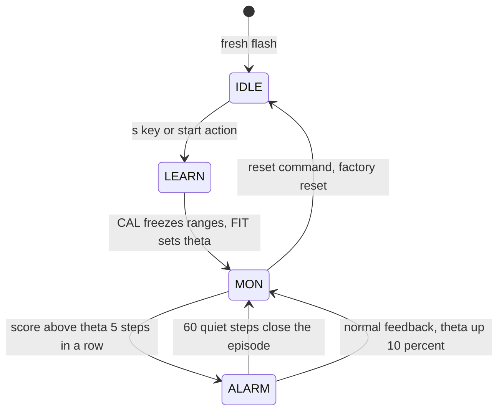
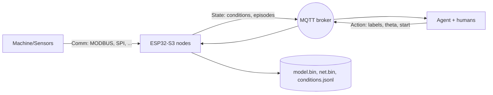
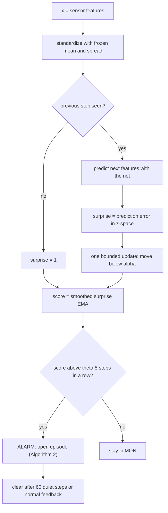
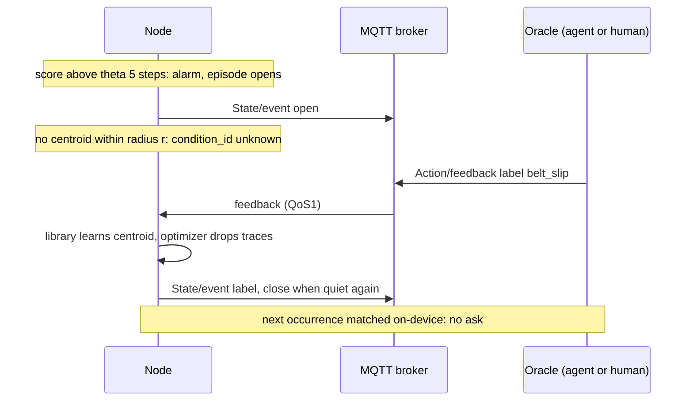

# TinyRL-Industrial: Edge Nodes TinyRL Semantic-Context Link on Agentic Workflow

**Repo Keywords:** Industry 5.0, Frugal AI, Edge Node, TinyML, TinyRL, Streaming RL, Predictive Maintenance, Covariate Shift, Semantic Data, Industrial Context, Active Learning, Semantic Communication, UNS, MQTT, PlatformIO

A general edge node `core` setup (industrial context) utilising the `TinyRL` library, with a standardised UNS schema and an AI-agent `skills.md`.

Reference setup: self-contained ESP32-S3 nodes monitoring a machine, learns what "normal" means on-device, reports conditions and episodes (not raw telemetry), and asks operator questions only when an alarm matches nothing it knows.

## Quick start

```bash
git clone --recurse-submodules https://github.com/leekaize/TinyRL-Industrial.git
# or, after a plain clone:
git submodule update --init --recursive

bash tests/run_tests.sh        # verification; needs g++ and bash only
```

- MCU: YD ESP32-S3 N16R8 (reference)
- Python + PlatformIO (`pipx install platformio`), MQTT broker on your LAN

### Adding a new sensor

1. Setup sensor: `nodes/sensors/<new>/` - implement `ISensorNode` (`begin / poll / pollPeriodMs / fresh / features / profile / logLine`). `features()` order and units are the node identity: they index the model and condition centroids.
2. Setup MCU node: `nodes/<new>_node/main.cpp` - copy `vfd_g100_node/main.cpp`, change identity only.
3. Setup build parameters: `platformio.ini` - copy the template env, set `build_src_filter`.

`nodes/core/**` is our standard algorithm shared by all nodes.

### Build, flash, watch

Set identity in `nodes/<specific_node>/main.cpp` (WiFi, broker IP, `dev_id`, UNS base path): the only node-specific file.

```bash
pio run -e <node_specific_env> -t upload
pio device monitor                          # 115200, USB-CDC
```

### Serial console

| Key | Action |
|---|---|
| `s` | [start] start learning |
| `r` | [read] poll sensor now |
| `l` | [library] print condition library |
| `p` | [pending] print stored unknown batches (label/discard by id) |
| `f <label> [normal\|fault]` | [feedback] label current/open episode |
| `m` | [monitor] status (step/score/theta/params/lib/pubs/qum/heap) |
| `reset` | [wipe] factory reset stored state, typed in full |

### Capture a hardware session, replay it offline

The node prints a machine line every 2 s (`[HDR]` feature identity once
on boot, then `[RAW] ts_ms=<ms> <features...> state= cond= conf= score= theta=`).
Capture it, analyse it, rerun it through the real core without hardware:

```bash
python3 tools/seriallog.py                    # capture: live view + raw .log + pandas .csv
bash tests/replay.sh data/serial/<file>.log   # rerun the session in the host core
```

The replay re-learns from an empty model at the captured start moment,
applies the captured labels, and compares every decision against the
captured ground truth. Change a `cfg::` knob, rerun, watch the match
rate move. Captures land in `data/serial/` (gitignored; force-add a
benchmark run if you want it in history).

## First-run lifecycle



The same story in words:

1. **IDLE**: press `s` or publish `{"action":"start"}` to `.../Action/feedback` — with the machine STOPPED (the CAL baseline becomes the `op_stopped` condition).
2. **LEARN, about 30 s CAL**: ranges freeze; the stopped baseline auto-registers.
3. **LEARN, about 30 s theta fit**: the net trains on the live stream the whole time.
4. **MON**: transitions are gated off (settle gate: no train/alarm/ask mid-motion); a settled anomaly raises ALARM and opens an episode; a known condition is labelled at once; `unknown` stores a pending batch and publishes an **ask** (ask loop below).
5. **Reboot**: `model.bin` + `net.bin` + `conditions.jsonl` (+ `pending.jsonl`) restore monitoring with zero relearning. A reboot mid-learning restarts CAL.

## The big picture



- **Uplink is semantic only**: condition changes and episode summaries, published on change. Never periodic raw telemetry; raw values travel only inside episode summaries (`meas`, measurement).
- **Downlink is context only**: labels, theta governance, start. The only subscribed topic is `Action/feedback`.
- Flash storage: four files restore the node exactly after a reboot (weights, stats, conditions, pending batches).

### MQTT contract (schema uns-v1.1)

Payload details in `uns/uns_schema_v1.json`; import `uns/uns_namespace.json` into your UNS broker.

| Topic | Retained | When | Payload |
|---|---|---|---|
| `.../State/condition` | yes | state or condition change, (re)connect | `state` (idle/learn/ok/alarm), `condition_id`, `confidence`, `episode_s` |
| `.../State/event` | no | every episode transition | `event` (open/close/label), `condition_id`, `severity`, `summary`, `meas:{feature:value}` |
| `.../State/node_info` | yes | every (re)connect | discovery doc: `features` + units, `lib_max`, `fw` |
| `.../Action/feedback` | subscribed, QoS1 | agent or human input | `start`, `label` (optionally `batch: P0001`), `discard` (batch id), `normal` (theta +10%), `fault` (theta -5%) |

An `open` event with `condition_id:"unknown"` is the node asking a question: the whole feedback loop.

## AI agent (agent/skills.md)

Paste-ready skill sheet for any LLM (local or cloud). Six skills:

1. **Intake & registry**: register nodes from `State/node_info`
2. **Answer open episodes**: reply to unknowns with labels
3. **Threshold governance**: `normal`/`fault` feedback tunes theta (percent steps)
4. **Knowledge-graph orchestration**: link nodes on related machines
5. **Bandwidth discipline**: semantic only, never raw streams
6. **UNS/MES bridging**: map conditions to MES states/ERP events

Point the agent runtime at the broker with this sheet + `uns/`; it runs every node without per-node babysitting.

## UNS integration

- `uns/uns_namespace.json`: site topology + topic map; import into your UNS broker.
- `uns/uns_schema_v1.json`: payload contract v1.1 (breaking changes vs MVP v3 listed inside).
- Plain MQTT JSON: no vendor lock, no special broker.

## The learning core at a glance

- **Learning**: one-step prediction net (4 to 32 to 32 to 4, layer-aware sparse init + LayerNorm + LeakyReLU), reward = -surprise, **StreamingOptimizer** update with eligibility traces (`nodes/core/streaming_optimizer.h`; every parameter moves < alpha per step; v2 ObGD via `-DMONITOR_USE_OBGD`). Score = z-space prediction-error EMA; alarm at theta = mu + 4 sigma.
- **Two feature spaces**: frozen anchored-ratio condition space (centroids + per-condition match units) and TinyRL z-scores (frozen after theta fit = exact post-boot resume). Details in ARCHITECTURE.md.
- **Persistence (LittleFS)**: `/model.bin` v6 + `/net.bin` (Linear layers verbatim) + `/conditions.jsonl` + `/pending.jsonl`.
- **Cost**: 1,348 params with about 16 KB optimizer state (traces + leaky max + grads); fwd+bwd+update at 1 Hz is far under 0.1% CPU at 240 MHz. PSRAM free for bigger nets.
- **Why a streaming optimizer, not the MVP histograms**: histograms saw only consecutive bin pairs; the net learns joint one-step dynamics; the per-parameter update bound keeps anomaly bursts sane.
- **Ported 2026-11-03**: StreamingOptimizer + layer-aware sparse init with connectivity floor. Rationale in `RESEARCH.md` design decisions.

## Algorithms

Read the pseudocode blocks first; the diagrams beside them show the same logic as control flow.

Recipe (all node-local; the schema never tunes these):

| Rule | What it does | Paper |
|---|---|---|
| Normalize | per-feature running mean mu / spread sigma; reward (= -surprise) scaled by its running spread | §3.1 |
| Stabilize | LayerNorm before each activation; sparse init (most weights start at 0, layer-aware budget, 95% total) | §3.2 |
| Bound updates | StreamingOptimizer: each parameter moves < alpha per sample | §3.3, App. A |

Legend: alpha = step size (max move per update) · delta = surprise (prediction error) · trace = memory of recently-used weights, fades each step · theta = detection threshold · z-space = standardized feature units · EMA = exponential moving average · centroid = average profile of a labelled condition.

### Algorithm 1: one monitor step (`tinyrl_monitor.h/.cpp`)

```
loop at poll rate (1 Hz):
 1: x <- sensor.features()                 # e.g. 4 telemetry values
 2: standardized x from frozen moments     # Rule 1
 3: y = net(x_prev)                        # predict next features from current
 4: delta = mean squared z-error           # surprise = predicted vs actual
 5: update net: trace + StreamingOptimizer # Rules 2+3: one small bounded step
 6: score <- EMA(delta)                    # smoothed surprise
 7: if score > theta: open episode         # -> Algorithm 2
 8: publish State/event
```



### Algorithm 2 + 3: episodes, asks and governance (`condition_library.*`, `episode.*`, `agent/skills.md`)

```
on episode open:
 1: d = distance(profile, each learned centroid)
 2: label = nearest if d < r, else "unknown"    # unknown = the ask -> Algorithm 3
 3: on close: store summary in conditions.jsonl

on "unknown" event:
 1: agent replies Action/feedback {label: normal | fault | <condition>}
 2: node stores centroid; theta moves by the governance step
 3: resume MON: next occurrence is labelled locally
```

Together they form the ask loop:



Suitability (which Stream-X variant fits a condition monitor):

| Algorithm | Needs | Verdict |
|---|---|---|
| **Stream-TD** | observations only | **ours** |
| Stream-Q, Stream-SARSA | discrete actions to take | unwired (no actuation) |
| Stream-AC, Stream-RAC | continuous actions | unwired (no actuation) |

Control variants ship in the TinyRL submodule: wire Stream-Q (discrete) or Stream-AC (continuous) only if nodes later actuate (VFD setpoints, maintenance triggers).

**Naming:** this is *not* Q-learning. The net's 4 outputs are 4 predicted features, not action-values; there is no action selection anywhere in `nodes/core/`. Update mechanics (traces + optimizer) are shared across the Stream-X family: our code reuses Stream-Q's update pattern minus the action (`tinyrl_monitor.cpp`).

Which problem each part solves (reading pointers into the Stream-X paper):

| Problem | Solution | Where |
|---|---|---|
| Per-sample learning diverges (no buffer averages noise) | normalize signals + LayerNorm + bounded updates | §2 stream barrier, §3 recipe |
| Update spikes after quiet periods | leaky-max normalizer (vs RMSProp/Adam) | §7 Leaky maximum normalization, App. A |
| Representation drifts on correlated streams | LayerNorm, sparse init | §7 Continual learning (plasticity) |
| No memory for replay buffers | per-sample learning, ~70 KB state | §7 Resource-constrained learning, §5 |

§4.1 shows re-adaptation after environment switches; accumulating *named* conditions is Algorithm 2 + 3.

## Project structure

```
├── README.md                         integration manual (this file)
├── platformio.ini                    one env per node-config, src_dir points into nodes/
│
├── nodes/core/                       GENERAL CORE - sensor-agnostic
│   ├── sensor_interface.h            ISensorNode contract every sensor implements
│   ├── node_config.h                 compile-time limits, topic layout, defaults
│   ├── feature_space.h               frozen log-range condition space (z + bin spaces)
│   ├── tinyrl_monitor.h/.cpp         TinyRL integration: nn::Sequential + streaming score
│   ├── streaming_optimizer.h         StreamingOptimizer (Stream-X v3 App. A)
│   ├── condition_library.h/.cpp      learned centroids (JSONL)
│   ├── episode.h/.cpp                open/feed/close episode lifecycle + summaries
│   ├── persistence.h/.cpp            model.bin v4 + net.bin (weights) + conditions.jsonl
│   ├── uns_messaging.h/.cpp          WiFi/MQTT, 4 topics, State/* + Action/feedback
│   ├── node_runtime.h/.cpp           composition root - the real setup()/loop()
│   ├── console.h/.cpp                serial console: s r l f m reset (+ JSON feedback)
│   ├── json_mini.h                   tiny JSON writer for payloads
│   └── esp_shim.c                    getentropy → esp_random (TinyRL TRNG on ESP32)
│
├── nodes/sensors/                    specify each type of sensor
│
├── dashboard/                        node-red/flowfuse dashboard schema
│
├── nodes/vfd_g100_node_01/           node-specific folder
│   └── main.cpp                      node identity (EDIT HERE)
│
├── uns/                              the "product paper" side
│   ├── uns_namespace.json            site topology + topic map → import into UNS broker
│   └── uns_schema_v1.json            payload contract v1.1 (State/*, Action/*)
│
├── agent/
│   └── skills.md                     6-skill sheet for the central AI agent
│
└── tests/                            no-hardware verification (all green)
    ├── run_tests.sh                  4-stage: syntax 13 TUs → simulation → full link → tripwire
    ├── run_mcu.sh                    PlatformIO build: flash/RAM usage vs budget per node
    ├── stub_esp32/                   Arduino/WiFi/PubSubClient/LittleFS/esp_random stubs
    ├── host/                         C++ sources for the suite + the bench
    │   ├── sim_test.cpp              short-stream simulation (cal/fit/alarm/persist/library)
    │   ├── plasticity.hpp            Dohare counters for the bench (dead units, mean |w|, eff rank)
    │   ├── tripwire_test.cpp         quiet-unmatched tripwire scenario (real SensorNodeApp)
    │   ├── console_test.cpp          boots the real node on stubs, drives console
    │   └── bench_host.cpp            multi-node host run that the web bench drives
    └── bench/                        the interactive web bench
        ├── bench_server.py           thin launcher (serves http://127.0.0.1:8765)
        ├── app.py                    Bench driver, HTTP API, run export
        ├── static/                   browser UI (vanilla js + Chart.js)
        ├── scenarios/                headless drivers: smoke.py, probe_pending.py, paper_tour.py
        ├── tools/                    summarize_run.py, plot_run.py, diag_space.py, plot_bench.py
        └── runs/                     exported runs (gitignored)
```

## References

- Stream-X (streaming deep RL - TinyRL's algorithm lineage): <https://arxiv.org/abs/2410.14606>
- Repository: <https://github.com/mohmdelsayed/TinyRL> (analyzed at commit `82f0774`)
- Documentation: <https://www.tinyrl.ai/docs/> - ESP32 guide: <https://www.tinyrl.ai/docs/esp32/>
- Board: YD ESP32-S3 WROOM N16R8 - <https://www.espboards.dev/esp32/yd-esp32-s3/>
