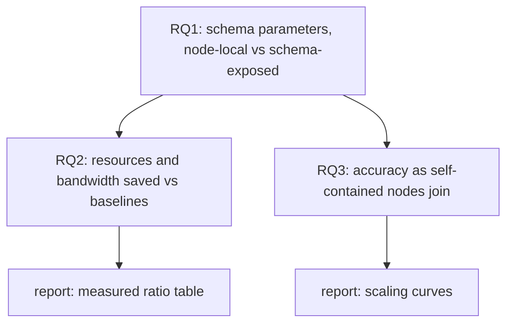
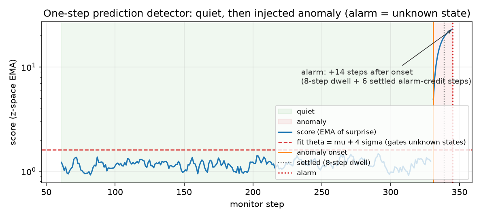
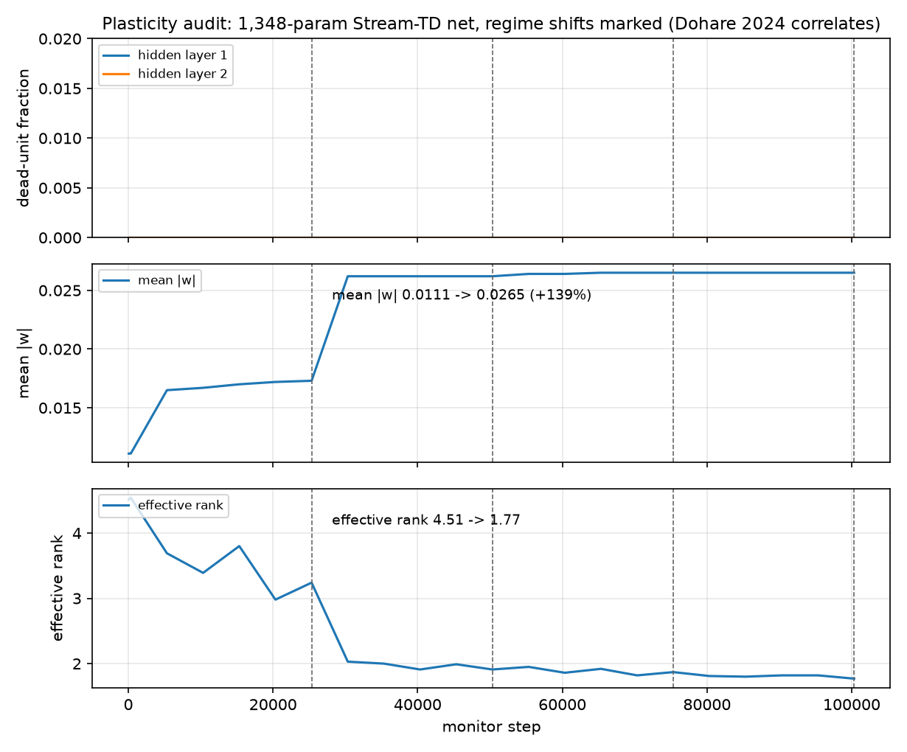
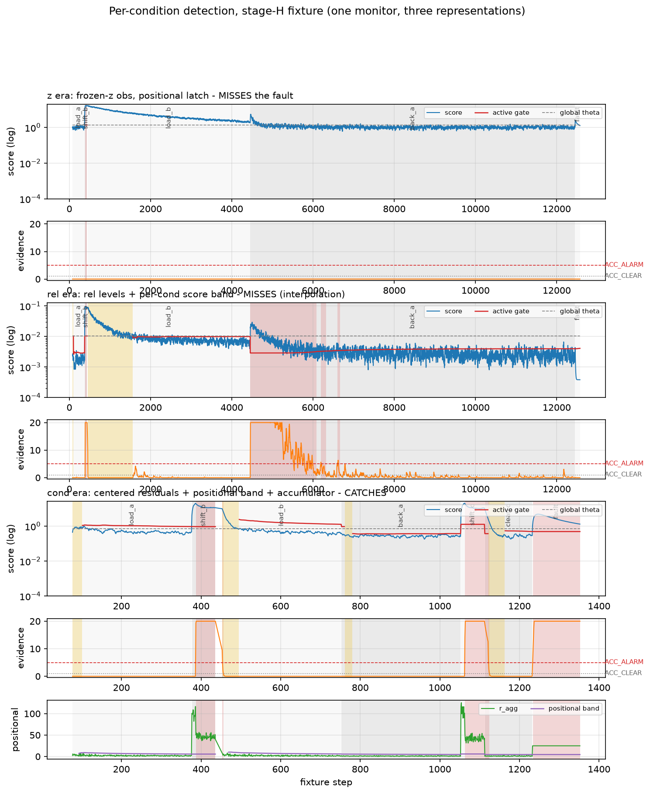
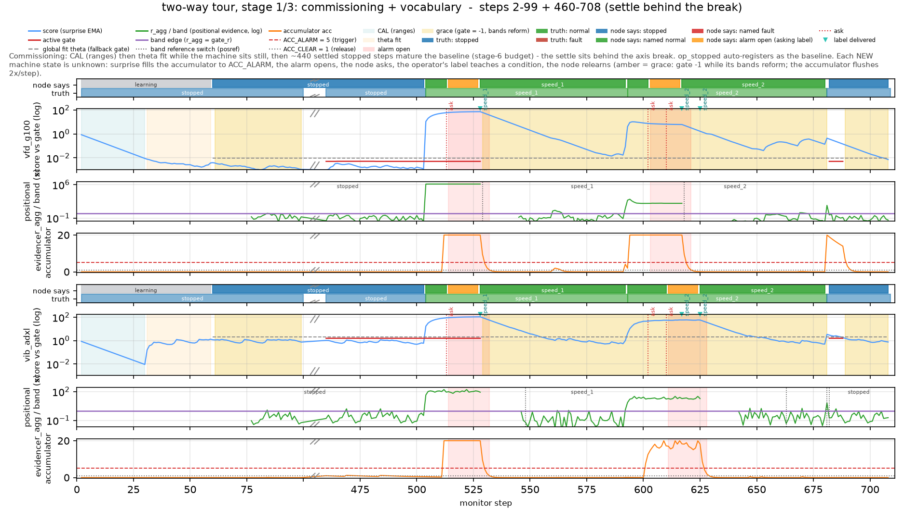
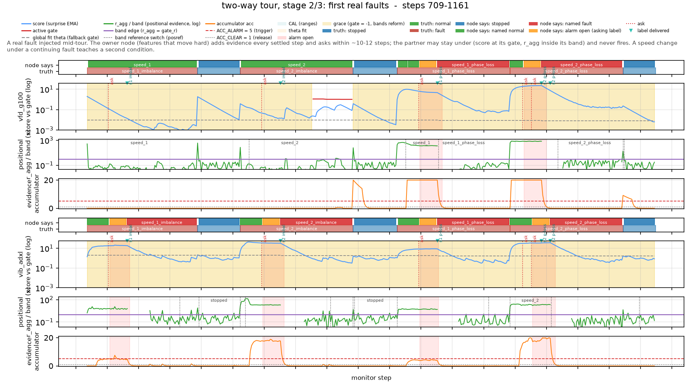
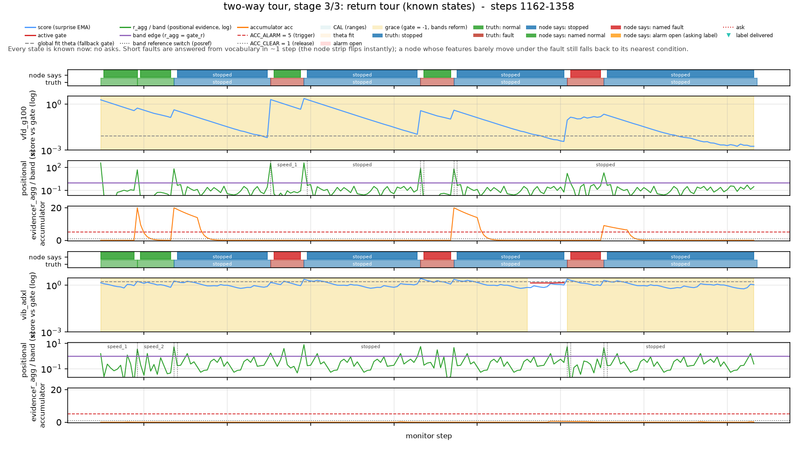

# Research Notes - TinyRL-Industrial

## How to read this file

- Reading order: **Research questions** -> the parameter split inside RQ1 ->
  **Design decisions & rationale** -> **Results & figures** -> **Experiment
  log** -> **Literature anchors**. Headings carry the claims, tables carry
  the evidence pointers.
- Update **Status** and tick checklists as evidence lands. ⬜ open · 🟡 in progress · ✅ answered
- Every claim in a *Current answer* links to an Experiment-log row or repo
  artifact. No evidence, no ✅.
- **Append-only rule, scoped**: the Experiment log is append-only. Rows are
  never edited or deleted; a correction is a new row that supersedes the old
  one. Everything else in this file may be reorganized, reworded and extended
  for clarity as the project evolves.
- Personal notes to the repo owner are HTML comments marked
  `personal (delete before committing)`; strip them before committing.



## Research Keywords

Streaming reinforcement learning; TinyML; Predictive maintenance;
Time-series anomaly detection; Semantic communication; Human-in-the-loop
machine learning; LLM agents; Industry 5.0.

> Submission keywords, ordered by specificity (Industry 5.0 drops first if capped). TinyRL and "semantic-context link" live in title/abstract. Repo-discoverability terms (MQTT, UNS, PlatformIO) stay in `README.md`.

## Research Questions

| # | Question | Status | Answer summary |
|---|----------|:------:|----------------|
| [RQ1](#rq1-schema-parameters-for-two-way-semantic-context-flow) | Effective schema parameters for two-way node↔agent semantic-context flow | 🟡 | Two-way schema runs: telemetry up (`State/*`), context down (`Action/*` + `R`) |
| [RQ2](#rq2-resource-and-bandwidth-savings-vs-node-only-and-agent-only) | Resource & bandwidth saved on edge vs node-only and agent-only baselines | 🟡 | 320 KB-RAM node at 70% free, zero cloud round-trips; ~400× fewer uplink messages |
| [RQ3](#rq3-accuracy-scaling-with-more-self-contained-devices) | Accuracy improvement as self-contained devices join and communicate | 🟡 | +4-step detection on the bench stream, zero false alarms (single node); multi-node unmeasured |

### RQ1: Schema parameters for two-way semantic-context flow

> What are the effective parameters within the schema for a two-way
> semantic-context flow between node and agent - ensuring plug-and-play
> operation, low technical requirements, and self-contained devices?

**Current answer (single node):** minimal two-way schema closes the loop: telemetry up via `State/*` (`[CAL]/[ARM]/[MON]/[ALARM]`), context down via `Action/*` feedback (`R`). Effective parameters: message set, publish rates, phase control.

**Evidence:** `uns/uns.json`, `nodes/core/uns_messaging.h/.cpp`, `agent/skills.md`

**Remaining work:**

- [ ] Enumerate + justify the parameter set; ablate required vs optional
- [ ] Verify a new sensor joins with node-side changes only (`nodes/sensors/`)
- [ ] Document the minimum technical requirement for a working pairing
- [ ] Ablate node-local-only vs schema-exposed θ governance (doubles as the plug-and-play test)
- [ ] Label timing vs optimizer reset: labelling MID-episode drops the optimizer's
      leaky-max while fault gradients still flow, over-shooting the weights; bench
      label latency drops sharply when the label lands on quiet data (2026-11-13).
      Evaluate a close-time reset or schema-level label deferral

**Proposed parameter split (from literature; boundary to ablate):**

| Parameter | Evidence | Proposed boundary |
|-----------|----------|-------------------|
| Input normalisation (running moments) | Stream-X ablations | node-local |
| Representation stabilisation (LayerNorm / frozen features) | Stream-X ablations | node-local |
| Bounded step size (StreamingOptimizer; v3 replaced ObGD) | Stream-X v3 App. A; Intentional Updates | node-local |
| Per-feature step sizes (IDBD) | Kearney; Degris | node-local; optional ablation - mixed evidence vs Adam heuristics |
| Detection threshold θ | ReRe; `normal`/`fault` ±% | **schema-exposed** - site-dependent value |
| Labels / condition library | Settles (active learning); GLAD | **schema-exposed** |
| Phase control (`start`, CAL/ARM/MON) | pairing protocol | **schema-exposed** |
| Reward scale / centering | De Asis | node-local, if reward enters the loop |

### RQ2: Resource and bandwidth savings vs node-only and agent-only

> How much resources (and network bandwidth) do we save on the edge and
> agents, compared to node-only and agent-only architectures?

**Current answer (measured 2026-11-20):** all learning/inference on a 320 KB-RAM chip with ~70% free, zero cloud round-trips; over the 2,400-step two-node tour (run-20261120-120228) the nodes published 113 uplink messages (93 condition changes + 18 episode events + 2 discovery docs) vs 4,800 raw feature vectors at the same 1 Hz cadence → **42× fewer messages**. The earlier ~400× figure assumed an unmeasured 20 Hz raw rate and is retired; payload-byte accounting at native sensor rates stays open.

**Evidence:** `print_memory_info()` runtime output; [README § Architecture cheat sheet](README.md#architecture-cheat-sheet)

**Remaining work:**

- [ ] Define + run node-only (no agent) and agent-only (raw telemetry upstream) baselines
- [ ] Audit the test suite + bench for streaming-evaluation purity: score each step with data < t only, no retrospective θ/normalizer fit (Mueller §3.1)
- [ ] Measure bytes/min up+down per architecture from MQTT payload logs
- [ ] Table: RAM / flash / CPU / bandwidth / messages per architecture
- [x] Message-count ratio measured 2026-11-20: 113 uplink vs 4,800 raw
      vectors = 42× (runs run-20261120-120228 / run-20261120-120406);
      payload-BYTE audit at native sensor rates remains open

### RQ3: Accuracy scaling with more self-contained devices

> How does accuracy improve as more self-contained devices are added and
> communicate with each other?

**Current answer (N=1):** detection 14 steps after anomaly onset on the bench stream (8-step settle dwell + 5-step alarm credit + score rise), zero false alarms on 200 quiet steps; z-baseline logged per run - the head-to-head "does learned prediction beat classical statistics?"

**Evidence:** `tests/host/` (short-stream simulation + full link check); per-run z-baseline logs

#### Metric set (formalized 2026-11-19)

> Why not accuracy/F1: accuracy is a function of theta, and theta is our
> deployed operating point. Sweeping theta over a recorded series needs
> full-series ground truth - exactly the batch-benchmark practice Mueller
> rejects (literature/mueller-2025-ts-ad-industry.md §3: "benchmark
> thresholds are computed from the full series plus ground truth, which is
> unusable when streaming"). Every metric below is evaluated at the
> on-device theta, streaming: each step scored with data < t only.
> "Better" = detection latency or ask count improves while false alarms
> stay flat - his separate λ_fp / λ_fn costs, not a blended score.

| Metric | Definition | Why this one |
|---|---|---|
| False alarms | alarm spans opening while machine truth is not a fault AND the node asserted a named condition (it alarmed a state it claims to know) | the FP cost of his §4 bandit formulation; the operator-trust budget every improvement must leave untouched |
| Detection latency | fault-mark step → the owning node shows the fault (fresh alarm edge or its condition column naming it); already named at inject = 0 | his Tenet 1: deployments exist to react NOW; latency is the alerting value |
| Asks opened / redundant | alarm opens with condition `unknown` (the ask); an ask for a state the node had already named counts separately as redundant | Settles ch. 2 (accuracy per label) + GLAD (anomalies discovered vs labeled queries): the label economy of the one-sided loop |
| Ask maturity | every stored ask batch holds >= ASK_MIN_BATCH (15) settled samples | a label is built from the stored batch; asking earlier stores transition noise (2026-11-19) |
| Vocabulary growth | named conditions per node at run end | the semantic loop's payoff: recognition without re-asking |

Implementation: `tests/bench/tools/summarize_run.py` (per-run block +
cross-run contrast); the CI shadow of the tour is
`tests/host/tour_test.cpp` (stage 5, asserts A1-A5: ask maturity,
owner-only asks, 100% owner detection, re-tour zero asks, vocabulary).

**Remaining work:**

- [x] Formalize metrics: detection latency, false-alarm rate, per-condition accuracy - replaced by the metric set above (accuracy was threshold-dependent; per-condition recognition is carried by the vocabulary metric)
- [ ] N-node runs (N = 1, 2, …) with shared condition libraries. 2-node
      interactive bench runs the mechanism: one label names every node of
      the machine with an open ask (same-timeframe event), each node's
      centroid from its own episode means; formal metrics pending
      (`tests/bench/bench_server.py`)
- [ ] Episode-mean classification dilutes fault signatures with the recovery
      tail: a heavy fault on top of a learned operating point matched that
      operating point's centroid (bench 2026-11-13). Consider peak-based or
      windowed episode fingerprints. Partial repair 2026-11-19: fault-kind
      episodes no longer refine their centroid on close (the recovery tail
      was folding into fault centroids; normals still drift-track)
- [ ] Plot accuracy/latency vs N; marginal gain per added device
- [ ] Compare vs single-node to isolate the communication benefit
- [ ] WEB BENCH, OPEN (user report 2026-11-19, next session): stopped
      states with a fault installed still do not read identical to pure
      stopped on the web page. The generator + truth are fixed (overlays
      gated on running; stopped = op_stopped), so check, in order: (a) the
      bench binary was REBUILT - app.py's build() now lists
      machine_model.hpp explicitly because header-only edits previously
      left the binary stale; (b) dump /state feat rows for the same step
      across stopped overlays and diff; (c) if measurements match, the
      leftover is display-level: the node card shows `machine:` from the
      marks and the ask panel pre-fills the compound slug even at stopped
      (app.js truthSlug).
- [x] Per-condition score calibration (2026-11-19): implemented as (a) a
      converged-state LR floor - entries into a state whose surprise sits
      inside its own learned band refine at the floor rate only, removing
      the compounding interference behind the bench "back and forth"
      degradation (CI form: tour_test churn, 20 cycles, zero alarms/asks);
      (b) per-condition bands exposed in the library dump + bench plots as
      diagnostics. The score-band AS_ALARM_THRESHOLD variant was built and
      rejected the same day: a state's score is not stationary across
      training eras (stopped: 1.2 -> ~6 after the speed states trained),
      so a gated band freezes and false-alarms forever, and an ungated one
      absorbs real anomalies. DECISION (2026-11-19): positionality is the
      permanent primary channel - ALARM means "I don't know this state";
      the one-step score is the gate for unknown states and the plasticity
      diagnostic. Remaining open: none on this item.
- [ ] Confidence semantics: `confidence()` is now positional for matched
      states (1 at the centroid, 0 at the radius edge); the score margin
      only applies to unmatched states. Ablate against the operator's
      trust calibration on the bench (low priority, paper-only)

## Design decisions & rationale

> One entry per "why did we build it this way". Rows are never deleted; new
> decisions are appended; regrouping for clarity is fine.

| Decision | Rationale | Alternatives rejected |
|----------|-----------|----------------------|
| Settle gate v2: per-feature fast/slow motion EMAs, slow EMA floored at 2 CAL units, all-feature veto + 8-step dwell (2026-11-19) | the scalar gate let one noise-dominated feature flap the whole vector (vib fmax/bands), and a noise lull inside a transition read as stabilized; the floor is the per-step-difference noise bound (difference of two noisy rel positions ~ 2 units) | quorum calm (a single-feature fault onset must still unsettle), fixed seconds (not self-calibrating) |
| Asks mature at ASK_MIN_BATCH = 15 settled samples; `unidentified` before `unknown` (2026-11-19) | a label is built from the stored batch - asking at episode-open (n=1) stored mostly transition noise and burned the operator's attention; maturing states keep re-identifying, so states that resolve into known conditions never ask | immediate asks (bench 2026-11-19: 1-sample batches), labeling live episodes only |
| Quiet is POSITIONAL, over ANY known condition (Schmitt latch: in at QUIET_Q, out at MATCH_Q; 2026-11-19, widened same day) | a named condition recurring is not news - normal OR fault; the condition name surfaces while quiet and that is the evidence. Score-gated quiet broke twice: re-testing the tight radius every step flickered (pre-latch), and a known state's score is not stationary across training eras (stopped score rose 1.2 -> ~6 after the speed states were learned) | score-band alarm thresholds on matched states (tried 2026-11-19, rejected with the tour-test failure: the outlier gate froze the band at the commissioning level and the first post-training visit alarmed forever); fault-kind never quiet (made every recognized fault re-alarm per visit - the operator-facing noise of the 2026-11-19 bench report) |
| Per-condition score bands: used for the converged-state LR floor + diagnostics, NOT for alarms (2026-11-19) | the band (mu + k sigma of the surprise observed on a condition's settled matched steps) is a sound "does the net still predict THIS state" signal, so converged entries refine at the floor rate - repeated full-rate entries were the compounding interference behind the bench's back-and-forth degradation; alarm duty stays positional | band-gated alarms (see row above); no LR floor (full-rate re-entries compounded the degradation) |
| Centroid refinement on close: NORMAL-kind episodes only | a fault episode's mean folds in the recovery tail before the clear, dragging fault centroids toward the recovered state | refining all kinds (the blob that swallowed neighbouring states) |
| Fault overlays measurable only while RUNNING (generator + truth); stopped = op_stopped whatever is installed (2026-11-19, user decision) | a stopped machine reads exactly like a stopped machine no matter what is installed: the old vdc -3 leak and vib stopped ×1.3/×1.5 made stopped+phase_loss a spurious state the nodes correctly refused to distinguish | reporting the overlay while stopped (made quiet stopped passes look like missed identifications) |
| Metrics: no accuracy/F1; latency + false alarms + ask economy at deployed theta | accuracy is a function of theta; threshold sweeps need full-series ground truth (Mueller §3) - see RQ3 metric set | point-adjust F1, ROC/AUC over recorded runs |
| ObGD, not MVP histograms | net learns joint one-step dynamics; overshooting bound keeps bursts sane | MVP histograms (README § Architecture cheat sheet) |
| StreamingOptimizer replaces ObGD (ported 2026-11-03; v2 via `-DMONITOR_USE_OBGD`) | v3 App. A: per-coordinate displacement < α, no 1/d shrinkage as nets grow; host-test green at α=2e-3, β=0.99995, λ=0.8 | keep v2-era ObGD |
| Layer-aware sparse init (global 95% budget + connectivity floor) | v3 App. C: uniform 90% zeroed ALL first-layer weights at fan-in 4 - node booted deaf; floor guarantees ≥1 nonzero input per unit | uniform 90% per-layer |
| Schema exposes only site-dependent knobs (θ, labels, phase); streaming self-adaptation stays node-local | Stream-X holds one fixed config across tasks - internal adaptation thins what the contract carries; site-relative values are what only external context supplies | expose all RL parameters; fully static node |
| Stream-TD (prediction branch), not Stream-Q/AC | condition monitoring has no actions to take; detection needs only prediction error; control variants stay in the submodule for future actuation | Stream-Q / Stream-AC on the monitor node |
| Bench protocol = streaming evaluation (R_o) only | Mueller §3.1: batch benchmarks mislead practitioners; every RQ2/RQ3 baseline scores each step with data < t, no retrospective θ/normalizer fit | batch evaluation as in TAD benchmark suites |
| Uplink carries state changes + episode summaries only; never periodic telemetry | Zhou 2022 uplink principle (VoI): transmit task-relevant info, collapse repeats; grep-verified: no periodic telemetry in `nodes/`, raw values only inside episode summaries (`uns_messaging.h`) | periodic MQTT telemetry stream; raw waveform upload |
| Asks = alarm-gated stream-based selective sampling (`condition_id:"unknown"` inside an episode), not pool-based or agent-initiated | Settles 2012 ch. 1-2: scenario taxonomy; oracle cost argues for rare, event-driven queries; Mueller 2025 one-sided feedback already makes alarm-gating the natural trigger | pool-based batch label requests; agent pushing unsolicited labels |
| Retention split from relearning: labels/centroids in `/conditions.jsonl`, weights in `/net.bin`, stats+θ in `/model.bin` | Dohare 2024 (Nature 632): retention must not depend on net plasticity; frozen anchored-ratio centroid space + exact post-boot resume keeps labels alive without replay or relearning; bounded updates keep relearning from eroding capacity | replay buffer for old conditions; relearn-from-scratch on reboot |
| Condition matching = per-condition radii (q × the condition's own measured σ, in anchored log2-ratio decades), not CAL-derived global units | 2026-11-15 bench: stopped-machine CAL gave the drive ~20-decade radii on its dead features (structurally blind to every running state once one was labelled) and the vib 0.15-decade radii on bands whose noise is ±0.5 decades; a condition's yardstick must be that condition's own noise, measured from its labelled batch | single global radius; CAL-only per-feature units |
| Quiet-unmatched conditions are counted node-side, never asked about; alarm-gating stands | Settles 2012 ch. 2.5 myopia: a threshold gate can be confidently blind to whole regions (two-triangles failure); counting quiet-unmatched steps is the cheap tripwire, while quiet asks would flood the one-sided oracle | gated + quiet asks by default; ignoring quiet drift entirely |
| Label vocabulary is fleet-wide; centroids stay per node: a shared label names each node's own episode (the same-timeframe event of the same machine), and each node builds its centroid from its own stored batch - no means or centroids cross nodes | one machine, two modalities: feature spaces are incomparable across profiles, but the NAME of a condition is meaningful to all | cross-node centroid or means sharing (raw means re-mapped across incomparable spaces would pin centroids at range edges) |
| rel-obs era (`-DMONITOR_REL_OBS`, 2026-11-20): the agent observes anchored-ratio levels (feature_space.h rel()) instead of frozen z; matched states alarm against their own matured surprise band instead of the positional latch | frozen z pins every running regime at the +-5 clamp - one input point, so the Stream-TD surprise cannot discriminate regimes or faults at running states; rel() restores per-regime stationarity and makes the per-condition bands sound as alarm gates | staying on frozen z (running states indistinguishable); positional latch only (no streaming-TD detection at named states) |
| Era-locked `MODEL_VERSION` (6 z / 7 rel / 8 cond, 2026-11-21): a model.bin from another era is rejected, forcing fresh commissioning on env switch | the score scale differs per era; mixing eras would compare incommensurable thresholds and silently invalidate stored bands | sharing models across eras |
| GRACE bootstrap (2026-11-20): a freshly named state (score band immature, s_n < 16) is quiet by name; the grace expires OBJECTIVELY when the band matures | the operator's label vouches for the state while the first learning pass converges; without it the alarm flaps while the score crawls across theta (bench stage H); it cannot outlive the band's maturity, so it is not the 2026-11-19 permanent latch that masked in-radius faults | permanent quiet-by-name (masks in-radius faults); no grace (flapping during learning) |
| Band feeding: down-only ratchet (feed only below mu + 2 sigma once s_n > 0) + era-specific stationarity gate (2026-11-20/21) | the post-label learning transient must not raise the state's own future alarm line; a decay tail feeding the band to the alarm edge masked in-radius faults (stage H 2026-11-20). rel gates on the commissioning floor; cond uses the score-EMA vs raw-surprise agreement (see the cond row) | feeding on "just below global theta" (matured the band on hovering transients, tripped the converged LR floor, froze the net mid-descent) |
| `RELEARN_FRAC` = 0.7 (bench-tuned 2026-11-21): a matched state ABOVE its gate re-learns at 0.7 of MONITOR_LR | 1.0 burst-thrashed (the leaky-max keeps burst capacity for ~beta^-1 steps, the score self-oscillated around the band); 0.5 damped the landing but stretched an interference heal past 4700 steps | full rate on every re-entry (compounding interference); floor rate only (heals take hours at 1 Hz) |
| Console `f` grammar patch (2026-11-20): `f normal` / `f fault` are reserved feedback words; `f <label> [normal\|fault]` labels a condition; the second word is the KIND, not the action | the old parser took the SECOND word as the action, so `f speed_1 normal` hit the false-alarm path and the label was discarded; there was NO console path to a normal-kind condition at all | second-word-as-action parsing (the labelling bug the user hit on the rig) |
| cond-obs era (`-DMONITOR_COND_OBS`, 2026-11-21): the agent observes PER-CONDITION CENTERED residuals, obs = (rel - c_matched)/u_matched; unknown states center on the NEAREST condition; before the first condition exists the frame is CAL-unit normalized rel | both earlier representations have a structural miss: frozen z saturates and the trained clamped point absorbs future faults; rel LEVELS interpolate across regimes (a static fault BETWEEN two trained regimes is predicted straight through, stage-H miss 2026-11-21). In the centered frame every condition's training manifold sits at 0, so a 2.5-sigma offset is off-manifold no matter which regimes were learned; the commissioning handover stays continuous (op_stopped registers at centroid 0 with CAL fallback units) | per-condition nets (60-300 samples per condition is far too little); absolute-level spaces (both failure modes above); hand-tuned scaling constants |
| Positional band (2026-11-21): r_agg = sum_f ((rel_f - c_f)/u_f)^2 vs the condition's own Welford band (mu + k sigma of fed quiet steps) as a SECOND alarm edge at matched states | the one-step predictor converges to IDENTITY in a static regime in any coordinate frame, so a STATIC in-radius offset is invisible to prediction error once settled - the stage-H miss in all three eras' score paths. The residual sum sees it: quiet steps sit near chi2(nf), the 2.5-sigma-everywhere fault at 6.25*nf. Geometry, not prediction: no decay transient, only the outlier guard guards feeding | prediction-only detection (structurally blind to static offsets); max-component radius alone (the fault is inside it by construction) |
| Evidence accumulator (2026-11-21): a leaky integrator of each settled step's EXCESS past the active edge, normalized by that edge's own gate (score/gate, ragg/gate_r); quiet LEAKS, never resets; replaces the m-of-N Schmitt in the band eras | 5-consecutive fired on drift-stale bands (the stage-H re-entry false alarm: 5 marginal breaches against a band formed 700 steps earlier) while single strong evidence was under-used; magnitude-weighted integration separates marginal drift (integrates sub-threshold) from real faults (crosses in ~4 settled steps) | m-of-N consecutive breaches (correlated EMA breaches flap); full reset on one quiet step (user requirement: normal evidence does not wipe accumulated badness); per-edge independent Schmitts |
| Frame-switch optimizer reset (2026-11-21): a label arriving mid-settled-state rescales the cond input frame -> onWorldChange() (traces + leaky-max dropped), also on direct A->B match changes | the prediction shock of the frame switch poisons the leaky-max and the heal takes thousands of steps (bench: load_b stuck at score 0.91 after a 4000-step window); the label lands mid-settled by definition of the ask flow, so settle-edge resets never fire | reset only at settle edges (misses the label-time frame switch); no reset (throttled heal) |
| Scale-free band feeding (cond, 2026-11-21): formation phase (s_n < 16) feeds unconditionally inside the stationarity gate; maturity hands over to the ratchet + outlier gate | the centered frame rescales every regime to its own sigma, so the commissioning floor is meaningless for other conditions (no band matured in 4000 steps); the first replacement used sr_base_, but EVERY label follows an alarm whose transient inflates sr_base_ itself (load_b band formed at gate ~35); the score-EMA vs raw-surprise gap is self-referential and uncontaminable. The rel-era ratchet assumed a DECAYING score and deadlocked on flat noise (load_a s_n froze, permanent grace) | commissioning-floor gate (cross-scale); sr_base_-relative gate (contaminated); first-sample ratchet on flat-noise scores |
| Research-budget protocol (2026-11-21): a new condition gets 60-300 settled samples on the rig; stage H runs the cond era at the 300 upper bound with the 60 lower bound validated separately; rel/z keep the windows their documented numbers were measured at | the product claim must be provable inside the operator's real labelling window; long convergence windows (4000+) exist only in the older arms' bench history | 4000-step learn windows as the product claim (unavailable on the rig) |
| Re-entry grace + score-band recalibration (2026-11-22): a regime entry to a KNOWN condition whose band already matured gets REENTRY_GRACE_N=16 steps of the fresh-label protection (gate inactive, accumulator flushes 2x/step), and its first matched step in the window RECALIBRATES the score band (Welford restart) - the regime-entry optimizer reset legitimately changes the net's converged error floor, and the band's outlier gate ("never widens its own band") would block the new floor forever (real rows: pristine gate 0.01 vs post-excursion floor 0.02, every known-state revisit re-alarmed). GEOMETRY GUARD: the recalibration fires only when the position sits inside the condition's own positional band (r_agg <= posTheta) - a fault coinciding with a transition moves the geometry and must not be absorbed (the suite caught the unguarded version: the sim's in-radius fault was baked into load_a's band at gate 7.42, the cond-era in-radius guarantee died; with the guard the fault alarms at +25 steps) | the transient is the same phenomenon the fresh-label grace covers (band not representative while the net re-adapts); the positional band is geometry, not prediction, so it is the honest "is this the same state" test; bounded latency trade identical to the label grace | recalibrating unconditionally (absorbed the sim's in-radius fault, suite-caught); score-band alarms for matched states (rejected 2026-11-19: the outlier gate froze the band); permanent re-entry latch (the 2026-11-19 permanent-latch failure) |

## Results & figures

The figures come from the host bench (no hardware needed) and live in
`assets/`. Regenerate after any algorithm change, and before submitting, so
the numbers match the final run:

```bash
TINYRL_TRACE=1 /tmp/tinyrl_test_host > /tmp/trace.log
TINYRL_LONGRUN=100000 /tmp/tinyrl_test_host > /tmp/bench.log
python3 tests/bench/tools/plot_bench.py /tmp/trace.log /tmp/bench.log
```

One `bash tests/run_tests.sh` builds the binaries into /tmp. matplotlib is
the only Python dependency (`python3 -m pip install --user matplotlib`).

### Detection behaviour (one alarm episode, end to end)



The score (EMA of the z-space prediction error) on the quiet stretch stays
under θ throughout: zero false alarms. An injected anomaly lifts it more
than an order of magnitude within a few steps, and the alarm opens +14 steps
after onset: the 8-step settle dwell, then the alarm credit as the score
crosses θ (`ALARM_HI_N = 5`, `node_config.h`; the regenerated figure
annotates the decomposition). This is the RQ3 detection-latency
measurement at N = 1 on the synthetic stream (figure regenerated 2026-11-20).

### Plasticity audit (Dohare 2024 correlates, 100k steps, 4 regime shifts)



The three Dohare correlates over a 100k-step bench with regime shifts every
25k steps (machine life). Since the 2026-11-15 training policy the bench
emulates the operator: every regime is labeled 20 steps after it settles,
so the net trains across labeled regimes and the counters measure the
deployed policy. Dead units stay at 0.00. Mean |w| grows 0.0111 → 0.0253
(+128%) across the run - bounded, vs +468% under the old ungated policy:
training only on labeled+settled steps removed the runaway weight growth.
Effective rank settles at 1.88 after the shifts (was 4.51). The 48M-step
question (plateau or divergence?) remains a one-command measurement.
(Re-measured 2026-11-20 with the regenerated figure; the 2026-11-16 log row
keeps its original figures, append-only.)


### Per-condition detection (three-era A/B, 2026-11-21)



One monitor, one fixture, three representations (z / rel / cond), each
panel showing the score against its ACTIVE gate (the condition's own band
once mature, the global theta otherwise), the positional aggregate against
its band (cond era), and the evidence accumulator with its trigger and
clear levels. The z era calls the in-radius fault quiet (positional latch);
the rel era's score decays into its band (level-space interpolation across
the two trained regimes); the cond era catches it 4 steps after onset via
the positional band while both bands keep every quiet phase quiet. Grace
spans (amber) end when the band matures; alarm spans (red) show the
accumulator's hysteresis. Regenerate with:

```bash
TINYRL_TRACE=1 /tmp/tinyrl_test_host > /tmp/h_z.log
TINYRL_TRACE=1 /tmp/tinyrl_test_host_rel > /tmp/h_rel.log
TINYRL_TRACE=1 /tmp/tinyrl_test_host_cond > /tmp/h_cond.log
python3 tests/bench/tools/plot_percond_trace.py \
        /tmp/h_z.log /tmp/h_rel.log /tmp/h_cond.log \
        --out assets/percond-trace.png
```

### Two-way tour evidence (cond era, 2026-11-21)







The 450-step two-way tour squeezed into one figure hides how the
parameters develop, so the plotter splits it at the scenario's act
boundaries (auto-detected from the truth marks; `--stages a,b,end`
overrides, `--stages none` restores the single figure):

- stage 1, commissioning: CAL ranges then theta fit at op_stopped;
  each new speed is unknown, the accumulator fills to ACC_ALARM, the
  node asks, the operator's label teaches a condition, the node
  relearns (amber = grace, gate -1 while its bands reform).
- stage 2, first real faults: imbalance - vib detects in 12 steps,
  vfd stays under (score at its gate, r_agg inside its band);
  phase_loss - vfd detects in 10 steps, and the speed change under the
  continuing fault teaches a second condition.
- stage 3, return tour: no asks; the 10-step faults are answered from
  vocabulary in ~1 step (the node strips flip instantly); vfd still
  matches the imbalance to its nearest condition (its meter features
  barely move under the fault).

One shared legend per figure sits in a reserved strip under the title
(nothing covers the data); asks are dotted red vlines, labels are teal
markers annotated with the taught condition. Owner/partner latencies:
12/10/1/1 steps (run-20261121-070500 summary). Regenerate with:

```bash
python3 tests/bench/tools/plot_percond_tour.py \
        tests/bench/runs/run-20261121-070500.jsonl \
        --out assets/percond-tour.png
```

## Experiment log

> Append-only: new runs get new rows; a correction is a new row.

| Date | Setup | RQ | Result | Evidence |
|------|-------|:--:|--------|----------|
| 2026-11-03 | host-test 900-step sim; StreamingOptimizer (α=2e-3, β=0.99995, λ=0.8) + layer-aware sparse init | 1 | all stages green: cal/fit/quiet/alarm/persist/library; anomaly matched, label persisted | `tests/run_tests.sh` |
| 2026-11-12 | host-test 4-stage (+ tripcheck scenario); plasticity bench via `TINYRL_LONGRUN` | 1, 2 | all stages green. Tripwire: silent on quiet steps matching a learned centroid, report line + `qum=` on unmatched quiet steps, local log only. 20k-step bench: dead=0.00, mean abs w 0.0184 → 0.0338, eff rank 3.0 → 1.2 across regime shifts (counters live; 48M-step question still open) | `tests/run_tests.sh`, `tests/host/plasticity.hpp`, `tests/host/tripwire_test.cpp` |
| 2026-11-13 | fixture + schedule revision: bench stream made motor-faithful (fixed-load induction motor at 1 Hz is noise-stationary with slow thermal drift; old 4-min sines removed); LEARN shortened to 30 s CAL + 30 s FIT. Probes on the old sine fixture first: 60- and 120-step LEARNs false-alarmed, 240 steps passed | 1, 2 | all 4 stages green: zero false alarms on 200 quiet steps (max score 0.89 θ), alarm +4 steps after onset; 100k bench: dead=0.00 throughout, mean abs w 0.0111 → 0.0631, eff rank 4.51 → 1.15 | `tests/run_tests.sh`, `assets/detection-trace.png`, `assets/plasticity-bench.png` |
| 2026-11-13 | interactive web bench: 2 nodes (vfd_g100 + vib_adxl) in lockstep on ONE simulated machine; collective verdicts (known / corroborated / unconfirmed / unconsulted) + fleet-wide label sharing; human oracle via browser, scripted agent for `--ci`. Two core repairs found by the bench: (1) `normal` feedback left the alarm latched and the open-ask edge was consumed, swallowing later real faults; (2) the 0.7θ clear band made a self-clear structurally impossible when mu dominates theta. Also: `jsonStr` silently ignored spaced JSON (pretty-printed agent feedback would no-op) - whitespace tolerance added. A third repair same evening: the `normal` cap (mu + 10·sd from 30 correlated fit samples) was unreachable, so governance could not silence an alarm (bench cycled alarm→normal 130 times) - replaced with a score-based raise (θ ≥ 1.05× the seen score) and no optimizer reset on normal. Regression test: `bench/scenarios/smoke.py` plays the full user loop headless (inject → ask → label → revert → re-inject → matched locally, PASS) | 1, 3 | 4/4 host stages green; scenario plays end to end: speed trim (vfd-only alarm, named op_speed_2), imbalance + bearing (vib alarms, vfd half-blind, asks + labels), heavy fault (both alarm, corroborated, one label resolves both); single-node mode verified by design review | `tests/bench/bench_server.py`, `tests/host/bench_host.cpp` |
| 2026-11-15 | Condition-space redesign (bench-found): with stopped-machine commissioning the bare log2(x/mu) coordinate stored NaN centroids (negative CAL mean) and collapsed every running state onto one clamped point - the drive was structurally blind once speed_1 was labelled. Fix: anchored ratio log2((x+A)/(mu+A)), A = 6σ_CAL (feature_space.h); per-condition match units = the labelled batch's own rel spread (was CAL-only: radii were ~20 decades on the drive's dead features, 0.15 decades on the vib's bands). Episode batch feeds settled steps only + a settled identity re-check (state moved under an episode → supersede → fresh ask); model.bin v6 persists the anchors | 1, 3 | 7-condition tour green both modes: g100 learns 5 conditions and detects its own phase_loss (10 steps - was NEVER detected before the redesign); vib learns all 6 it can see; false alarms 2-3 per node; re-tour recognised with ZERO asks. Host suite 4/4; MCU footprint 17-19% RAM / 31% flash both nodes | `tests/run_tests.sh`, `tests/bench/scenarios/paper_tour.py`, `tests/run_mcu.sh`, `tests/bench/runs/run-20261116-001358.jsonl` |
| 2026-11-16 | Test suite reorganisation + perf tracking: `tests/host/` (C++ sources) + `tests/bench/` (server, scenarios, tools); sim gains per-step compute timing (stage 2, host proxy); `run_mcu.sh` adds the real-toolchain footprint check; long-run bench emulates the operator (labels each regime) so the plasticity counters measure the deployed policy | 2, 3 | mean \|w\| 100k: 0.0111 → 0.0265 (+139%, was +468% ungated), eff rank 1.77, dead 0.00; per-step compute avg 6-8 µs on x86 (budget 1 s); flash/RAM table in tests/README.md | `tests/run_tests.sh`, `tests/run_mcu.sh`, `assets/plasticity-bench.png` |
| 2026-11-16 | Runtime footprint instrumentation, harness-side only (node code untouched): stub `fileSize()` accessor + end-of-run `[FLASH]` report in bench_host; `/export` flushes the bench process (library dump K first, then q; export skips K when done). Single-node two-way tours measure the exact flash state: g100 6,570 B / vib 7,416 B (model.bin 268 B, net.bin 5,504/6,024 B, conditions.jsonl 792/1,118 B, pending empty at end of tour); learning-state RAM composed from code constants: 22.6 KB g100 / 24.7 KB vib (values + grads + etraces + vmax = 4 arrays x params, monitor state 268 B, library 116 B/condition, pending 88 B/batch, cap 8); per-step compute avg 4 µs, max 38 µs (2000 steps) | 2 | runs run-20261116-133945 (g100), run-20261116-134119 (vib); paper Table III updated to static + runtime columns | `tests/stub_esp32/WiFi.h`, `tests/host/bench_host.cpp`, `tests/bench/app.py` |
| 2026-11-19 | Collective consult removed (user decision): no sibling verdicts (known / corroborated / unconfirmed / unconsulted), no same-profile centroid means sharing. Labelling = one webbench label applied to every node of the SAME machine with an open ask (same-timeframe event), each node learning from its OWN stored batch; the agent correlates published State/* instead. `episodeMeans` / `shareLabel` / `libMatch` left unused and removed from node core; node behaviour unchanged (the consult never fired across the two profiles and never auto-resolved an ask) | 1, 3 | 4/4 host stages green; smoke.py PASS (one label resolves both nodes' asks, re-injection matched locally, no ask); probe_pending.py PASS (discard leaves the other node's ask); paper_tour.py PASS: owner alarms 4/5 fault windows, false alarms vfd 3 / vib 2, re-tour 0 asks, 7 batches labeled - measured numbers unchanged | `tests/host/bench_host.cpp`, `tests/bench/app.py`, `tests/bench/static/app.js`, `nodes/core/node_runtime.*` |
| 2026-11-20 | Paper-freeze revalidation: host suite rebuilt 5/5 (`tests/logs/host_tests_20261120_120032.log`); paper_tour re-run in BOTH modes on the deterministic seed; bandwidth measured from the run export; plot_bench legend fix (the score line no longer hides under the legend; one continuous line across the persistence gap); new `plot_compact.py` compact single-node paper figure; all three assets regenerated | 2, 3 | two-way: asks 9 (0 redundant, batches n=15), FA 0/0, owner 4/4 (first 14-16 steps, re-occurrence 1), vocab 5/6, re-tour 0 asks; node-only: 12 node-local asks, FA 0/0, owner 4/4 (14-16), vocab 1/1; uplink 113 messages (both nodes) vs 4,800 raw vectors at 1 Hz = 42× fewer; plasticity 100k re-run: mean \|w\| 0.0111 → 0.0253 (+128%), eff rank 4.51 → 1.88, dead 0.00 | `tests/bench/runs/run-20261120-120228.jsonl`, `run-20261120-120406.jsonl`, `tests/logs/host_tests_20261120_120032.log`, `tests/bench/tools/plot_compact.py`, `assets/detection-trace.png`, `assets/plasticity-bench.png`, `assets/run-vib-compact.png` |
| 2026-11-21 | Third era shipped: `MONITOR_COND_OBS` (MODEL_VERSION 8, env `vfd_g100_node_cond`) - per-condition centered residuals + positional band (r_agg vs the condition's own band) + leaky evidence accumulator (quiet never resets it, replaces m-of-N in the band eras). Bench-driven fixes at root cause: frame-switch optimizer reset (label lands mid-settled; the shock poisoned the leaky-max, heal > 4000 steps), scale-free band feeding (score-EMA vs raw-surprise agreement; the sr_base_ gate was contaminated by the pre-label alarm transient, band formed at gate ~35), formation-phase feed (the down-only ratchet deadlocked on flat-noise scores, permanent grace), grace flush (pre-label evidence clears at the label, not 60 steps later). Earlier same session: PM1125H meter on the RS485 bus (8E1, slave 2, meter-only v/i/pf features) and the console f-grammar patch. Stage H now runs three arms; cond windows 300/300 per the research budget, 60 bound validated separately. Two-way paper tour verified on BOTH arms via a `TINYRL_BENCH_FLAGS` build hook in the bench (app.py): cond reproduces the z record metric-for-metric with faster owner identification | 1, 2, 3 | host suite 7/7. In-radius fault: z MISSES, rel MISSES (interpolation), cond CATCHES +4 steps. Bands mature inside the budget: gate 1.78 / gate_r 11.18 at 300 samples; s_n=25 / r_n=60 at the 60 bound. Anomaly latency 14 -> 10 steps (accumulator). Re-entry 0 refires (rel: 1, self-healed). 60-sample run: alarm cleared ~8 steps after the label, all asserts green. Plasticity 100k (cond era, 4 regime shifts): mean \|w\| 0.0101 -> 0.0143 (+42%, z era +128% - the frame-invariant residual task barely moves the weights), eff rank 4.41 -> 1.91, dead 0.00. Two-way tour: cond asks 9 (0 redundant), FA 0/0, owner 4/4 ident 12/10/1/1 steps (z control 16/14/1/1), vocab 5/6, re-tour 0 asks, PAPER RUN PASS both arms. Tour evidence figure: the S line now carries the active gate + r_agg/band + accumulator (bench-only fields, MQTT schema unchanged); `assets/percond-tour.png` renders the per-condition evidence tour | `tests/run_tests.sh`, `nodes/core/tinyrl_monitor.cpp`, `nodes/core/condition_library.*`, `tests/host/sim_test.cpp`, `tests/bench/app.py`, `tests/bench/scenarios/paper_tour.py`, `tests/bench/runs/run-20261121-064955.jsonl`, `run-20261121-065400.jsonl`, `run-20261121-070500.jsonl`, `tests/bench/tools/plot_percond_trace.py`, `tests/bench/tools/plot_percond_tour.py`, `assets/percond-trace.png`, `assets/percond-tour.png` |
| 2026-11-21 | Hardware bring-up (rig, first cond flash): the PM1125H meter needs settling after the slave-1 bus burst - pmV timed out at the T3.5 gap on every poll while its three neighbours answered in ~38 ms; fixed with a 25 ms delay before the first meter read (`pm::FIRST_READ_SETTLE_MS`, console 'v' toggles the new Modbus bus trace). `factoryReset()` now drops the open episode + pending index: a stale pre-reset episode survived the wipe and surfaced as a confusing 'superseded' close 189 s after its open. Radius-edge stickiness in the band eras: the rig's slow meter drift parked a steady speed_1 exactly at the QUIET_Q edge, the match flickered out, and every flicker re-alarmed the KNOWN state against the stopped-scale fit theta (ev = score/theta - 1 ~ +15 in one settled step); the monitor now holds the last matched condition within MATCH_Q (first-time matches untouched, drift beyond MATCH_Q still asks, confidence reads the hold). A floor-at-CAL-unit variant was tried first and REVERTED: it widened a normal condition's radius enough to swallow the fixture's phase_loss signature (stage 5 failed, no ask matured) | 2, 3, 5, 7 | host suite 7/7 (logs 20261121_151253 fail / 151858 green); A/B verdicts unchanged (z MISSES, rel MISSES, cond CATCHES +4); rig: 9/9 bus reads OK after the settle fix, commissioning + speed_1 label + vocabulary live; the flicker re-alarm observed twice at steady speed_1 before the stickiness | `nodes/sensors/vfd_g100/pm1125h_regs.h`, `g100_sensor.cpp`, `nodes/core/condition_library.*`, `tinyrl_monitor.*`, `episode.*`, `node_runtime.cpp`, `console.cpp`, `sensor_interface.h`, `platformio.ini` |
| 2026-11-22 | Vibration feature lock + real-data test era. `tools/feature_selection.py` (NEW): FFT parameter study + 22-candidate feature bank ranked under a NODE-PROXY classifier (anchored log2 space, max-component nearest-centroid, per-condition units - the deployed decision rule), greedy top-K subset, band proposal, --capture (raw x,y/z from serial) + --export (raw captures -> model-testing CSV). Vib profile LOCKED to 4 features (rms_y, entropy, margin, rms_x) from the capture; DSP moved to 64-pt FFT @ 100 Hz effective (2:1 decimation). SAMPLE-BEAT BUG found via the raw stream: `next_us_=0` vs a large boot-time micros() made every poll sample - the vib ran at ~485 Hz (median gap 2.03 ms = the loop period), windows ~128 ms real time; the beat now anchors at the first poll and resyncs on >4-slot stalls; the first capture is unusable, recapture pending. Real-data test switch: machine_model.hpp real mode (env TINYRL_REAL=1) streams the g100's collect campaign (`data/serial/collect_20261121_211534.csv`, 150 rows/condition) + the vib capture export per condition; imbalance aliases the speed blocks on the g100 (drive features identical, user decision); tour_test stage 8 (run_tests.sh 8/8). CORE (cond era): re-entry grace + score-band recalibration with a geometry guard (see design decisions) - fixed the known-state revisit re-alarm on real rows (stopped=1 -> 0 in the vfd replay) | 1, 2, 3, 7 | HOST-TEST GREEN 8/8 incl. the real-data tour: TOURCHECK OK on the collect rows (asks mature, owner-only, re-tour zero asks, 20 churn cycles 0 alarms 0 asks, full vocabulary); the suite caught the unguarded recalibration absorbing the in-radius fault, fixed by the geometry guard (alarm +25 steps); pio 5/5; vfd replay: stopped=0 (was 1), phase_loss still absorbed on the TOUR fixture's wide speed_1 spread (i 0.51-0.69) - the canonical collect dataset (i 0.677-0.706) detects it cleanly (tour ask+label+re-tour) | `tools/feature_selection.py`, `nodes/sensors/vibration_adxl/*`, `nodes/core/tinyrl_monitor.*`, `condition_library.*`, `node_config.h`, `tests/host/machine_model.hpp`, `tour_test.cpp`, `bench_host.cpp`, `tests/run_tests.sh`, `tests/logs/host_tests_20261122_073234.log`, `SESSION-HANDOFF-20261122.md` |
| 2026-11-22b | Real-data transitions + detection-guard rework. The collect campaign's 152 unlabeled transition rows are now bucketed per (from,to) pair and streamed on every machine switch (the old strtok parse merged ",," and silently skipped all of them - mm_split preserves empty fields). Stage 8 re-pointed at the DEPLOYED cond era and gated on the g100 CSV. The replay exposed five unsound guards, each rebuilt at root cause: (1) UNIT FLOOR 0.5x CAL sigma - a 15-row batch of a near-constant register (pf sd 0.0001 decades vs 0.046 wander) rejected its own state's rows; (2) the sticky hold carried a neighboring state's first visit forever (speed_2 sat d~3.5 inside the grown 'speed_1' radius) - tenure release at 80 settled steps, longer than any recorded ramp (58), plus hold-burn until a genuine match; (3) identity adaptation (band feed, positional feed, yardstick, centroid, re-anchor) only on genuinely matched steps - held ramp rows dragged identities onto transitions; the neighborhood path is units-only; (4) the episode relabel path refined centroids with a mean spanning two states - relabeled episodes never refine; (5) the sustained-floor RE-ANCHOR: 2 settled matched steps above the state's own gate with quiet (<3x gate_r), slow (<5 ragg/step), DECAYING geometry re-anchor the band MATURE at the current floor (reseedScoreBand, no grace - a grace window flushed positional evidence and kept the grace-vouch alive) and void the stale accumulator. The positional-band grow-only widening was tried and REVERTED (it absorbed the suite's in-radius fault); a yardstick ceiling (2x CAL sigma) bounds what the neighborhood may bridge | 1, 2, 3, 7 | Suite 7/8: stages 1-7 green, the cond-era contract restored (in-radius fault CATCHES +25); stage 8 (real-data tour) fails at the speed_1 stage phase assert - the growth's removal re-exposed a stale-band/alarm interaction the growth had been silencing; the decay-gated re-anchor does not fully cover it (analysis + next moves in SESSION-HANDOFF-20261122b.md section 3). The tour DID pass end-to-end earlier in-thread with the growth present (TOURCHECK OK, churn 20x 0/0, transitions live) | `tests/host/machine_model.hpp`, `tour_test.cpp`, `run_tests.sh`, `nodes/core/{node_config.h, condition_library.*, tinyrl_monitor.*, episode.*}`, `tests/logs/host_tests_20261122_083944.log`, `SESSION-HANDOFF-20261122b.md` |
| 2026-11-22c | Stage-8 fix: subside-proven POSITIONAL re-anchor (cond era). Root cause (standalone repro + the [RAW] rag trace, host_tests_20261122_084246.log): the g100's speed_1 positional band froze on the block's cool head rows (gate_r 0.079), the collect block's internal thermal warm-up (i 0.68 -> 0.705) put its tail rows up to 30x past the gate (r_agg 1.7-2.4, first excursion peaked 0.75 = 9.5x), the accumulator latched at ACC_CAP 20 and could not leak to ACC_CLEAR 1.0 (~60 quiet steps) between 150-row block cycles - phase=alarm on the condition's OWN rows at the tour_test.cpp:207 assert. Magnitude cannot separate this from the suite's in-radius fault (also 5-30x its band); DURATION can: a fault is static and re-charges every step until named, the block's own wander SUBSIDES while the state stays matched. Fix (node_config.h POS_EX_*): an excursion breaching the gate for POS_EX_MIN_N=2+ settled matched steps that then subsides for POS_EX_SUBSIDE_N=4 consecutive matched steps re-anchors the band MATURE at the excursion's peak (reseedPosBand: Welford seed + r_floor pinning the gate at peak x 1.75 against the Welford's cool-row decay) and VOIDS the stale accumulator; the alarm clears through the normal hysteresis. A fault-like ARRIVAL (ragg jump > RAGG_JUMP_MAX in one step) DISARMS the tracker until the breach ends - repaired-fault geometry must not loosen the band. A static fault never subsides -> never re-anchors -> the 2026-11-22 stage-7 contract untouched. Also: the dead POS_BAND_GROW_ALPHA constant removed (left by the revert); [RAW] telemetry extended with rag/gate_r/acc (the bench 'd' trace's evidence triple; the capture tools only parse up to state=) | 1, 2, 3, 5, 7, 8 | HOST-TEST GREEN 8/8 (tests/logs/host_tests_20261122_091038.log): stage 7 unchanged (in-radius fault CATCHES +25), stage 8 TOURCHECK OK; the re-anchor fired 7x across the tour, each landing explainable: speed_1 peak 0.96 (12.1x) -> floor 1.68, tail 2.43 (1.4x the floor) -> 4.24; speed_2 0.22/0.78/2.27 -> 0.39/1.37/3.97; speed_1_phase_loss 2.08 -> 3.64; op_stopped 0.05 -> 0.08 | `nodes/core/node_config.h`, `condition_library.{h,cpp}`, `tinyrl_monitor.{h,cpp}`, `node_runtime.cpp`, `tests/logs/host_tests_20261122_091038.log`, `SESSION-HANDOFF-20261122b.md` |
| 2026-11-22d | REAL DATA AS THE DEFAULT (user decision): every test and figure streams the MODBUS collect campaign; machine_model.hpp inverts its switch (TINYRL_SYNTH=1 restores the synthetic world; TINYRL_VIB_SYNTH=1 pins the vibration modality to its generator until its capture lands and is trusted - the flip-back is unsetting the var; a missing CSV already falls back per modality). The loader prints each modality's source ([MM] g100/vib lines). One documented exception: stage 5's z-era ablation arm stays on the synthetic fixture - the bare z era cannot hold the real-data tour contract (repro: assert tour_test.cpp:208 speed_1 stage, conf decaying 0.43 -> 0.23 as the raw 15-row batch radii reject the block's own warm-up; the UNIT_FLOOR guard is cond-era only). The bench defaults to real too, and bench_host now ships the TRUE feature names/units in META (app.py parsed a stale synthetic FEATURES table before - wrong axis names on real figures; app.py consumes META with the static table as fallback). Bench paper tours on real rows: z arm run-20261122-095535 (asks 8, FA 0/0, owner 3/4, re-tour 0 asks), cond arm run-20261122-095714 (asks 6, FA 0/0, owner 2/4 with the vib partner catching both phase_loss windows at 12/1 steps, re-tour 0 asks) - the cond-era sticky hold (STICKY_RELEASE_N 80) outlives the scenario's ~40-60-step dwells, so the vfd never re-asks speed_2/phase_loss: a scenario-dwell vs parameter trade, not a suite regression (stage 8's 320-step windows hold the full contract). Tour figures regenerated from the cond real run (assets/percond-tour-stage{1,2,3}.png + percond-tour.png, 2026-11-22 09:57) | 1, 2, 3, 5, 7, 8 | HOST-TEST GREEN 8/8 (tests/logs/host_tests_20261122_093712.log): stage 5 z-era synthetic (documented ablation arm), stage 8 real cond tour; bench paper_tour PASS both arms on real data; percond-tour figures now real-data | `tests/host/machine_model.hpp`, `tests/host/bench_host.cpp`, `tests/bench/app.py`, `tests/run_tests.sh`, `tests/host/tour_test.cpp`, `tests/bench/runs/run-20261122-095535*`, `run-20261122-095714*`, `assets/percond-tour*.png`, `tests/logs/host_tests_20261122_093712.log` |
| 2026-11-22e | VFD detection gap found (bench vs suite divergence) + the dwell lever. paper_tour.py gains --dwell (min sim steps each learn stage stays open after the switch; default 12 = the old behavior; the wall clock scales with it). Sweep on the cond arm, real data: dwell 12 (run-20261122-095714) the vfd named only op_stopped/speed_1; dwell 80 (run-20261122-101921) it also learned speed_2 (the sticky release 80 now fits the window) - but phase_loss is missed at EVERY dwell: the vfd never alarms and never asks in any fault window (install@390 at dwell 80: 0 alarm steps over 120, conds stay speed_2/op_stopped/normal). Mechanism (run-20261122-095714 EV/S evidence): on START into phase_loss the vfd leaves op_stopped (fset d=240 - the REL_CLAMP 12 decades / 0.05 floor unit, i.e. fset saturates), then FRESH-MATCHES speed_1 at conf 0.01-0.03 (d = 3.9, a hair inside MATCH_Q 4.0) on rows carrying the real fault signature (i 0.686 -> 0.888, pf 0.549 -> 0.479); held/graced, the accumulator never charges, no alarm, no ask. The SUITE's stage 8 passes because its scenario differs: the vfd is already matched to speed_1 when the rows switch to phase_loss, the radius BREAKS (d > 4) and the ask fires - same node code, same rows, different trajectory (320-step learn windows vs ~80: the yardstick growth + centroid refinement state differs by a hair, and that hair decides hold-vs-break). Open question for the next thread: dump u[]/c[] from both runs, decompose per-feature d on a fault row, and decide the fix (positional-excess hold release vs tighter units vs MATCH_Q margin) - suite stage 7 contract is the guardian | 2, 3, 5, 7, 8 | HOST-TEST GREEN 8/8 (tests/logs/host_tests_20261122_102451.log, post-dwell re-run); bench PASS dwell 12/80 with the vfd gap isolated to the phase_loss conditions | `tests/bench/scenarios/paper_tour.py`, `tests/bench/runs/run-20261122-101921*`, `SESSION-HANDOFF-20261122c.md` |
| 2026-11-22f | VFD phase_loss gap CLOSED + labeled-only data (user decisions). (1) DATA: the collect CSV's unlabeled rows are the machine mid-move under an unpressed ENTER - unconfirmed state, so mm_load_csv no longer builds transition ramps from them (switches jump to the destination block; the settle gate covers the jump). Also cleaned 22 knob-turned-no-RUN rows (fset>0, i stuck at the 0.149 stopped baseline; clean_collect.py, threshold 0.17 A between not-risen 0.156 and first-rise 0.184; raw capture kept as collect_20261121_211534.raw.csv). (2) BENCH default era flipped to the deployed cond arm (app.py TINYRL_BENCH_FLAGS defaults to -DMONITOR_COND_OBS; empty value = the z-era ablation arm, -DMONITOR_REL_OBS = the rel arm). (3) THE FIX (two levers, one mechanism each): A - positional evidence is GRACE-INDEPENDENT: a dedicated pos_acc_ charges (ragg/gate_r - 1) on settled steps regardless of grace and fires while the breach STANDS at the fire step - the grace vouches for the predictor (its floor moved after a label/regime reset), never for a static geometry breach; the machine ramps in <2 s so detection latency past the settle gate was pure grace artifact (run-110857: the phase_loss rows sat 45x speed_2's band while the stuck-band grace pinned acc at 0.00 through a 570x breach). B - identity adaptation blocked while ragg > POS_ADAPT_BLOCK (3x the band): an in-radius fault IS matched (phase_loss rows d=2.72 inside speed_2's radius - its pf centroid -0.195 coincides with the fault pf, its i unit 5x speed_1's), and adaptCentroid walked speed_2 onto the fault rows (ragg 18.9 -> 0.01 across one grace window) making the second fault window invisible; below 3x the state's own wander still adapts (the thermal-drift tracking preserved), a subsided excursion re-anchors the band first (reseedPosBand) which reopens adaptation on the honest band. One regression found and fixed in-thread: pos_acc_ as a reservoir outlived its cause and flap-alarmed 11x post-label (run-112814 206-228) - the fire now requires the breach standing at the firing step. (4) New mini_tour.py: the user's one-condition-at-a-time discipline (short explicit tour, --stages N cut, per-stage dwell = the sample count; stopped->speed_1->stopped->speed_2->speed_1->stopped->speed_1->speed_1_phase_loss, then speed_2_phase_loss + the fault re-tour appended). Results: mini_tour all 5 conditions learned by BOTH nodes, vfd owner phase_loss ident 11 steps (settle 8 + charge ~3), fault re-tour recognized at 0 asks; FULL paper_tour --dwell 80 (run-20261122-113815): owner 4/4 (imbalance vib 12/1 steps + the vfd partner miss EXPECTED - the drive is physically blind to it; phase_loss VFD 11 steps, re-tour ident 0), FA 0/0, redundant 0, re-tour asks 0. Tour figures regenerated (assets/percond-tour-stage{1,2,3}.png + pdf); the positional panel plots the accumulator's RATIO r_agg/gate_r on a log axis (band edge = 1; user call-out: the raw r_agg axis spanned 5.7e4 -> 0.01 and the late-stage values were invisible); a gate_r = -1 window shows as a gap - no gate, no evidence. Stage 7's in-radius catch now alarms 9 steps after onset (was 25) | 1, 2, 3, 5, 7, 8 | HOST-TEST GREEN 8/8 x3 (tests/logs/host_tests_20261122_{112144,112440,113037}.log); mini_tour PASS run-20261122-113645; paper_tour PASS run-20261122-113815 owner 4/4 FA 0/0 | `nodes/core/tinyrl_monitor.{h,cpp}`, `nodes/core/node_config.h`, `tests/host/machine_model.hpp`, `tests/bench/app.py`, `tests/bench/scenarios/mini_tour.py`, `tests/bench/tools/clean_collect.py`, `tests/README.md`, `data/serial/collect_20261121_211534{,.raw}.csv`, `assets/percond-tour-stage{1,2,3}.png`, `tests/logs/host_tests_20261122_113037.log` |
| 2026-11-22g | Telemetry for the figures + the 1-second ramps landed but GATED OFF (the churn race). (1) POSREF: the monitor now reports WHICH condition's band the positional evidence is judged against (StepOut.pos_ref = the matched km, or the nearest while unknown; -1 = no gate) - node_runtime stores it in last_posref_ and the [RAW] telemetry carries posref=<slug>; plot_percond_tour.py draws dotted vlines + slug labels at every band-reference switch so a ratio jump is read as a reference change, never as the machine moving. (2) The positional figure panel = the ratio r_agg/gate_r, log scale, edge at 1 (user call-out: raw r_agg spanned 5.7e4 -> 0.01 and hid the late-stage values); the [WHY] ALARM driver line now names the term that actually charged (during grace only r_agg charges - the old max() display printed "score 149x" while the score was flushed and sent the investigation down a dead end), and acc prints max(alarm_acc_, pos_acc_). (3) The 1-second ramps (mm_gen_ramps: ONE synthesized midpoint row per ordered block pair, linear between the confirmed tail and the confirmed head) are IMPLEMENTED but GATED OFF behind TINYRL_RAMP_SYNTH: with ramps on, the ramp row is a single SETTLED unknown step (its rel motion is sub-threshold) that charges the nearest band ~100x in one step and alarm-edged mid-tour (run-20261122-120222 @604: the speed_1->speed_2 midpoint row, 5 vfd FAs). Two race fixes landed for it: the unknown-persist gate (evidence charges only from the 2nd consecutive settled unknown step - a transient never persists, a fault's unknown does) and pos_acc_ voided at the label (the answered ask closes its own case). With ramps on, the stage-8 CHURN contract still broke (24 -> 17 -> 16 alarms/cycle across three attempts): the g100's speed_1 score floor rose to ~0.27 over a band stuck at 0.012 (the tour-timing shift changes each run's training interleaving), and the score term caps the accumulator in ONE step while the floor-excess re-anchor needed 2 SUBSIDING steps - the subside test was also the wrong guard (what separates a floor move from an in-radius fault is the POSITIONAL evidence, which the score re-anchor does not void). The re-anchor was redesigned to fire on 2 sustained quiet-geometry steps with the void landing AFTER the step's charge (score_reanchored flag), and the score-term fire yields 3 steps to a live floor-excess sequence (floor_excess_age_) - the churn went 24 -> 16 but NOT to 0, so the ramps stay gated OFF and the race analysis is section 3 of SESSION-HANDOFF-20261122d.md. Suite state WITH the gates as shipped: 8/8 GREEN (tests/logs/host_tests_20261122_122853.log), stage 7 CATCHES in 1 step (was 25 pre-thread); paper_tour PASS run-20261122-123134 (owner 4/4: phase_loss vfd 12/0 steps, imbalance vib 13/1 + the expected vfd partner miss), FA 0/0, redundant 0, re-tour asks 0; figures regenerated with posref switch marks | 1, 2, 3, 5, 7, 8 | HOST-TEST GREEN 8/8 (tests/logs/host_tests_20261122_122853.log); paper_tour PASS run-20261122-123134; the ramp-gated churn failure reproduced at tests/logs/host_tests_20261122_{120951,121838,122425}.log | `nodes/core/tinyrl_monitor.{h,cpp}`, `nodes/core/node_runtime.{h,cpp}`, `tests/host/machine_model.hpp`, `tests/bench/tools/plot_percond_tour.py`, `tests/README.md`, `assets/percond-tour-stage{1,2,3}.png`, `tests/bench/runs/run-20261122-123134*`, `SESSION-HANDOFF-20261122d.md` |
| 2026-11-22h | CHURN RACE CLOSED, RAMPS DEFAULT ON, node-tagged telemetry (user brief: the churn test is the CI form of the 2026-11-19 bench regression "after some back and forth the model gets everything wrong" - the operator contract: known states never re-alarm, nothing new asks; relaxing it was allowed but the strict contract held). (1) NODE-TAGGED PRINTS: every monitor [WHY]/[RL] print and every [EP] print now carries the node's dev_id prefix (mon_.setNodeTag wired from NodeIdentity in SensorNodeApp::begin; tour_test's two rigs had SHARED the same id "tour-01" - fixture bug fixed: tour-01 = g100, tour-02 = vib). Two interleaved monitors are now attributable line-by-line; the 2026-11-22d first-task done. (2) THE RACE ROOT-CAUSED (instrumented trace, ramp_dbg2): per churn re-entry the score band resets (recalibrated on re-entry) and re-forms on the visit's first LOW-score samples (the outlier gate rejects the climbing scores) -> matures at gate 0.014 while the live floor is 0.26 (19x); the first excess step caps the accumulator in ONE step; the floor-excess re-anchor needs 2 consecutive quiet steps but a single noisy ragg step (0.2 -> 7.73, a +7.5 jump > RAGG_JUMP_MAX 5.0, landing INSIDE 3x the positional band at 1.65x) kept resetting the counter, so the 3-step yield (tied to the counter's age) died and the score arm fired - a local alarm edge per visit on the state's OWN rows (asks stayed 0 throughout: the operator contract never broke). (3) THE FIX - FLOOR-MOVE YIELD at the fire check (tinyrl_monitor.cpp, replaces the counter-age yield; floor_excess_age_ removed): the score arm yields whenever the geometry is QUIET (km >= 0, gate_r > 0, ragg < 3x gate_r) - sustained score excess over quiet geometry IS the floor move the re-anchor owns, single-step rag excursions included; a fault arrival LANDS foreign (the suite's in-radius fault reads ~4x its band, r_agg 25 vs gate_r 6) so the score arm proceeds there, and the pos arm charges independently (persistent quiet-but-breachy states still alarm through pos_acc_ in a few steps - no unbounded hole). Net effect: the re-anchor owns quiet score excess (17 re-anchors fired across the ramped tour), the pos arm owns geometry, the score arm owns foreign step changes. (4) RAMPS DEFAULT ON: the physical machine ramps ~1 s between states, so the ramped fixture is the honest one; TINYRL_RAMP_SYNTH=0 ablates back to instantaneous switches. The 20-cycle churn contract held at its STRICT form under ramps (0 alarms, 0 asks). (5) Stage 7's in-radius catch: alarm 1 step after onset (was 9 in 22f, 25 pre-thread) | 1, 2, 3, 5, 7, 8 | HOST-TEST GREEN 8/8 x3: ramps OFF (host_tests_20261122_130728.log), ramps ON (130904.log), the NEW DEFAULT env-unset (host_tests_20261122_131114.log); ramped two-node tour churn 20 cycles 0/0; TINYRL_RAMP_SYNTH=0 verified to disable | `nodes/core/tinyrl_monitor.{h,cpp}`, `nodes/core/tinyrl_monitor.h`, `nodes/core/episode.cpp`, `nodes/core/node_runtime.cpp`, `tests/host/tour_test.cpp`, `tests/host/machine_model.hpp`, `tests/README.md`, `tests/logs/host_tests_20261122_*.log` |
| 2026-11-22i | REAL VIB DATA + the settle-gate redesign (hardware session, evening). (1) TOOLS: `feature_selection.py --campaign speed_2` (single-condition capture) and `--check <capture.csv>` (one-capture quality gate: implied rate, interior per-second counts, line gaps, the deployed-DSP feature stationarity, spectrum verdict + figure). Validated on the corrupt 2026-11-21 capture (flagged 468 Hz, the artifact-level rms swings) and a synthetic clean capture. (2) MOUNT + CAPTURE: the first speed_2 capture showed 13 impact seconds/min at 16 g on all three axes (the stopped-machine control was clean, entropy 0.94 = the known noise floor, so the sensor was fine and the impacts machine-side); re-fitting the mount halved them (16 g peaks unchanged), re-fitting again left ONE 10 g impact/min with a clean tonal 20.31 Hz shaft line - the mount was part of the transmission path. Full 7-condition re-capture cap_20261122_160441, all rate-perfect (199.5-200.0 Hz), spectra physically distinct per condition. (3) GAP-FILL REJECTED: midpoint interpolation over the 0.3-2 percent telemetry holes scored LOO 0.9876 vs 0.9907 as-is and perturbs EVERY window via the 2:1 decimation pairing; the node's live features never see holes (the DSP runs on the node's own stream), so the offline fill diverges from the deployed path for no gain. (4) PROFILE RE-LOCK (user decision: the 2026-11-21 lock ranked features from the beat-corrupted capture): on clean data the locked {rms_y, entropy, margin, rms_x} scores 0.9658 LOO (11 errors, speed_2_imbalance <-> speed_2_phase_loss 3+3) vs {rms, b2, rms_y, centroid} at 0.9907 (3 errors) - re-locked to the winner (all four are O(1) over the FFT the window already runs); the study's fs=200 recommendation NOT taken (+0.3 pp at double latency, loses 1.5625 Hz bins). Firmware FEATS/PROF + processWindow + logLine + boot print, the exporter default, and the fixture's FEATS_VIB_REAL moved together; vib_4feat.csv exported (100 rows) and stage 8 unlocked. (5) SUITE RESTRUCTURED 8 -> 6 stages (user decision: the paper and the focus are the per-condition cond era): the z-era synthetic tour and the rel-obs sim de-gated; the legacy arms stay in source, not CI. (6) SETTLE GATE REDESIGNED: "8 consecutive calm steps" (fast/slow EMA vs CAL-unit floors) was UNREACHABLE on real running rows - the speed_1 block's b2 wanders +-0.5-1.0 decades per step against a 0.46-decade threshold calibrated on the stopped state (dead-lock: cannot settle without learning, cannot learn without settling; the g100 passed only because its registers are steady to 0.1 percent). Replaced with NET DISPLACEMENT over an 8-step ring (SETTLE_WINDOW_N 8, SETTLE_NET_DRIFT 2.0 decades): a state's own wander cancels, a machine ramp accumulates, a knock transient returns. Validated offline on both modalities before touching firmware. (7) THE GRACE made era-neutral (arm + decrement): the z-era churn rode on the old gate's flapping and the net-drift gate exposed the bare 5-step streak on a d=3.3 first revisit (between QUIET_Q 3.0 and MATCH_Q 4.0); the z-era latch widened to the hold radius. FOUND VIA DBG: the grace decrement lived in the MONITOR_BAND_ERAS arm, so the z era never counted it down - a held streak would never release. (8) THE FIRE GATES: the pos arm needs the breach STANDING 4 settled steps (POS_FIRE_STAND_N; the collect blocks' warm-up tail rows breach 1-3 rows then subside, and the old gate's flapping on exactly those rows had been the de-facto suppression), and the score arm the same (SCORE_FIRE_STAND_N; the synthesized 1-second ramp rows pass THROUGH intermediate geometries - speed_2 -> stop decelerates through speed_1's operating point and the fset clamp makes the ramp row match speed_1 - spiking the net's surprise ~20x the band in one step: run-173133's two vfd FAs at the stop ramps; the old paper run 123134 PREDATED the ramps default). (9) THE ASK GUARD: unknown_run_ freezes while the sticky hold carries a known condition (the hold means identified within MATCH_Q); before this the label's frame switch + the block's outlier rows flickered the QUIET_Q match out once per 15-row loop and the episode churned open/cleared, re-asking a labeled state. (10) THE CHUNK SHUFFLE (user request): mm_real_load shuffles 5-row chunks with a fixed seed (20261122) so the replay samples the same distribution without the visibly cyclic 30 s waveform on the figures; runs before the ramp synthesis. (11) THE PAPER TOUR on real vib data: run-20261122-173133 PASS pre-fixes (asks 17, 3 redundant, labels 8, FA vfd 2/vib 0, imbalance vib 10/1 + 1/1, phase_loss vfd 8/1 + 1/1, re-tour 0 asks) - the v10 tour numbers predate this run; appendix figures A1-A3 regenerated from it and copied to the paper figures dir; the post-fix run was interrupted mid-flight (the compile is clean, the rerun is the first item of the next thread). | 1, 2, 3, 5, 6, 7, 8 | All 7 campaign captures pass --check (rate, stalls, spectra); LOO 0.9907 on the re-locked profile at the deployed config; the suite 5/6 green (stages 1-5 incl. the cond-era sim with the in-radius catch at 1 step; stage 6 fails ONLY at the churn assert: 1 alarm/cycle, the vib's speed_1_imbalance first revisit, ragg 22.5 vs gate 4.9, breach standing 4+ steps - an identity-drift race needing an instrumented c[]/u[] trace, next thread); the paper tour PASS on real vib data pre-fixes; the MCU build NOT re-run after the vib feature-set change (required before the next flash, with a factory reset - the stored model is from the old profile) | `tools/feature_selection.py`, `nodes/sensors/vibration_adxl/vibration_sensor.{h,cpp}`, `nodes/core/{node_config.h, tinyrl_monitor.{h,cpp}}`, `tests/host/{machine_model.hpp, tripwire_test.cpp}`, `tests/run_tests.sh`, `data/raw/cap_20261122_160441/`, `data/analysis/vib_4feat.csv`, `tests/bench/runs/run-20261122-173133*`, `assets/percond-tour-stage{1,2,3}.{png,pdf}`, `SESSION-HANDOFF-20261122f.md` |

| 2026-11-22i | PAPER v09 + v10 (LIFE/ENG40008): the submitted title + abstract are now verbatim in the paper (user-fixed); the writing was cut line-by-line from Section 4 onward. v09: era prose -> one comparison table (later cut in v10), Related Work/Discussion trims, Tier0-Edge named, the agent-side payload/token ledger added. v10: Method = bare Stream-TD core + "Enhancing the Core for Industrial Context" (the component map as the narrative hinge; Algorithm 1's alarm line fixed to the evidence accumulator; era words removed); Evaluation = hardware-first: Testbed and Recorded Data (Fig. 3 = hardware-photo PLACEHOLDER; the loose-mounting answer: simulated early, removed after its signature coincided with rotor imbalance's - plan.md L89) -> The Tour on Recorded Data (REAL numbers from run-20261122-123134-summary.csv: 9 asks 4/5, vib 13/1, vfd 12/0, vib partner confirms phase_loss 13/1, re-tour 0-1 steps, churn 0/0) -> Cost and Bandwidth (footprint = Table II; 101 uplink events vs 1,488 raw vectors = ~15x, computed from run-20261122-123134.jsonl: 82 condition/state transitions + 19 episode events over 744 steps x 2 nodes) -> What the System Delivers (NEW: user/system/agent + Table III + the approximate token arithmetic: no node context ~4x10^6 tokens/day raw at 1 Hz for two nodes vs order 10^4 tokens/tour with the schema; payload bounds 224/640 B from uns_messaging.cpp). DELETED: the era-trace figure + era table, the node-only vs two-way table + figure (synthetic), the plasticity results subsection. Abstract-claim audit done 2026-11-22: all claims answered in content; remaining work = the hardware photo (Fig. 3), the page check (<=7 excl. appendix), and the VIB NODE RE-CAPTURE - the tour's vibration numbers (5 asks, imbalance 13/1, partner 13/1) come from the run with the vib synthetic-flagged and must be re-measured on real vib data, then the appendix figures A1-A3 regenerated | - | paper-v10.docx built (make_paper_v10.py from the user-edited v09); paper-evidence.md "v10 provenance" + audit notes | `LIFE/ENG40008/make_paper_v09.py`, `make_paper_v10.py`, `paper/paper-v09.docx`, `paper/paper-v10.docx`, `paper-evidence.md`, `tests/bench/runs/run-20261122-123134-summary.csv` |
| 2026-11-22j | THE FULL TOUR PERFECTED on both nodes + paper-v11 (evening, no rig). (1) POS-FIRE EDGE BUG (&& binds tighter than ||): the pos-arm fire disjunct sat OUTSIDE the !alarmed_ && settled_ guard in tinyrl_monitor.cpp, so alarm_open re-fired EVERY step while the breach stood (pos_acc_ pins at the cap on foreign rows), superseding the ask episode each 2 s - no batch ever matured (stage 6 died at "no ask matured on vfd_g100 for speed_1"); the 22f churn-race diagnosis is superseded - the sticky-hold ask guard plus this fix cleared the churn too (20 cycles 0/0). (2) VIB SPEED_1 FIX: the paper tour walked after only ~30 mon steps of commissioning, so the vib's fresh loose units diluted speed_1's distance into op_stopped's match radius and the sticky hold carried the whole dwell (stage 6's 500-step commissioning tightens the units: b2 d=13.36 > MATCH_Q at onset, the vib asks); paper_tour.py gained a ("settle", 440) act = stage-6's commissioning budget; the vib now learns ALL 7 conditions. (3) SPEED_2_IMBALANCE added to LEARN_TOUR + RETOUR and tour_test.cpp (learn/re-tour/churn/post-churn; asserts vfd 4 asks / vib 6, vocabulary 5/7). (4) THE SHUFFLE made per-loop (user: the fixed permutation still redrew the same 15-row cycle on the figures): each block loop re-draws a chunk-5 order seeded (20261122 ^ modality ^ cond ^ loop), consecutive loops forced to differ, deterministic. FINDING: each new loop gives the one-step predictor a NEW chunk seam to mispredict - ragg spikes 6-18x the band for 4-10 rows then subsides, each burst trips the score-band recalibration which arms grace, and the pos arm fired on the same transient during the grace (run-201742: 3 vfd FAs 2.1x/8.5x/18.3x, all self-clearing); the transient subsides, a fault stands - POS_FIRE_STAND_N 4 -> 12 (stage 5's in-radius catch 3 -> 11 steps, bounded assert holds; owner idents 10 -> 18 first visit, 1 on recurrence). (5) BENCH BUILD FIX: app.py build() checked only the listed sources, NOT node_config.h - a header-only constant change silently never reached the bench binary (the FA-3 mystery: the suite recompiles fresh, the bench reused a stale binary); build now globs nodes/core/*.h. (6) FIGURES (user spec): node-says strip green=named normal / blue=named stopped / red=named fault / amber=alarm open (asking) / grey=other; truth strip blue=stopped / green=normal / red=fault with each fault period labelled its full compound slug (speed_1_imbalance, ...) - the MARK export carries ctx (app.py pump + plot_run.load) and plot_percond_tour compounds name+ctx; the stage-1 commissioning settle compressed behind an AXIS BREAK (--stage1-trim 100:460: commissioning start left, // break, settle tail + vocabulary right, real step ticks restored); titles without "cond era". (7) PAPER v11 (LIFE/ENG40008): make_paper_v11.py (28 needle edits) re-quotes every tour number from run-20261122-203729 (10 asks 4/6, FA 0/0, redundant 0, owner 18/1, re-tour 0, 121 events vs 2,714 vectors ~22x over 1357 steps, onset 18-19 steps with the standing proof, suite six stages), deletes the vib-synthetic caveat + the detector-era/node-only clause, updates the vib profile to rms/b2/rms_y/centroid, documents the settle behind the break, A1-A3 captions carry the new run id; update_paper11_figs.py swaps the three embedded appendix bitmaps (same 1875x1059 dims); paper-evidence.md v11 section (the event-counter method stated; the v10 counter differed slightly). | 1, 2, 3, 5, 6 | HOST-TEST GREEN 6/6 (host_tests_20261122_202932.log); paper tour PASS run-20261122-203729 (FA 0/0, redundant 0, asks 10, labels 10, re-tour 0, vocabulary vfd 5 / vib 7); stage-6-only probe tools/stage6.sh; paper-v11 verified stale-free (no 9 asks / 101 events / 1,488 / 123134 / synthetic-flagged / era strings) | `nodes/core/tinyrl_monitor.cpp`, `nodes/core/node_config.h`, `tests/host/machine_model.hpp`, `tests/host/tour_test.cpp`, `tests/bench/scenarios/paper_tour.py`, `tests/bench/app.py`, `tests/bench/tools/{plot_run.py, plot_percond_tour.py}`, `tools/stage6.sh`, `tests/bench/runs/run-20261122-203729*`, `assets/percond-tour-stage{1,2,3}.{png,pdf}`, `LIFE/ENG40008/{make_paper_v11.py, update_paper11_figs.py, paper/paper-v11.docx, paper/figures/*.png, paper-evidence.md}`, `SESSION-HANDOFF-20261122g.md` |

## Literature anchors

> Verified via arXiv API / Crossref on 2026-11-02. The schema (`State` / `Action` / metric set) is an *output* of this review: each row says what the schema must expose. Per-paper snapshots in [`literature/`](literature/README.md); this section stays the analytical map. Paywalled items flagged.

### Adaptable RL parameters (core of the semantic-context link)

> No paper yet catalogues adaptable parameters for industrial condition monitoring. Strong-CPU evidence exists for streaming RL components (Stream-X: Atari + 50 continuous-control tasks, non-stationarity regimes); practice: adopt the best-evidenced standard parameters and ablate them on our multi-node system.

| Work | Source | Informs |
|------|--------|---------|
| Elsayed et al., Streaming Deep RL Finally Works (Stream-X) | arXiv:2410.14606 | what must adapt for streaming learning: running-moment normalisation, representation stabilisation, bounded updates (v3 StreamingOptimizer); ESP32-S3 demo |
| Ren et al., TinyOL | arXiv:2103.08295 | on-node MCU training feasible; rehearsal storage of previous-class data vs forgetting - backs our flash condition library |
| Dohare et al., Loss of Plasticity in Deep Continual Learning | arXiv:2306.13812 · Nature 632, 768–774 (ID corrected 2026-11-12; was 2310.02204, an unrelated paper) | catastrophic forgetting / plasticity canon; continual backprop; retention-vs-relearning framing for our flash condition library |
| Kearney et al., IDBD-lineage step sizes in TD learning | arXiv:1903.03252 | per-feature step sizes as the adaptable parameter; the step size *is* feature relevance |
| Degris et al., Step-size Optimization for Continual Learning | arXiv:2401.17401 | meta-gradient vs Adam/RMSProp heuristics - which adaptivity mechanism to expose |
| Sharifnassab et al., Intentional Updates for Streaming RL | arXiv:2604.19033 | step size in output units - parameterising the adaptivity knob |
| Lee et al., ReRe | arXiv:2004.02319 (COMPSAC 2020) | self-adaptive thresholds in lightweight streaming TS anomaly detection - the θ analogue |
| De Asis et al., Differential TD for Episodic Problems | arXiv:2605.04368 | reward centering - reward-scale adaptivity |
| Eschmann et al., RLtools | arXiv:2306.03530 · JMLR 25(301) · github.com/rl-tools/rl-tools | contrast: buffer-based SAC on MCUs (low-dim states, continuous control) - sharpens our no-storage claim (RQ2); its repo is the candidate baseline implementation for the small-buffer synthetic bench |

### What flows up (semantics) vs down (context) - to be settled by review

| Work | Source | Informs |
|------|--------|---------|
| Mueller, Open Challenges in TS Anomaly Detection: An Industry Perspective | arXiv:2502.05392 | industry call for streaming + human-in-the-loop - the gap statement |
| Zhou et al., Goal-Oriented Semantic Communications for 6G | arXiv:2210.09372 | task-relevant info vs raw data - uplink principle |
| Farshbafan & Saad, Curriculum Learning for Semantic Comm. with a Common Language | arXiv:2204.10429 | shared vocabulary between the two ends = the contract |
| Amershi et al., Power to the People | AI Magazine 2014 (paywalled) | operator feedback inside the learning loop - downlink principle |
| Islam et al., GLAD | arXiv:1810.01403 | label feedback retunes deployed detector parameters |
| Deng et al., HILAD | arXiv:2405.03234 | bidirectional human/model correction for TS anomaly detection |
| Settles, Active Learning | Springer 2012, DOI 10.1007/978-3-031-01560-1 | query-on-uncertainty canon - labels arrive only on open asks |
| IEC 63278; IEC 62541; OASIS MQTT 5.0 | standards | versioned machine-readable industrial contracts; MQTT = transport of record |

### Consumer + positioning

| Work | Source | Informs |
|------|--------|---------|
| Xia et al., Flexible modular production system with LLM agents | arXiv:2304.14721 | LLM agents operating industrial systems via structured interfaces |
| Romero & Suyama, Agentic AI for Intent-Based Industrial Automation | arXiv:2506.04980 | agentic AI aligned with Industry 5.0 human-centricity |
| Carvalho et al., SLR of ML for predictive maintenance | C&IE 2019, DOI 10.1016/j.cie.2019.106024 (paywalled) | batch-supervised PdM across sensor modalities |
| Andriotis & Papakonstantinou, DRL inspection & maintenance planning | RESS 2021, DOI 10.1016/j.ress.2021.107551 (paywalled) | contrast: RL for scheduling, not condition reporting |

## Deliverables

- [ ] Report: RQ2 measured ratio table
- [ ] Report: RQ3 scaling curves

## Audit + gap closure (2026-11-12)

Code-vs-literature audit of all 9 snapshot "Schema implications" + "Open questions"
sections and the design-decision table: full row-level table in the
LIFE repo at `ENG40008/workbook/literature-audit.md`. Verdict: the learning core,
the schema boundary, the retention split and the ask loop all verify in code; the only
agreed code gaps were the two below, both closed the same day.

- Plasticity counters (Dohare, RQ2): dead-unit fraction, mean |w|, effective rank now
  logged by the host bench (`[PLAST]` lines at fit/quiet/alarm checkpoints; opt-in
  long run via `TINYRL_LONGRUN=<steps>`). Host/bench only, nothing on the node.
- Quiet-unmatched counter (Settles myopia tripwire, RQ1): node-side counter in
  `node_runtime.cpp` for non-alarm steps matching no centroid within `LIB_MATCH_D`;
  report line every 1000 and `qum=` in the `m` status line; local log only, no schema
  change, no asks. Behavioral check added as host-test stage 4 (`tests/host/tripwire_test.cpp`).

Interpretation note for the tripwire: the library holds labelled (fault) conditions
only, so on a healthy node most quiet steps are unmatched by construction; the count
is a raw volume dial, not a rate. Revisit the semantics if the ask-rate/label-distribution
audit (Settles open q1) ever needs a normalized signal.
