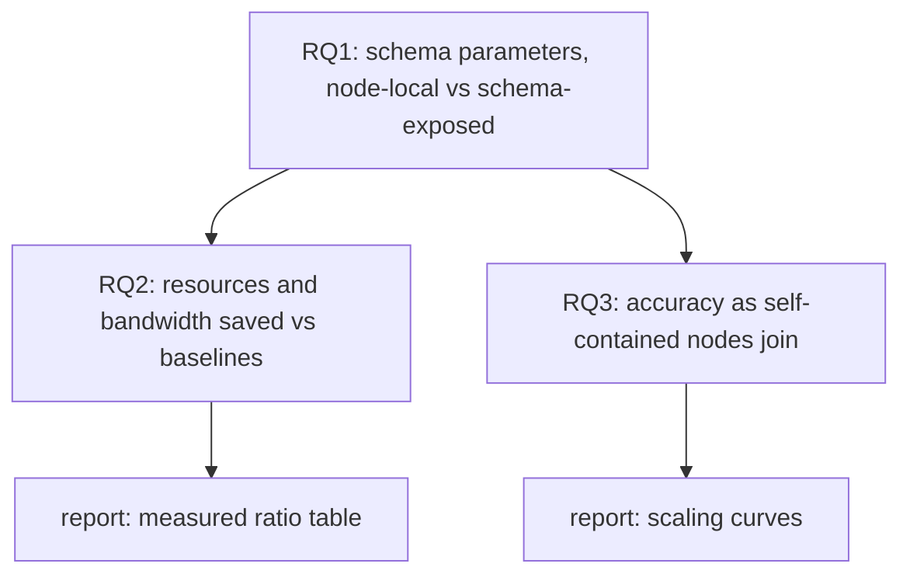

# Research Notes - TinyRL-Industrial

## How to read this file

- Reading order: **Research questions** -> the parameter split inside RQ1 ->
  **Design decisions & rationale** -> **Results & figures** -> **Experiment
  log** -> **Literature anchors**. Headings carry the claims, tables carry
  the evidence pointers.
- Update **Status** and tick checklists as evidence lands. ⬜ open · 🟡 in progress · ✅ answered
- Every claim in a *Current answer* links to an Experiment-log row or repo
  artifact. No evidence, no ✅.
- **Append-only rule, scoped**: the Experiment log is append-only. Rows are
  never edited or deleted; a correction is a new row that supersedes the old
  one. Everything else in this file may be reorganized, reworded and extended
  for clarity as the project evolves.
- Personal notes to the repo owner are HTML comments marked
  `personal (delete before committing)`; strip them before committing.



## Research Keywords

Streaming reinforcement learning; TinyML; Predictive maintenance;
Time-series anomaly detection; Semantic communication; Human-in-the-loop
machine learning; LLM agents; Industry 5.0.

> Submission keywords, ordered by specificity (Industry 5.0 drops first if capped). TinyRL and "semantic-context link" live in title/abstract. Repo-discoverability terms (MQTT, UNS, PlatformIO) stay in `README.md`.

## Research Questions

| # | Question | Status | Answer summary |
|---|----------|:------:|----------------|
| [RQ1](#rq1-schema-parameters-for-two-way-semantic-context-flow) | Effective schema parameters for two-way node↔agent semantic-context flow | 🟡 | Two-way schema runs: telemetry up (`State/*`), context down (`Action/*` + `R`) |
| [RQ2](#rq2-resource-and-bandwidth-savings-vs-node-only-and-agent-only) | Resource & bandwidth saved on edge vs node-only and agent-only baselines | 🟡 | 320 KB-RAM node at 70% free, zero cloud round-trips; ~400× fewer uplink messages |
| [RQ3](#rq3-accuracy-scaling-with-more-self-contained-devices) | Accuracy improvement as self-contained devices join and communicate | 🟡 | +4-step detection on the bench stream, zero false alarms (single node); multi-node unmeasured |

### RQ1: Schema parameters for two-way semantic-context flow

> What are the effective parameters within the schema for a two-way
> semantic-context flow between node and agent - ensuring plug-and-play
> operation, low technical requirements, and self-contained devices?

**Current answer (single node):** minimal two-way schema closes the loop: telemetry up via `State/*` (`[CAL]/[ARM]/[MON]/[ALARM]`), context down via `Action/*` feedback (`R`). Effective parameters: message set, publish rates, phase control.

**Evidence:** `uns/uns_schema_v1.json`, `uns/uns_namespace.json`, `nodes/core/uns_messaging.h/.cpp`, `agent/skills.md`

**Remaining work:**

- [ ] Enumerate + justify the parameter set; ablate required vs optional
- [ ] Verify a new sensor joins with node-side changes only (`nodes/sensors/`)
- [ ] Document the minimum technical requirement for a working pairing
- [ ] Ablate node-local-only vs schema-exposed θ governance (doubles as the plug-and-play test)
- [ ] Label timing vs optimizer reset: labelling MID-episode drops the optimizer's
      leaky-max while fault gradients still flow, over-shooting the weights; bench
      label latency drops sharply when the label lands on quiet data (2026-11-13).
      Evaluate a close-time reset or schema-level label deferral

**Proposed parameter split (from literature; boundary to ablate):**

| Parameter | Evidence | Proposed boundary |
|-----------|----------|-------------------|
| Input normalisation (running moments) | Stream-X ablations | node-local |
| Representation stabilisation (LayerNorm / frozen features) | Stream-X ablations | node-local |
| Bounded step size (StreamingOptimizer; v3 replaced ObGD) | Stream-X v3 App. A; Intentional Updates | node-local |
| Per-feature step sizes (IDBD) | Kearney; Degris | node-local; optional ablation - mixed evidence vs Adam heuristics |
| Detection threshold θ | ReRe; `normal`/`fault` ±% | **schema-exposed** - site-dependent value |
| Labels / condition library | Settles (active learning); GLAD | **schema-exposed** |
| Phase control (`start`, CAL/ARM/MON) | pairing protocol | **schema-exposed** |
| Reward scale / centering | De Asis | node-local, if reward enters the loop |

### RQ2: Resource and bandwidth savings vs node-only and agent-only

> How much resources (and network bandwidth) do we save on the edge and
> agents, compared to node-only and agent-only architectures?

**Current answer (measured 2026-11-20):** all learning/inference on a 320 KB-RAM chip with ~70% free, zero cloud round-trips; over the 2,400-step two-node tour (run-20261120-120228) the nodes published 113 uplink messages (93 condition changes + 18 episode events + 2 discovery docs) vs 4,800 raw feature vectors at the same 1 Hz cadence → **42× fewer messages**. The earlier ~400× figure assumed an unmeasured 20 Hz raw rate and is retired; payload-byte accounting at native sensor rates stays open.

**Evidence:** `print_memory_info()` runtime output; [README § Architecture cheat sheet](README.md#architecture-cheat-sheet)

**Remaining work:**

- [ ] Define + run node-only (no agent) and agent-only (raw telemetry upstream) baselines
- [ ] Audit the test suite + bench for streaming-evaluation purity: score each step with data < t only, no retrospective θ/normalizer fit (Mueller §3.1)
- [ ] Measure bytes/min up+down per architecture from MQTT payload logs
- [ ] Table: RAM / flash / CPU / bandwidth / messages per architecture
- [x] Message-count ratio measured 2026-11-20: 113 uplink vs 4,800 raw
      vectors = 42× (runs run-20261120-120228 / run-20261120-120406);
      payload-BYTE audit at native sensor rates remains open

### RQ3: Accuracy scaling with more self-contained devices

> How does accuracy improve as more self-contained devices are added and
> communicate with each other?

**Current answer (N=1):** detection 14 steps after anomaly onset on the bench stream (8-step settle dwell + 5-step alarm credit + score rise), zero false alarms on 200 quiet steps; z-baseline logged per run - the head-to-head "does learned prediction beat classical statistics?"

**Evidence:** `tests/host/` (short-stream simulation + full link check); per-run z-baseline logs

#### Metric set (formalized 2026-11-19)

> Why not accuracy/F1: accuracy is a function of theta, and theta is our
> deployed operating point. Sweeping theta over a recorded series needs
> full-series ground truth - exactly the batch-benchmark practice Mueller
> rejects (literature/mueller-2025-ts-ad-industry.md §3: "benchmark
> thresholds are computed from the full series plus ground truth, which is
> unusable when streaming"). Every metric below is evaluated at the
> on-device theta, streaming: each step scored with data < t only.
> "Better" = detection latency or ask count improves while false alarms
> stay flat - his separate λ_fp / λ_fn costs, not a blended score.

| Metric | Definition | Why this one |
|---|---|---|
| False alarms | alarm spans opening while machine truth is not a fault AND the node asserted a named condition (it alarmed a state it claims to know) | the FP cost of his §4 bandit formulation; the operator-trust budget every improvement must leave untouched |
| Detection latency | fault-mark step → the owning node shows the fault (fresh alarm edge or its condition column naming it); already named at inject = 0 | his Tenet 1: deployments exist to react NOW; latency is the alerting value |
| Asks opened / redundant | alarm opens with condition `unknown` (the ask); an ask for a state the node had already named counts separately as redundant | Settles ch. 2 (accuracy per label) + GLAD (anomalies discovered vs labeled queries): the label economy of the one-sided loop |
| Ask maturity | every stored ask batch holds >= ASK_MIN_BATCH (15) settled samples | a label is built from the stored batch; asking earlier stores transition noise (2026-11-19) |
| Vocabulary growth | named conditions per node at run end | the semantic loop's payoff: recognition without re-asking |

Implementation: `tests/bench/tools/summarize_run.py` (per-run block +
cross-run contrast); the CI shadow of the tour is
`tests/host/tour_test.cpp` (stage 5, asserts A1-A5: ask maturity,
owner-only asks, 100% owner detection, re-tour zero asks, vocabulary).

**Remaining work:**

- [x] Formalize metrics: detection latency, false-alarm rate, per-condition accuracy - replaced by the metric set above (accuracy was threshold-dependent; per-condition recognition is carried by the vocabulary metric)
- [ ] N-node runs (N = 1, 2, …) with shared condition libraries. 2-node
      interactive bench runs the mechanism: one label names every node of
      the machine with an open ask (same-timeframe event), each node's
      centroid from its own episode means; formal metrics pending
      (`tests/bench/bench_server.py`)
- [ ] Episode-mean classification dilutes fault signatures with the recovery
      tail: a heavy fault on top of a learned operating point matched that
      operating point's centroid (bench 2026-11-13). Consider peak-based or
      windowed episode fingerprints. Partial repair 2026-11-19: fault-kind
      episodes no longer refine their centroid on close (the recovery tail
      was folding into fault centroids; normals still drift-track)
- [ ] Plot accuracy/latency vs N; marginal gain per added device
- [ ] Compare vs single-node to isolate the communication benefit
- [ ] WEB BENCH, OPEN (user report 2026-11-19, next session): stopped
      states with a fault installed still do not read identical to pure
      stopped on the web page. The generator + truth are fixed (overlays
      gated on running; stopped = op_stopped), so check, in order: (a) the
      bench binary was REBUILT - app.py's build() now lists
      machine_model.hpp explicitly because header-only edits previously
      left the binary stale; (b) dump /state feat rows for the same step
      across stopped overlays and diff; (c) if measurements match, the
      leftover is display-level: the node card shows `machine:` from the
      marks and the ask panel pre-fills the compound slug even at stopped
      (app.js truthSlug).
- [x] Per-condition score calibration (2026-11-19): implemented as (a) a
      converged-state LR floor - entries into a state whose surprise sits
      inside its own learned band refine at the floor rate only, removing
      the compounding interference behind the bench "back and forth"
      degradation (CI form: tour_test churn, 20 cycles, zero alarms/asks);
      (b) per-condition bands exposed in the library dump + bench plots as
      diagnostics. The score-band AS_ALARM_THRESHOLD variant was built and
      rejected the same day: a state's score is not stationary across
      training eras (stopped: 1.2 -> ~6 after the speed states trained),
      so a gated band freezes and false-alarms forever, and an ungated one
      absorbs real anomalies. DECISION (2026-11-19): positionality is the
      permanent primary channel - ALARM means "I don't know this state";
      the one-step score is the gate for unknown states and the plasticity
      diagnostic. Remaining open: none on this item.
- [ ] Confidence semantics: `confidence()` is now positional for matched
      states (1 at the centroid, 0 at the radius edge); the score margin
      only applies to unmatched states. Ablate against the operator's
      trust calibration on the bench (low priority, paper-only)

## Design decisions & rationale

> One entry per "why did we build it this way". Rows are never deleted; new
> decisions are appended; regrouping for clarity is fine.

| Decision | Rationale | Alternatives rejected |
|----------|-----------|----------------------|
| Settle gate v2: per-feature fast/slow motion EMAs, slow EMA floored at 2 CAL units, all-feature veto + 8-step dwell (2026-11-19) | the scalar gate let one noise-dominated feature flap the whole vector (vib fmax/bands), and a noise lull inside a transition read as stabilized; the floor is the per-step-difference noise bound (difference of two noisy rel positions ~ 2 units) | quorum calm (a single-feature fault onset must still unsettle), fixed seconds (not self-calibrating) |
| Asks mature at ASK_MIN_BATCH = 15 settled samples; `unidentified` before `unknown` (2026-11-19) | a label is built from the stored batch - asking at episode-open (n=1) stored mostly transition noise and burned the operator's attention; maturing states keep re-identifying, so states that resolve into known conditions never ask | immediate asks (bench 2026-11-19: 1-sample batches), labeling live episodes only |
| Quiet is POSITIONAL, over ANY known condition (Schmitt latch: in at QUIET_Q, out at MATCH_Q; 2026-11-19, widened same day) | a named condition recurring is not news - normal OR fault; the condition name surfaces while quiet and that is the evidence. Score-gated quiet broke twice: re-testing the tight radius every step flickered (pre-latch), and a known state's score is not stationary across training eras (stopped score rose 1.2 -> ~6 after the speed states were learned) | score-band alarm thresholds on matched states (tried 2026-11-19, rejected with the tour-test failure: the outlier gate froze the band at the commissioning level and the first post-training visit alarmed forever); fault-kind never quiet (made every recognized fault re-alarm per visit - the operator-facing noise of the 2026-11-19 bench report) |
| Per-condition score bands: used for the converged-state LR floor + diagnostics, NOT for alarms (2026-11-19) | the band (mu + k sigma of the surprise observed on a condition's settled matched steps) is a sound "does the net still predict THIS state" signal, so converged entries refine at the floor rate - repeated full-rate entries were the compounding interference behind the bench's back-and-forth degradation; alarm duty stays positional | band-gated alarms (see row above); no LR floor (full-rate re-entries compounded the degradation) |
| Centroid refinement on close: NORMAL-kind episodes only | a fault episode's mean folds in the recovery tail before the clear, dragging fault centroids toward the recovered state | refining all kinds (the blob that swallowed neighbouring states) |
| Fault overlays measurable only while RUNNING (generator + truth); stopped = op_stopped whatever is installed (2026-11-19, user decision) | a stopped machine reads exactly like a stopped machine no matter what is installed: the old vdc -3 leak and vib stopped ×1.3/×1.5 made stopped+phase_loss a spurious state the nodes correctly refused to distinguish | reporting the overlay while stopped (made quiet stopped passes look like missed identifications) |
| Metrics: no accuracy/F1; latency + false alarms + ask economy at deployed theta | accuracy is a function of theta; threshold sweeps need full-series ground truth (Mueller §3) - see RQ3 metric set | point-adjust F1, ROC/AUC over recorded runs |
| ObGD, not MVP histograms | net learns joint one-step dynamics; overshooting bound keeps bursts sane | MVP histograms (README § Architecture cheat sheet) |
| StreamingOptimizer replaces ObGD (ported 2026-11-03; v2 via `-DMONITOR_USE_OBGD`) | v3 App. A: per-coordinate displacement < α, no 1/d shrinkage as nets grow; host-test green at α=2e-3, β=0.99995, λ=0.8 | keep v2-era ObGD |
| Layer-aware sparse init (global 95% budget + connectivity floor) | v3 App. C: uniform 90% zeroed ALL first-layer weights at fan-in 4 - node booted deaf; floor guarantees ≥1 nonzero input per unit | uniform 90% per-layer |
| Schema exposes only site-dependent knobs (θ, labels, phase); streaming self-adaptation stays node-local | Stream-X holds one fixed config across tasks - internal adaptation thins what the contract carries; site-relative values are what only external context supplies | expose all RL parameters; fully static node |
| Stream-TD (prediction branch), not Stream-Q/AC | condition monitoring has no actions to take; detection needs only prediction error; control variants stay in the submodule for future actuation | Stream-Q / Stream-AC on the monitor node |
| Bench protocol = streaming evaluation (R_o) only | Mueller §3.1: batch benchmarks mislead practitioners; every RQ2/RQ3 baseline scores each step with data < t, no retrospective θ/normalizer fit | batch evaluation as in TAD benchmark suites |
| Uplink carries state changes + episode summaries only; never periodic telemetry | Zhou 2022 uplink principle (VoI): transmit task-relevant info, collapse repeats; grep-verified: no periodic telemetry in `nodes/`, raw values only inside episode summaries (`uns_messaging.h`) | periodic MQTT telemetry stream; raw waveform upload |
| Asks = alarm-gated stream-based selective sampling (`condition_id:"unknown"` inside an episode), not pool-based or agent-initiated | Settles 2012 ch. 1-2: scenario taxonomy; oracle cost argues for rare, event-driven queries; Mueller 2025 one-sided feedback already makes alarm-gating the natural trigger | pool-based batch label requests; agent pushing unsolicited labels |
| Retention split from relearning: labels/centroids in `/conditions.jsonl`, weights in `/net.bin`, stats+θ in `/model.bin` | Dohare 2024 (Nature 632): retention must not depend on net plasticity; frozen anchored-ratio centroid space + exact post-boot resume keeps labels alive without replay or relearning; bounded updates keep relearning from eroding capacity | replay buffer for old conditions; relearn-from-scratch on reboot |
| Condition matching = per-condition radii (q × the condition's own measured σ, in anchored log2-ratio decades), not CAL-derived global units | 2026-11-15 bench: stopped-machine CAL gave the drive ~20-decade radii on its dead features (structurally blind to every running state once one was labelled) and the vib 0.15-decade radii on bands whose noise is ±0.5 decades; a condition's yardstick must be that condition's own noise, measured from its labelled batch | single global radius; CAL-only per-feature units |
| Quiet-unmatched conditions are counted node-side, never asked about; alarm-gating stands | Settles 2012 ch. 2.5 myopia: a threshold gate can be confidently blind to whole regions (two-triangles failure); counting quiet-unmatched steps is the cheap tripwire, while quiet asks would flood the one-sided oracle | gated + quiet asks by default; ignoring quiet drift entirely |
| Label vocabulary is fleet-wide; centroids stay per node: a shared label names each node's own episode (the same-timeframe event of the same machine), and each node builds its centroid from its own stored batch - no means or centroids cross nodes | one machine, two modalities: feature spaces are incomparable across profiles, but the NAME of a condition is meaningful to all | cross-node centroid or means sharing (raw means re-mapped across incomparable spaces would pin centroids at range edges) |

## Results & figures

Both figures come from the host bench (no hardware needed) and live in
`assets/`. Regenerate after any algorithm change, and before submitting, so
the numbers match the final run:

```bash
TINYRL_TRACE=1 /tmp/tinyrl_test_host > /tmp/trace.log
TINYRL_LONGRUN=100000 /tmp/tinyrl_test_host > /tmp/bench.log
python3 tests/bench/tools/plot_bench.py /tmp/trace.log /tmp/bench.log
```

One `bash tests/run_tests.sh` builds the binaries into /tmp. matplotlib is
the only Python dependency (`python3 -m pip install --user matplotlib`).

### Detection behaviour (one alarm episode, end to end)


The score (EMA of the z-space prediction error) on the quiet stretch stays
under θ throughout: zero false alarms. An injected anomaly lifts it more
than an order of magnitude within a few steps, and the alarm opens +14 steps
after onset: the 8-step settle dwell, then the alarm credit as the score
crosses θ (`ALARM_HI_N = 5`, `node_config.h`; the regenerated figure
annotates the decomposition). This is the RQ3 detection-latency
measurement at N = 1 on the synthetic stream (figure regenerated 2026-11-20).

### Plasticity audit (Dohare 2024 correlates, 100k steps, 4 regime shifts)


The three Dohare correlates over a 100k-step bench with regime shifts every
25k steps (machine life). Since the 2026-11-15 training policy the bench
emulates the operator: every regime is labeled 20 steps after it settles,
so the net trains across labeled regimes and the counters measure the
deployed policy. Dead units stay at 0.00. Mean |w| grows 0.0111 → 0.0253
(+128%) across the run - bounded, vs +468% under the old ungated policy:
training only on labeled+settled steps removed the runaway weight growth.
Effective rank settles at 1.88 after the shifts (was 4.51). The 48M-step
question (plateau or divergence?) remains a one-command measurement.
(Re-measured 2026-11-20 with the regenerated figure; the 2026-11-16 log row
keeps its original figures, append-only.)


## Experiment log

> Append-only: new runs get new rows; a correction is a new row.

| Date | Setup | RQ | Result | Evidence |
|------|-------|:--:|--------|----------|
| 2026-11-03 | host-test 900-step sim; StreamingOptimizer (α=2e-3, β=0.99995, λ=0.8) + layer-aware sparse init | 1 | all stages green: cal/fit/quiet/alarm/persist/library; anomaly matched, label persisted | `tests/run_tests.sh` |
| 2026-11-12 | host-test 4-stage (+ tripcheck scenario); plasticity bench via `TINYRL_LONGRUN` | 1, 2 | all stages green. Tripwire: silent on quiet steps matching a learned centroid, report line + `qum=` on unmatched quiet steps, local log only. 20k-step bench: dead=0.00, mean abs w 0.0184 → 0.0338, eff rank 3.0 → 1.2 across regime shifts (counters live; 48M-step question still open) | `tests/run_tests.sh`, `tests/host/plasticity.hpp`, `tests/host/tripwire_test.cpp` |
| 2026-11-13 | fixture + schedule revision: bench stream made motor-faithful (fixed-load induction motor at 1 Hz is noise-stationary with slow thermal drift; old 4-min sines removed); LEARN shortened to 30 s CAL + 30 s FIT. Probes on the old sine fixture first: 60- and 120-step LEARNs false-alarmed, 240 steps passed | 1, 2 | all 4 stages green: zero false alarms on 200 quiet steps (max score 0.89 θ), alarm +4 steps after onset; 100k bench: dead=0.00 throughout, mean abs w 0.0111 → 0.0631, eff rank 4.51 → 1.15 | `tests/run_tests.sh`, `assets/detection-trace.png`, `assets/plasticity-bench.png` |
| 2026-11-13 | interactive web bench: 2 nodes (vfd_g100 + vib_adxl) in lockstep on ONE simulated machine; collective verdicts (known / corroborated / unconfirmed / unconsulted) + fleet-wide label sharing; human oracle via browser, scripted agent for `--ci`. Two core repairs found by the bench: (1) `normal` feedback left the alarm latched and the open-ask edge was consumed, swallowing later real faults; (2) the 0.7θ clear band made a self-clear structurally impossible when mu dominates theta. Also: `jsonStr` silently ignored spaced JSON (pretty-printed agent feedback would no-op) - whitespace tolerance added. A third repair same evening: the `normal` cap (mu + 10·sd from 30 correlated fit samples) was unreachable, so governance could not silence an alarm (bench cycled alarm→normal 130 times) - replaced with a score-based raise (θ ≥ 1.05× the seen score) and no optimizer reset on normal. Regression test: `bench/scenarios/smoke.py` plays the full user loop headless (inject → ask → label → revert → re-inject → matched locally, PASS) | 1, 3 | 4/4 host stages green; scenario plays end to end: speed trim (vfd-only alarm, named op_speed_2), imbalance + bearing (vib alarms, vfd half-blind, asks + labels), heavy fault (both alarm, corroborated, one label resolves both); single-node mode verified by design review | `tests/bench/bench_server.py`, `tests/host/bench_host.cpp` |
| 2026-11-15 | Condition-space redesign (bench-found): with stopped-machine commissioning the bare log2(x/mu) coordinate stored NaN centroids (negative CAL mean) and collapsed every running state onto one clamped point - the drive was structurally blind once speed_1 was labelled. Fix: anchored ratio log2((x+A)/(mu+A)), A = 6σ_CAL (feature_space.h); per-condition match units = the labelled batch's own rel spread (was CAL-only: radii were ~20 decades on the drive's dead features, 0.15 decades on the vib's bands). Episode batch feeds settled steps only + a settled identity re-check (state moved under an episode → supersede → fresh ask); model.bin v6 persists the anchors | 1, 3 | 7-condition tour green both modes: g100 learns 5 conditions and detects its own phase_loss (10 steps - was NEVER detected before the redesign); vib learns all 6 it can see; false alarms 2-3 per node; re-tour recognised with ZERO asks. Host suite 4/4; MCU footprint 17-19% RAM / 31% flash both nodes | `tests/run_tests.sh`, `tests/bench/scenarios/paper_tour.py`, `tests/run_mcu.sh`, `tests/bench/runs/run-20261116-001358.jsonl` |
| 2026-11-16 | Test suite reorganisation + perf tracking: `tests/host/` (C++ sources) + `tests/bench/` (server, scenarios, tools); sim gains per-step compute timing (stage 2, host proxy); `run_mcu.sh` adds the real-toolchain footprint check; long-run bench emulates the operator (labels each regime) so the plasticity counters measure the deployed policy | 2, 3 | mean \|w\| 100k: 0.0111 → 0.0265 (+139%, was +468% ungated), eff rank 1.77, dead 0.00; per-step compute avg 6-8 µs on x86 (budget 1 s); flash/RAM table in tests/README.md | `tests/run_tests.sh`, `tests/run_mcu.sh`, `assets/plasticity-bench.png` |
| 2026-11-16 | Runtime footprint instrumentation, harness-side only (node code untouched): stub `fileSize()` accessor + end-of-run `[FLASH]` report in bench_host; `/export` flushes the bench process (library dump K first, then q; export skips K when done). Single-node two-way tours measure the exact flash state: g100 6,570 B / vib 7,416 B (model.bin 268 B, net.bin 5,504/6,024 B, conditions.jsonl 792/1,118 B, pending empty at end of tour); learning-state RAM composed from code constants: 22.6 KB g100 / 24.7 KB vib (values + grads + etraces + vmax = 4 arrays x params, monitor state 268 B, library 116 B/condition, pending 88 B/batch, cap 8); per-step compute avg 4 µs, max 38 µs (2000 steps) | 2 | runs run-20261116-133945 (g100), run-20261116-134119 (vib); paper Table III updated to static + runtime columns | `tests/stub_esp32/WiFi.h`, `tests/host/bench_host.cpp`, `tests/bench/app.py` |
| 2026-11-19 | Collective consult removed (user decision): no sibling verdicts (known / corroborated / unconfirmed / unconsulted), no same-profile centroid means sharing. Labelling = one webbench label applied to every node of the SAME machine with an open ask (same-timeframe event), each node learning from its OWN stored batch; the agent correlates published State/* instead. `episodeMeans` / `shareLabel` / `libMatch` left unused and removed from node core; node behaviour unchanged (the consult never fired across the two profiles and never auto-resolved an ask) | 1, 3 | 4/4 host stages green; smoke.py PASS (one label resolves both nodes' asks, re-injection matched locally, no ask); probe_pending.py PASS (discard leaves the other node's ask); paper_tour.py PASS: owner alarms 4/5 fault windows, false alarms vfd 3 / vib 2, re-tour 0 asks, 7 batches labeled - measured numbers unchanged | `tests/host/bench_host.cpp`, `tests/bench/app.py`, `tests/bench/static/app.js`, `nodes/core/node_runtime.*` |
| 2026-11-20 | Paper-freeze revalidation: host suite rebuilt 5/5 (`tests/logs/host_tests_20261120_120032.log`); paper_tour re-run in BOTH modes on the deterministic seed; bandwidth measured from the run export; plot_bench legend fix (the score line no longer hides under the legend; one continuous line across the persistence gap); new `plot_compact.py` compact single-node paper figure; all three assets regenerated | 2, 3 | two-way: asks 9 (0 redundant, batches n=15), FA 0/0, owner 4/4 (first 14-16 steps, re-occurrence 1), vocab 5/6, re-tour 0 asks; node-only: 12 node-local asks, FA 0/0, owner 4/4 (14-16), vocab 1/1; uplink 113 messages (both nodes) vs 4,800 raw vectors at 1 Hz = 42× fewer; plasticity 100k re-run: mean \|w\| 0.0111 → 0.0253 (+128%), eff rank 4.51 → 1.88, dead 0.00 | `tests/bench/runs/run-20261120-120228.jsonl`, `run-20261120-120406.jsonl`, `tests/logs/host_tests_20261120_120032.log`, `tests/bench/tools/plot_compact.py`, `assets/detection-trace.png`, `assets/plasticity-bench.png`, `assets/run-vib-compact.png` |

## Literature anchors

> Verified via arXiv API / Crossref on 2026-11-02. The schema (`State` / `Action` / metric set) is an *output* of this review: each row says what the schema must expose. Per-paper snapshots in [`literature/`](literature/README.md); this section stays the analytical map. Paywalled items flagged.

### Adaptable RL parameters (core of the semantic-context link)

> No paper yet catalogues adaptable parameters for industrial condition monitoring. Strong-CPU evidence exists for streaming RL components (Stream-X: Atari + 50 continuous-control tasks, non-stationarity regimes); practice: adopt the best-evidenced standard parameters and ablate them on our multi-node system.

| Work | Source | Informs |
|------|--------|---------|
| Elsayed et al., Streaming Deep RL Finally Works (Stream-X) | arXiv:2410.14606 | what must adapt for streaming learning: running-moment normalisation, representation stabilisation, bounded updates (v3 StreamingOptimizer); ESP32-S3 demo |
| Ren et al., TinyOL | arXiv:2103.08295 | on-node MCU training feasible; rehearsal storage of previous-class data vs forgetting - backs our flash condition library |
| Dohare et al., Loss of Plasticity in Deep Continual Learning | arXiv:2306.13812 · Nature 632, 768–774 (ID corrected 2026-11-12; was 2310.02204, an unrelated paper) | catastrophic forgetting / plasticity canon; continual backprop; retention-vs-relearning framing for our flash condition library |
| Kearney et al., IDBD-lineage step sizes in TD learning | arXiv:1903.03252 | per-feature step sizes as the adaptable parameter; the step size *is* feature relevance |
| Degris et al., Step-size Optimization for Continual Learning | arXiv:2401.17401 | meta-gradient vs Adam/RMSProp heuristics - which adaptivity mechanism to expose |
| Sharifnassab et al., Intentional Updates for Streaming RL | arXiv:2604.19033 | step size in output units - parameterising the adaptivity knob |
| Lee et al., ReRe | arXiv:2004.02319 (COMPSAC 2020) | self-adaptive thresholds in lightweight streaming TS anomaly detection - the θ analogue |
| De Asis et al., Differential TD for Episodic Problems | arXiv:2605.04368 | reward centering - reward-scale adaptivity |
| Eschmann et al., RLtools | arXiv:2306.03530 · JMLR 25(301) · github.com/rl-tools/rl-tools | contrast: buffer-based SAC on MCUs (low-dim states, continuous control) - sharpens our no-storage claim (RQ2); its repo is the candidate baseline implementation for the small-buffer synthetic bench |

### What flows up (semantics) vs down (context) - to be settled by review

| Work | Source | Informs |
|------|--------|---------|
| Mueller, Open Challenges in TS Anomaly Detection: An Industry Perspective | arXiv:2502.05392 | industry call for streaming + human-in-the-loop - the gap statement |
| Zhou et al., Goal-Oriented Semantic Communications for 6G | arXiv:2210.09372 | task-relevant info vs raw data - uplink principle |
| Farshbafan & Saad, Curriculum Learning for Semantic Comm. with a Common Language | arXiv:2204.10429 | shared vocabulary between the two ends = the contract |
| Amershi et al., Power to the People | AI Magazine 2014 (paywalled) | operator feedback inside the learning loop - downlink principle |
| Islam et al., GLAD | arXiv:1810.01403 | label feedback retunes deployed detector parameters |
| Deng et al., HILAD | arXiv:2405.03234 | bidirectional human/model correction for TS anomaly detection |
| Settles, Active Learning | Springer 2012, DOI 10.1007/978-3-031-01560-1 | query-on-uncertainty canon - labels arrive only on open asks |
| IEC 63278; IEC 62541; OASIS MQTT 5.0 | standards | versioned machine-readable industrial contracts; MQTT = transport of record |

### Consumer + positioning

| Work | Source | Informs |
|------|--------|---------|
| Xia et al., Flexible modular production system with LLM agents | arXiv:2304.14721 | LLM agents operating industrial systems via structured interfaces |
| Romero & Suyama, Agentic AI for Intent-Based Industrial Automation | arXiv:2506.04980 | agentic AI aligned with Industry 5.0 human-centricity |
| Carvalho et al., SLR of ML for predictive maintenance | C&IE 2019, DOI 10.1016/j.cie.2019.106024 (paywalled) | batch-supervised PdM across sensor modalities |
| Andriotis & Papakonstantinou, DRL inspection & maintenance planning | RESS 2021, DOI 10.1016/j.ress.2021.107551 (paywalled) | contrast: RL for scheduling, not condition reporting |

## Deliverables

- [ ] Report: RQ2 measured ratio table
- [ ] Report: RQ3 scaling curves

## Audit + gap closure (2026-11-12)

Code-vs-literature audit of all 9 snapshot "Schema implications" + "Open questions"
sections and the design-decision table: full row-level table in the
LIFE repo at `ENG40008/workbook/literature-audit.md`. Verdict: the learning core,
the schema boundary, the retention split and the ask loop all verify in code; the only
agreed code gaps were the two below, both closed the same day.

- Plasticity counters (Dohare, RQ2): dead-unit fraction, mean |w|, effective rank now
  logged by the host bench (`[PLAST]` lines at fit/quiet/alarm checkpoints; opt-in
  long run via `TINYRL_LONGRUN=<steps>`). Host/bench only, nothing on the node.
- Quiet-unmatched counter (Settles myopia tripwire, RQ1): node-side counter in
  `node_runtime.cpp` for non-alarm steps matching no centroid within `LIB_MATCH_D`;
  report line every 1000 and `qum=` in the `m` status line; local log only, no schema
  change, no asks. Behavioral check added as host-test stage 4 (`tests/host/tripwire_test.cpp`).

Interpretation note for the tripwire: the library holds labelled (fault) conditions
only, so on a healthy node most quiet steps are unmatched by construction; the count
is a raw volume dial, not a rate. Revisit the semantics if the ask-rate/label-distribution
audit (Settles open q1) ever needs a normalized signal.
