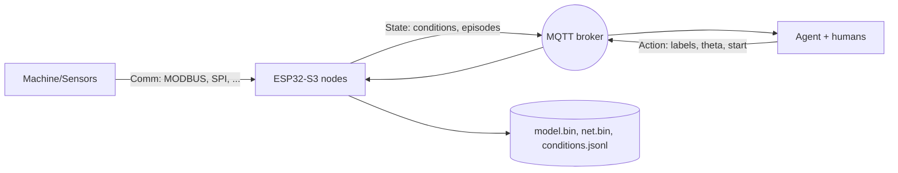

# What is TinyRL-Industrial

One sentence: intelligent sensing nodes monitor a machine, learn its normal states on-device with streaming reinforcement learning, and work with a human or AI agent - context flows down, conditions flow up, and alarms go out only when something needs attention.

The repo keywords: Industry 5.0, Frugal AI, Edge Node, TinyML, TinyRL, Streaming RL, Predictive Maintenance, Covariate Shift, Semantic Data, Industrial Context, Active Learning, Semantic Communication, UNS, MQTT, PlatformIO (README.md L3).

## Mental models

Three models make every later detail click.

1. **The node is a self-contained learner.** It polls its sensor at 1 Hz, predicts the next step with a small network, and treats surprise as the reward signal. Labels live in a flash-resident condition library, weights in flash too. Nothing requires a server to be reachable.
2. **Uplink is semantic, downlink is context.** The node publishes condition changes and episode summaries, on change only. It subscribes to one topic, `Action/feedback`, which carries labels, threshold governance, start and reset. Raw streams never cross the network; raw values travel only inside episode summaries (`meas`).
3. **The ask loop is the whole feedback loop.** An alarm with no matching condition is a question. The question matures 15 settled samples, stores them by batch id, and publishes the ask. One label answers it, joins a fleet-wide vocabulary, and the next occurrence is recognised on-device. Everything else in the system serves this loop.

## The big picture

## Start here

| Step | Read | What it unlocks |
|---|---|---|
| 1 | [Quick start](/guide/quickstart) | clone, run the host suite, flash a node |
| 2 | [First-run lifecycle](/guide/lifecycle) | what the node does from boot to monitoring, and the ask loop |
| 3 | [MQTT contract](/system/contract) | the five topics, their payloads, and `uns/uns.json` |
| 4 | [Node architecture](/system/architecture) | the 1 Hz data path and the two feature spaces |
| 5 | [Enhancements](/system/enhancements) | every mechanism `nodes/core/` adds over the base learner, with the failure it prevents |

Deeper layers: the [algorithms](/system/algorithms) page walks the monitor step and the ask loop in pseudocode; [research questions](/research/questions) and [design decisions](/research/decisions) carry the why; [tests and validation](/reference/tests) shows how every claim is reproduced.

## Where things live

- `nodes/core/` is the sensor-agnostic core, compiled unchanged for every node.
- `nodes/<node>/main.cpp` is the node's whole identity: WiFi, broker, dev id, UNS base.
- `uns/uns.json` is the single contract file, import-ready for the Tier0-Edge UNS platform.
- `agent/skills.md` is the agent's skill sheet.
- `tests/` is the no-hardware verification story: the host suite, the web bench, the MCU footprint check.

Evidence trail: every measurable claim on this site points at a repo file, a dated test log in `tests/logs/`, or a bench run id. The [reference](/reference/tests) section lists the commands that regenerate them.
