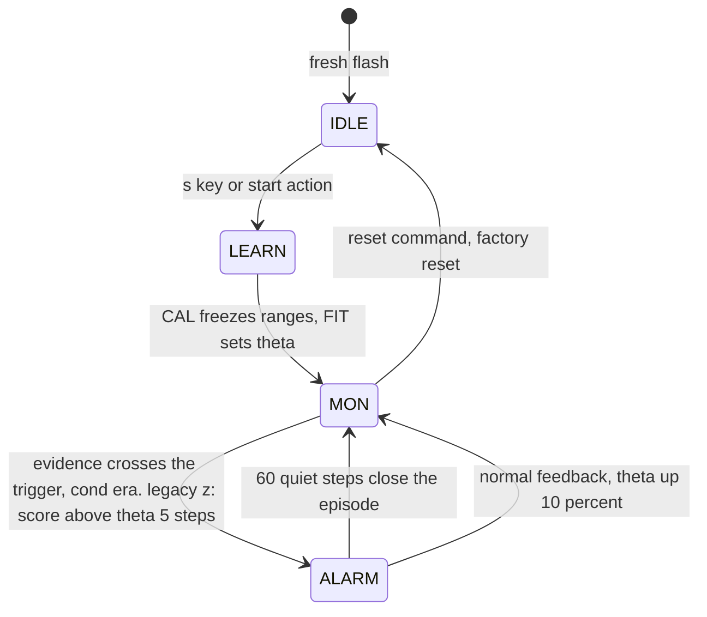
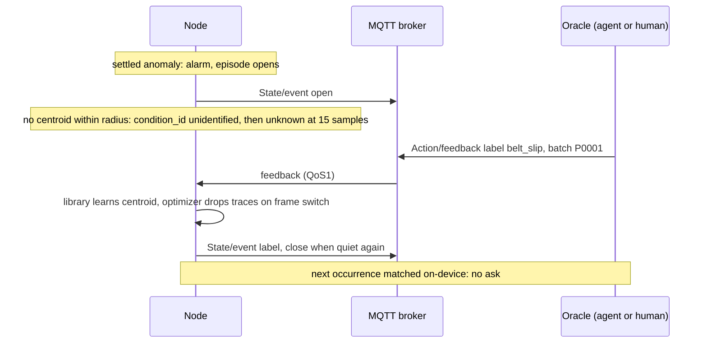

# First-run lifecycle

A node goes from fresh flash to trusted monitor in about a minute of commissioning, and everything it learns survives a reboot. This page walks that life, plus the ask loop that teaches it.

## The state diagram

The same story in words:

1. **IDLE**: press `s` or publish `{"action":"start"}` to `.../Action/feedback`, on a representative machine state. The CAL baseline auto-registers as the `op_stopped` condition; that slug is kept whatever state commissions the node. With the PM1125H meter in the feature set, commission on a RUNNING state: the meter sends NaN power factor at no load and the all-or-nothing poll fails, so a stopped machine cannot feed the node.
2. **LEARN, about 30 s CAL**: ranges freeze; the baseline auto-registers.
3. **LEARN, about 30 s theta fit**: the net trains on the live stream the whole time.
4. **MON**: transitions are gated off (the settle gate: no train, alarm or ask mid-motion). A settled anomaly raises ALARM and opens an episode. A known condition is labelled at once. `unknown` stores a pending batch and publishes an ask (below).
5. **Reboot**: `model.bin` + `net.bin` + `conditions.jsonl` (+ `pending.jsonl`) restore monitoring with zero relearning. A reboot mid-learning restarts CAL.

## The ask loop

Details that matter:

- Before the batch exists the node publishes `unidentified` (batch maturing). It becomes `unknown`, the ask, only once the episode holds >= 15 settled samples (`ASK_MIN_BATCH`, node_config.h).
- The ask carries a batch id (`P0001...`) in `State/condition.batch`, present only while the ask is live. The same id is printed on serial (`[PEND]`, console `p`). Label or discard by that id; late labels work because the batch survives reboots.
- A maturing unknown that resolves into a known condition re-identifies and never asks.
- Unknown regimes never train. A novel condition keeps alarming until named (suite stage 4, `tripwire_test.cpp`).
- One label names every open occurrence of the same state on that machine; recognition on revisit is 0-ask by construction.

## What a reset does

`{"action":"reset"}` or console `reset` (typed in full) performs a factory wipe and immediately publishes a retained IDLE banner. The console path does not republish; the MQTT path does, so dashboards and agents see the banner at once (contract change shipped 2026-11-24, `node_runtime.cpp`). Reset is human-initiated only; the agent's skill sheet forbids sending it (agent/skills.md, Non-negotiables).

## What lives on flash

Four files restore the node exactly (`persistence.cpp`, `condition_library.cpp`):

| File | Holds | Notes |
|---|---|---|
| `/model.bin` | score stats, theta, frozen ranges, normalizer moments | era-locked by `MODEL_VERSION` (6 z / 7 rel / 8 cond); a file from another era is rejected and the node relearns; magic `TRL4` |
| `/net.bin` | every Linear layer's weights and bias, verbatim | topology re-validated on load; a mismatch relearns |
| `/conditions.jsonl` | one condition per line: `id`, centroid `c[]`, `count`, `first`/`last`, `source` | human-inspectable |
| `/pending.jsonl` | stored unknown batches: `id` `P0001...`, `mean[]`, `n`, timestamps | waiting for a label or discard, by id |

Autosave rewrites these at most every 5 minutes (flash-wear budget, `AUTOSAVE_MS`, node_config.h); the pending store saves on batch events.
