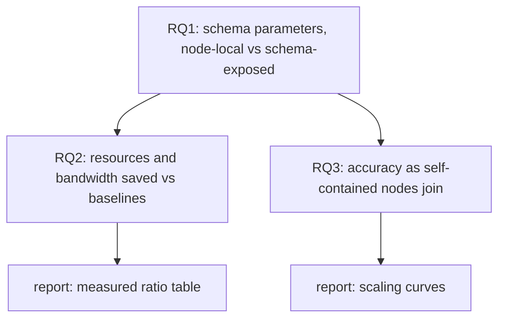

# Research questions

The project is organized around three research questions. This page carries the questions, their current answers with evidence, and the metric set. The append-only experiment log (one row per run, corrections as new rows) lives in `RESEARCH.md` in the repo, not on this site.

| # | Question | Status | Answer summary |
|---|----------|:------:|----------------|
| [RQ1](#rq1-schema-parameters-for-two-way-semantic-context-flow) | Effective schema parameters for two-way node-agent semantic-context flow | in progress | Two-way schema runs: telemetry up (`State/*`), context down (`Action/*`) |
| [RQ2](#rq2-resource-and-bandwidth-savings-vs-node-only-and-agent-only) | Resource and bandwidth saved on edge vs node-only and agent-only baselines | in progress | 320 KB-RAM node at ~70% free, zero cloud round-trips; 42x fewer uplink messages (measured 2026-11-20) |
| [RQ3](#rq3-accuracy-scaling-with-more-self-contained-devices) | Accuracy improvement as self-contained devices join and communicate | in progress | +14-step detection on the bench stream, zero false alarms (single node); multi-node unmeasured |

## RQ1: Schema parameters for two-way semantic-context flow

> What are the effective parameters within the schema for a two-way semantic-context flow between node and agent, ensuring plug-and-play operation, low technical requirements, and self-contained devices?

**Current answer (single node):** the minimal two-way schema closes the loop: telemetry up via `State/*` (condition, event, node_info, keepalive), context down via `Action/feedback` (start, label, discard, normal, fault, reset). Effective parameters: message set, publish rates, phase control.

**Evidence:** `uns/uns.json`, `nodes/core/uns_messaging.h/.cpp`, `agent/skills.md`, and the [contract page](/system/contract).

**Remaining work** (from RESEARCH.md):

- Enumerate + justify the parameter set; ablate required vs optional
- Verify a new sensor joins with node-side changes only (`nodes/sensors/`)
- Document the minimum technical requirement for a working pairing
- Ablate node-local-only vs schema-exposed theta governance (doubles as the plug-and-play test)
- Label timing vs optimizer reset: labeling mid-episode drops the optimizer's leaky-max while fault gradients still flow; evaluate a close-time reset or schema-level label deferral (bench finding 2026-11-13)

**Proposed parameter split** (from literature; the boundary to ablate):

| Parameter | Evidence | Proposed boundary |
|-----------|----------|-------------------|
| Input normalisation (running moments) | Stream-X ablations | node-local |
| Representation stabilisation (LayerNorm / frozen features) | Stream-X ablations | node-local |
| Bounded step size (StreamingOptimizer; v3 replaced ObGD) | Stream-X v3 App. A; Intentional Updates | node-local |
| Per-feature step sizes (IDBD) | Kearney; Degris | node-local; optional ablation |
| Detection threshold theta | ReRe; `normal`/`fault` +/- % | **schema-exposed** - site-dependent value |
| Labels / condition library | Settles (active learning); GLAD | **schema-exposed** |
| Phase control (`start`, CAL/FIT/MON) | pairing protocol | **schema-exposed** |
| Reward scale / centering | De Asis | node-local, if reward enters the loop |

## RQ2: Resource and bandwidth savings vs node-only and agent-only

> How much resources and network bandwidth do we save on the edge, compared to node-only and agent-only architectures?

**Current answer (measured on the recorded tour, run-20261122-203729):** over the 1,357-step two-node recorded tour the fleet published 121 uplink semantic messages (101 condition/state transitions + 20 episode events) vs 2,714 raw vectors (1,357 steps x 2 nodes at 1 Hz): **about 22x fewer, ~30 KB vs ~275 KB**. Payloads are bounded by the schema buffers: at most 224 B for a state change, 640 B for an episode summary with its per-feature means. All learning/inference runs on a 320 KB-RAM chip with ~70% free, zero cloud round-trips; the rebooted state is 7.1 KB (drive) / 7.3 KB (vib, 7 conditions): 268 B model.bin + 5.5 KB net.bin + 1,464/1,712 B condition library + empty pending store (single-node tours, exact per-node flash state).

The fixed-cadence comparison remains as measured 2026-11-20 (run-20261120-120228): 113 uplink messages vs 4,800 raw vectors at 1 Hz = 42x. The earlier v10 count (101/1,488 from run-20261122-123134) used a slightly different transition counter and is superseded; payload-byte accounting at native sensor rates stays open.

**Evidence:** run-20261122-203729.jsonl + summary; `tests/run_mcu.sh`; `print_memory_info()` runtime output; the [results page](/research/results).

**Remaining work:**

- Define + run node-only (no agent) and agent-only (raw telemetry upstream) baselines
- Audit the suite + bench for streaming-evaluation purity (Mueller section 3.1)
- Measure bytes/min up+down per architecture from MQTT payload logs

## RQ3: Accuracy scaling with more self-contained devices

> How does accuracy improve as more self-contained devices are added and communicate with each other?

**Current answer (N=1 bench, N=2 recorded tour):** detection 14 steps after anomaly onset on the bench stream (8-step settle dwell + 5-step alarm credit + score rise), zero false alarms on 200 quiet steps. On the recorded tour (N=2, run-20261122-203729): owner-centric identification with zero false alarms and zero redundant asks - 10 asks to learn the machine, 1-step re-identification afterwards, zero asks on the re-tour; the detection-chain ablation attributes the robustness to the positional channel and the per-condition residual frame (paper Table A-III). Formal accuracy-versus-N statistics beyond N=2 remain future work.

**Evidence:** `tests/run_tests.sh` (stages 2 and 5); per-run z-baseline logs; run-20261122-203729.jsonl; [results and figures](/research/results).

## The metric set (formalized 2026-11-19)

Why not accuracy/F1: accuracy is a function of theta, and theta is the deployed operating point. Sweeping theta over a recorded series needs full-series ground truth, exactly the batch-benchmark practice Mueller rejects (literature/mueller-2025-ts-ad-industry.md section 3). Every metric below is evaluated at the on-device theta, streaming: each step scored with data < t only. "Better" = detection latency or ask count improves while false alarms stay flat: separate costs, not a blended score.

| Metric | Definition | Why this one |
|---|---|---|
| False alarms | alarm spans opening while machine truth is not a fault AND the node asserted a named condition (it alarmed a state it claims to know) | the operator-trust budget every improvement must leave untouched |
| Detection latency | fault-mark step to the owning node showing the fault (fresh alarm edge or its condition column naming it); already named at inject = 0 | deployments exist to react NOW; latency is the alerting value |
| Asks opened / redundant | alarm opens with condition `unknown` (the ask); an ask for a state the node had already named counts separately as redundant | the label economy of the one-sided loop (Settles ch. 2; GLAD) |
| Ask maturity | every stored ask batch holds >= ASK_MIN_BATCH (15) settled samples | a label is built from the stored batch; asking earlier stores transition noise (2026-11-19) |
| Vocabulary growth | named conditions per node at run end | the semantic loop's payoff: recognition without re-asking |

Implementation: `tests/bench/tools/summarize_run.py` (per-run block + cross-run contrast); the CI shadow of the tour is `tests/host/tour_test.cpp` (suite stage 6): ask maturity, owner-only asks, full owner detection, re-tour zero asks, full vocabulary.
