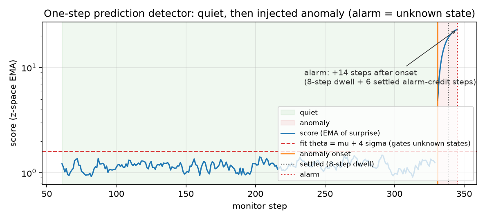
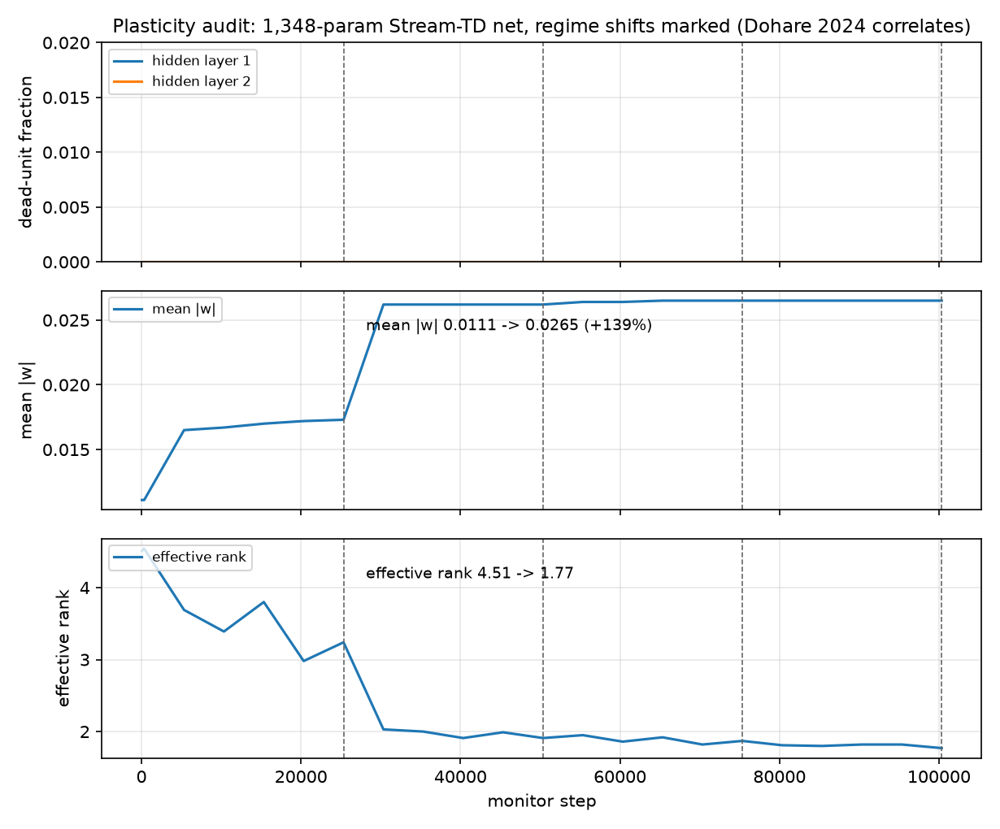
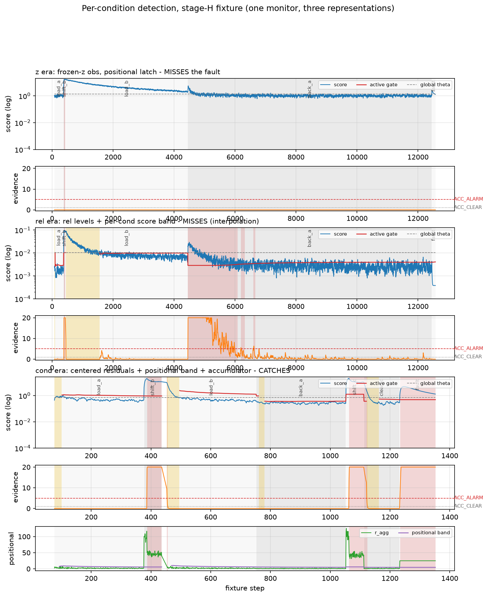
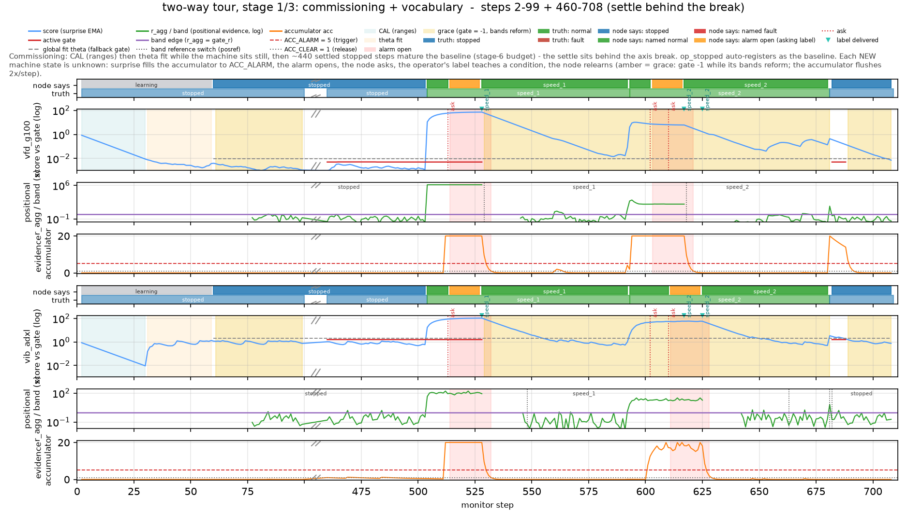
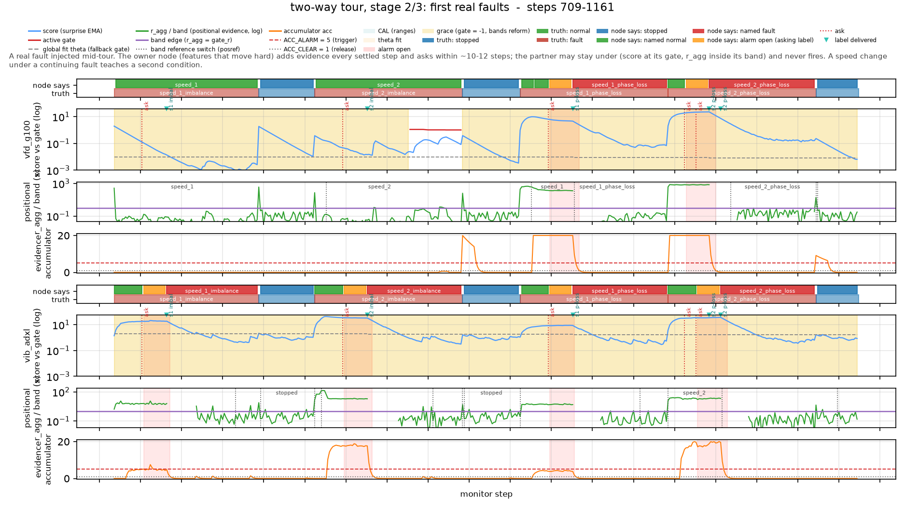
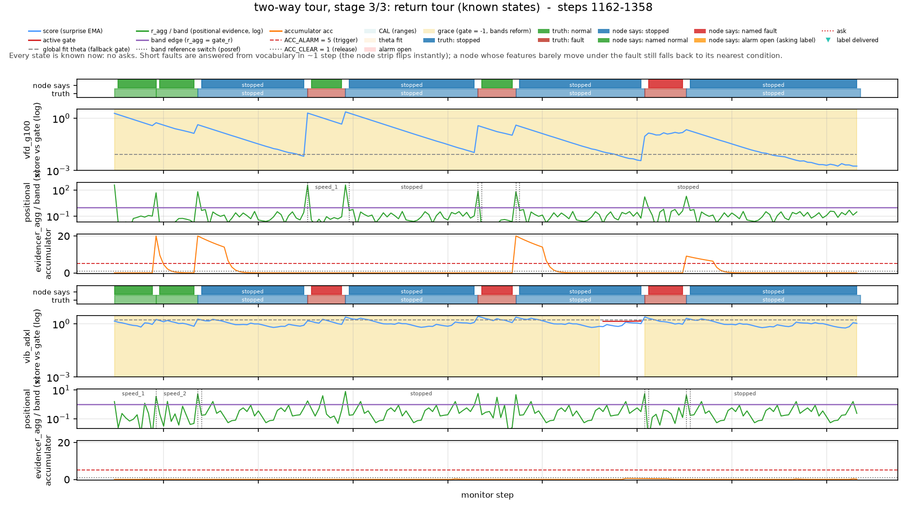

# Results and figures

The figures come from the host bench (no hardware needed) and live in `assets/` (mirrored to `docs/public/assets/` for this site). Regenerate after any algorithm change so the numbers match the final run:

```bash
TINYRL_TRACE=1 /tmp/tinyrl_test_host > /tmp/trace.log
TINYRL_LONGRUN=100000 /tmp/tinyrl_test_host > /tmp/bench.log
python3 tests/bench/tools/plot_bench.py /tmp/trace.log /tmp/bench.log
```

One `bash tests/run_tests.sh` builds the binaries into /tmp. matplotlib is the only Python dependency.

## Detection behaviour (one alarm episode, end to end)



The score (EMA of the prediction error) on the quiet stretch stays under theta throughout: zero false alarms. An injected anomaly lifts it more than an order of magnitude within a few steps, and the alarm opens +14 steps after onset: the 8-step settle dwell, then the evidence trigger as the score crosses theta. This is the RQ3 detection-latency measurement at N = 1 on the bench stream (figure regenerated 2026-11-20).

## Plasticity audit (Dohare 2024 correlates, 100k steps, 4 regime shifts)



The three Dohare correlates over a 100k-step bench with regime shifts every 25k steps (machine life). Since the 2026-11-15 training policy the bench emulates the operator: every regime is labeled 20 steps after it settles, so the counters measure the deployed policy. Dead units stay at 0.00. Mean |w| grows 0.0111 to 0.0253 (+128%) across the run, bounded, vs +468% under the old ungated policy: training only on labeled+settled steps removed the runaway weight growth. Effective rank settles at 1.88 after the shifts (was 4.51). The 48M-step question (plateau or divergence?) remains a one-command measurement (`TINYRL_LONGRUN=48000000 bash tests/run_tests.sh`, about 30-40 min). Re-measured 2026-11-20; the 2026-11-16 log row keeps its original figures (append-only).

## Per-condition detection (three-era A/B, 2026-11-21)



One monitor, one fixture, three representations (z / rel / cond), each panel showing the score against its ACTIVE gate (the condition's own band once mature, the global theta otherwise), the positional aggregate against its band (cond era), and the evidence accumulator with its trigger and clear levels. The z era calls the in-radius fault quiet (positional latch); the rel era's score decays into its band (level-space interpolation across the two trained regimes); the cond era catches it 4 steps after onset via the positional band while both bands keep every quiet phase quiet. Grace spans (amber) end when the band matures; alarm spans (red) show the accumulator's hysteresis.

```bash
TINYRL_TRACE=1 /tmp/tinyrl_test_host > /tmp/h_z.log
TINYRL_TRACE=1 /tmp/tinyrl_test_host_rel > /tmp/h_rel.log
TINYRL_TRACE=1 /tmp/tinyrl_test_host_cond > /tmp/h_cond.log
python3 tests/bench/tools/plot_percond_trace.py \
        /tmp/h_z.log /tmp/h_rel.log /tmp/h_cond.log \
        --out assets/percond-trace.png
```

## Two-way tour evidence (cond era, recorded data, run-20261122-203729)

The deployed core follows the operator's tour on the recorded campaign (1,357 steps, two nodes). Commissioning on the stopped machine: 30 s CAL, 30 s theta fit, ~440 settled steps that mature the `op_stopped` baseline. Learn tour: 10 asks - 4 on the drive (speed_1, speed_2, both phase-loss states), 6 on the vibration node (imbalance at both speeds included) - with zero false alarms and zero redundant asks. Re-tour: zero asks; fault re-occurrences re-identify at 0-1 steps from vocabulary. Churn: 20 unlabeled cycles (faults installed and removed, every switch through a one-second transition row) produce zero alarms and zero asks.

Cross-modal ownership is by physics, not defects: rotor imbalance is visible to the vibration node only (the drive's electrical features shift 1.6-2.6%, below its evidence trigger); phase loss shows first in the drive's current and power-factor signature. Owner identification: 18 steps on first visit, 1 step on recurrence; the vib partner confirms phase_loss at 18/1. Onset latency is 18-19 steps on the imbalance onsets (the 12-step standing proof `POS_FIRE_STAND_N` plus the transition settle).







- **Stage 1**: commissioning and the first vocabulary. Both nodes learn `op_stopped` from the commissioning procedure itself; speed_1 then arrives unknown, alarms, asks at 15 settled samples, and is named; speed_2 repeats the cycle; bands form under grace and mature at 16 samples, which ends the grace objectively.
- **Stage 2**: the real faults and cross-modal ownership. Each fault's owner detects and asks; the partner stays quiet by design; the two labels together make the machine coherent to the fleet.
- **Stage 3**: the return tour and the churn. Every known state is recognised with zero asks; fault re-occurrences resolve at the next settled step from vocabulary; the 20 churn cycles keep the alarm silent while the score-band re-anchors follow the machine's own drift (visible as logged re-anchor events, not alarm spans).

Regenerate:

```bash
python3 tests/bench/tools/plot_percond_tour.py \
        tests/bench/runs/run-20261122-203729.jsonl \
        --out assets/percond-tour.png
```

The three stage figures ship as `percond-tour-stage{1,2,3}.png`.

## Leave-one-out ablation (recorded tour, run-20261122-203729)

Each detection-chain family is removed from the deployed build one at a time (the paper's Table A-III):

| Configuration | Asks (redundant) | FA vfd/vib | Owner | Latency (steps) | Vocab vfd/vib | Re-tour asks |
|---|---|---|---|---|---|---|
| **Full deployed (all ON)** | 10 (0) | 0/0 | 6/6 | 18, 18, 18, 1, 1, 1 | 5/7 | 0 |
| - positional evidence channel | 2 (0) | 0/0 | 0/6, all faults missed | - | 2/2 | 0 |
| - per-condition edges (bands + grace + floor re-anchor) | 12 (0) | 0/0 | 5/6, one miss | 18, 18, 25, 1, 1, miss | 5/7 | 0 |
| - accumulator + standing proofs (5-of-N Schmitt) | 10 (0) | 0/0 | 6/6 | 25, 25, 25, 1, 1, 1 | 5/7 | 0 |
| - settle gate | 10 (0) | 0/0 | 6/6 | 11, 11, 3, 1, 1, 1 | 5/7 | 0 |
| - drift recovery (sticky hold + yardstick growth) | 10 (0) | 0/0 | 6/6 | 18, 18, 18, 1, 1, 1 | 5/7 | 0 |
| - unknown-persist gate | 10 (0) | 0/0 | 6/6 | 18, 18, 18, 1, 1, 1 | 5/7 | 0 |
| rel-level observation (no cond-centered residuals) | 18 (6) | 1/5 | 6/6 | 25, 25, 10, 10, 10, 1 | 6/7 | 1 |

Reading: the positional channel is load-bearing - without it no fault is identified and the vocabulary collapses to the commissioning states. The per-condition residual frame is what keeps the loop quiet: the rel-level arm asks 18 times, false-alarms six times, and re-asks on the second tour. The accumulator's scale-free integration buys seven steps of first-visit latency over the 5-of-N rule it replaced. The drift-recovery and unknown-persist families show no delta on this tour: their prevented failure classes arise on other fixtures (rig-replay flicker, the 1-row transition charge).

## Headline contrast (two-way vs node-only, bench, deterministic seed)

From `summarize_run.py` on the paper-tour runs (validated 2026-11-20):

| metric | two-way | node-only |
|---|---|---|
| upstream asks | 9 (redundant 0, every batch = 15 settled samples) | 0 (asks stay on the node) |
| labels consumed | 9 | 0 |
| false alarms | g100=0, vib=0 | g100=0, vib=0 |
| fault identification (owner) | 4/4 hits, first occurrence 14-16 steps, re-occurrence 1 step | 4/4 hits, 14-16 steps |
| condition vocabulary (final) | g100=5, vib=6 | g100=1, vib=1 |

Reading: detection is the same without the semantic loop. The payoff of two-way context is the vocabulary (every condition recognised on the re-tour with zero new asks) and the small, bounded number of upstream calls. The partner misses are cross-modal, not defects: the VFD registers shift 1.6-2.6% under imbalance, inside any honest radius - the vibration node owns that fault.

This table is the synthetic-bench node-only baseline comparison (the only run mode where the semantic loop is fully disabled). The deployed recorded-tour numbers are in the section above: 10 asks, zero false alarms, re-tour zero asks (run-20261122-203729).

Numbers regenerating is the rule: every figure above has its command here, and every quoted number points at a run id or log. Where this page and the latest run disagree, re-run the command and update the page.
