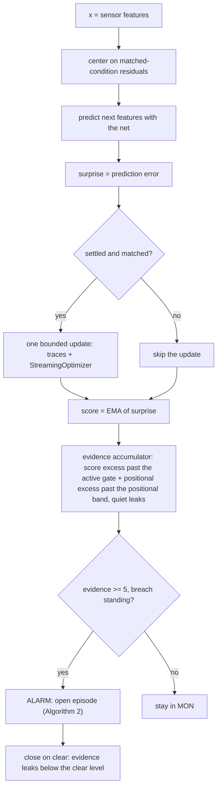
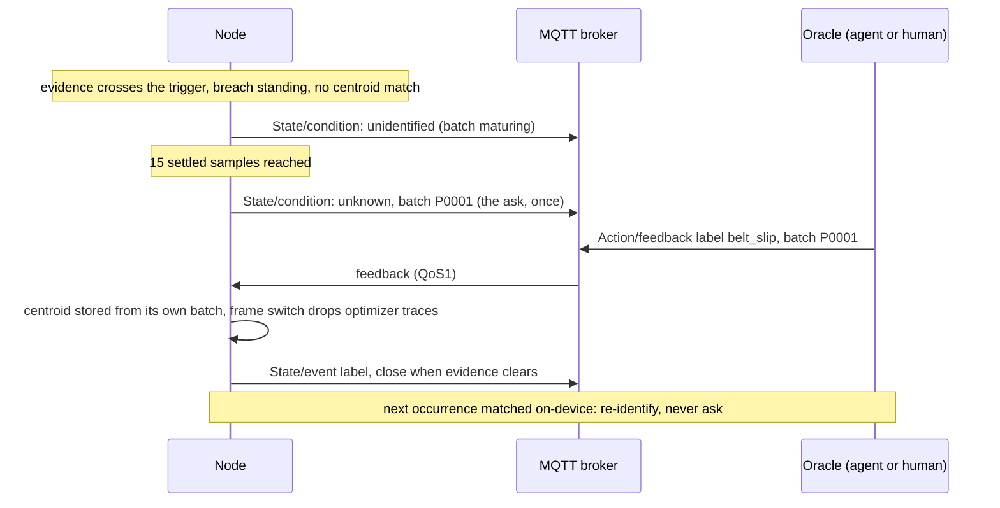

# Algorithms

The algorithms below are the deployed cond-era pipeline, stated exactly as the submitted paper states them. The reader first question they answer: how does a node decide, every second, whether something is wrong, and what does it do when it does not know?

Notation: theta is the alarm threshold; delta is the one-step prediction error, called surprise; score is the smoothed surprise; an episode is a bounded alarm period; a condition is a named operating pattern stored with its centroid; the ask is the node's request for a label; the observation frame is per-condition centered residuals.

## The Stream-X recipe

Three rules carry the streaming stability (Stream-X, arXiv:2410.14606):

| Rule | What it does |
|---|---|
| Normalize | inputs and reward scale live in running moments |
| Stabilize | LayerNorm before every activation; layer-aware sparse initialisation with a connectivity floor (every unit gets at least one nonzero input) |
| Bound | every per-parameter displacement stays below alpha (StreamingOptimizer) |

Why the connectivity floor: the first layer sees only four inputs per unit, so uniform 90% masking left roughly two thirds of its units with no live input at all - the node booted deaf. The budget is now allocated across layers.

Full-net training stays, unlike TinyOL's frozen body: at 1,348 parameters (4*32+32, 32*32+32, 32*4+4; both nodes run the same net since both profiles locked to 4 features) the flash and RAM argument does not bind, and a frozen body limits what a one-step predictor can extract. The whole learning core costs 1,348 parameters and about 16 KB of optimizer state; one forward, backward and update pass at 1 Hz stays far under 0.1% CPU at 240 MHz. The core trains on the live stream only: no training set, no replay buffer.

## One monitor step (Algorithm 1)

The state variables:

- delta_t = (1/n) * sum_i (f_i(x_{t-1}) - z_{t,i})^2 : the net's one-step prediction error, the surprise (paper Eq. 1)
- s_t = (1-alpha) * s_{t-1} + alpha * delta_t, alpha = 0.15 : the score, an EMA of the surprise (paper Eq. 2)
- c_f(x) = log2((x_f + A_f) / (mu_f + A_f)), A_f = 6 sigma_CAL,f : the anchored-ratio condition space (paper Eq. 3)
- d_k(x) = max_f |c_f(x) - c_k,f| / u_k,f : the worst-feature match distance to condition k, in that condition's own units u_k,f, the labelled batch's own measured spread (paper Eq. 4)

```
Algorithm 1. One monitor step at 1 Hz (tinyrl_monitor)
loop at poll rate (1 Hz):
 1: x <- sensor.features()  # telemetry values
 2: center x on matched-condition residuals  # Rule 1
 3: y <- net(x_prev)   # predict next features
 4: delta <- mean squared prediction error  # surprise
 5: if settled AND matched: update net (traces + StreamingOptimizer) # Rules 2+3
 6: score <- EMA(delta)  # smoothed surprise
 7: if evidence >= 5 with the breach standing: open episode # -> Algorithm 2
 8: publish State/event
```

The same logic as control flow:



A step is settled when, for every feature, the net displacement over the last 8 steps stays under its bound: the state's own wander cancels over the window, a machine ramp accumulates. The bounded update runs only on settled steps of matched conditions. An unmatched state opens an episode when the evidence accumulator reaches its trigger: every settled step contributes how far the score sits past theta = mu_fit + 4 sigma_fit, and the episode closes when the evidence clears.

This is Stream-TD, not Q-learning (Stream-Q): the monitor takes no actions, so the control variants of the TinyRL library stay unwired for future work with actuation.

| Stream-X variant | Needs | Verdict |
|---|---|---|
| **Stream-TD** | observations only | **ours** |
| Stream-Q, Stream-SARSA | discrete actions to take | unwired (no actuation) |
| Stream-AC, Stream-RAC | continuous actions | unwired (no actuation) |

## Episode handling and the ask loop (Algorithm 2)

The anchored ratio is bench-found: the bare ratio log2(x/mu) stored NaN centroids once the CAL mean went negative under stopped-machine commissioning, and it collapsed every running state onto one clamped point, so the drive node went structurally blind after its first labeled condition. The anchored form (Eq. 3) with per-condition match units (Eq. 4) fixed both failures; the nearest qualifying condition wins.

```
Algorithm 2. Episode handling and the ask loop (episode.cpp, node_runtime.cpp)
on alarm open (evidence >= its trigger, breach standing; no centroid match):
 1: close any open episode; its stored batch survives for late labels
 2: name from the nearest centroid (confident match only), else condition <- unknown
 3: publish State/condition: condition_id <- name | "unidentified"
 4: feed settled samples only into the episode batch
 5: if the settled state matches a centroid: re-identify, never ask
 6: at 15 settled samples: store the batch, publish "unknown" # the ask, once
on clear (evidence leaks below the clear level):
 1: publish the State/event summary
 2: an unasked batch freezes at its settled mean and stays stored
 3: normal-kind episodes refine their centroid (EMA 0.9/0.1); fault-kind do not
on Action/feedback (label | normal | fault | discard):
 1: label: names every open ask on the machine; each node stores its centroid from its own batch
 2: normal: theta <- max(1.10*theta, 1.05*score) # false alarm: desensitise
 3: fault: theta <- max(0.95*theta, mu + 2.5*sigma) # missed fault: sharpen
 4: discard: clear the ask, model untouched, this occurrence never re-asks
```

The ask loop, end to end:



Asks are alarm-gated stream-based selective sampling (Settles 2012): a query exists only inside an open episode whose profile matches no centroid within its radius; the episode first publishes `unidentified` while it accumulates settled samples, and the ask fires once the batch reaches 15. The myopia warning is answered node-side: steps that match no centroid while quiet are counted and reported, never asked about, because the oracle is one-sided and quiet asks would flood it. Labels are fleet-wide vocabulary while centroids stay per node; faults are named with their operating point, as compound slugs like `speed_1_imbalance`.

## Which problem each part solves

Reading pointers into the Stream-X paper (arXiv:2410.14606):

| Problem | Solution | Where |
|---|---|---|
| Per-sample learning diverges (no buffer averages noise) | normalize signals + LayerNorm + bounded updates | section 2 stream barrier, section 3 recipe |
| Update spikes after quiet periods | leaky-max normalizer (vs RMSProp/Adam) | section 7 Leaky maximum normalization, App. A |
| Representation drifts on correlated streams | LayerNorm, sparse init | section 7 Continual learning (plasticity) |
| No memory for replay buffers | per-sample learning, ~70 KB state | section 7 Resource-constrained learning, section 5 |

Section 4.1 shows re-adaptation after environment switches; accumulating named conditions is Algorithm 2. The full inventory of what `nodes/core/` adds on top (13 detection-chain mechanisms, 8 learning-loop mechanisms, 7 wrapper mechanisms) is on [enhancements](/system/enhancements).
