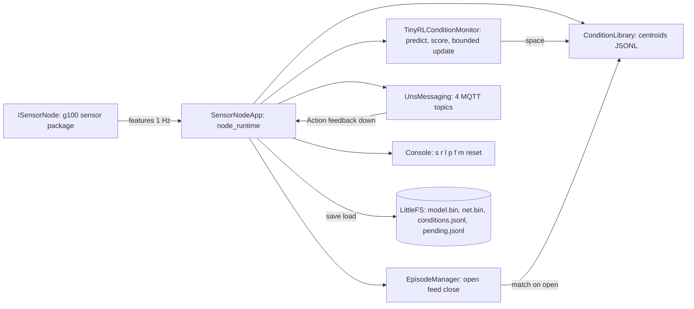
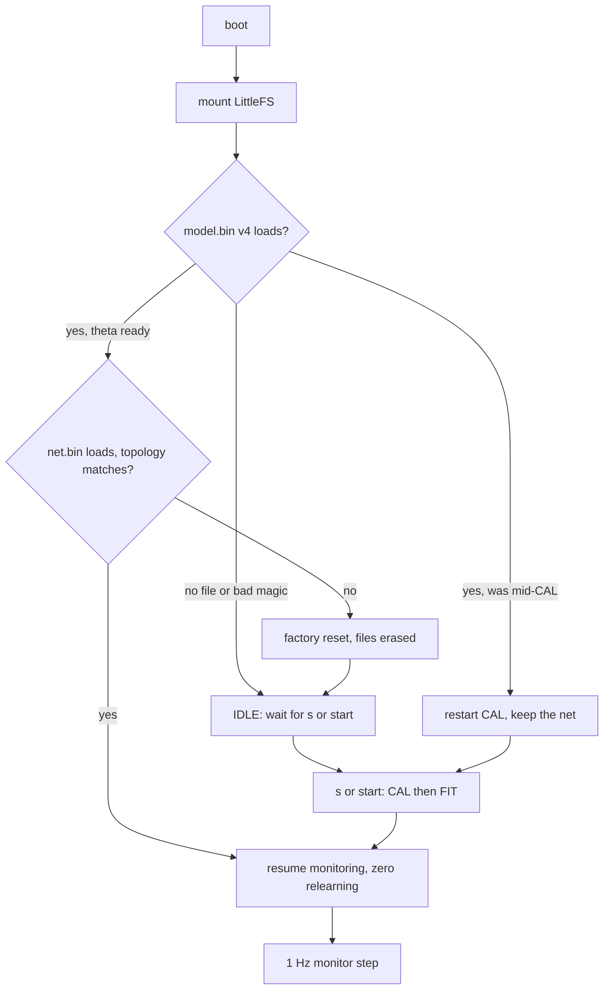

# Node architecture

One module map explains the whole node: sensor in, one decision per second, conditions out, four files that survive a reboot. `nodes/core/` is the sensor-agnostic core that does it, compiled unchanged for every node. This page covers the modules, the 1 Hz data path, the two feature spaces, boot and persistence, what it all costs, and how the modular rewrite differs from the MVP.

## Module map

`main.cpp` is about 20 lines of identity: it builds the sensor and calls `app.begin(sensor, id)` plus `app.tick()` from the loop. Everything else is `nodes/core/`, compiled unchanged for every node. The full file list is on the [repository layout](/reference/layout) page.

| Module | File | Job |
|---|---|---|
| Composition root | `node_runtime.h/.cpp` | the real setup()/loop(); wires sensor, monitor, library, episodes, messaging, console |
| Monitor | `tinyrl_monitor.h/.cpp` | TinyRL integration: nn::Sequential + streaming score + evidence |
| Optimizer | `streaming_optimizer.h` | StreamingOptimizer (Stream-X v3 App. A); v2 ObGD via `-DMONITOR_USE_OBGD` |
| Feature space | `feature_space.h` | frozen anchored-ratio condition space |
| Condition library | `condition_library.h/.cpp` | learned centroids, JSONL on flash |
| Episodes | `episode.h/.cpp` | open/feed/close lifecycle + summaries |
| Messaging | `uns_messaging.h/.cpp` | WiFi/MQTT, 5 topics, State/* + Action/feedback |
| Persistence | `persistence.h/.cpp` | model.bin + net.bin + conditions.jsonl + pending.jsonl |
| Console | `console.h/.cpp` | serial console + JSON feedback path |
| Config | `node_config.h` | compile-time limits, topic layout, defaults |
| JSON writer | `json_mini.h` | tiny JSON writer for payloads |
| TRNG shim | `esp_shim.c` | getentropy -> esp_random (TinyRL TRNG on ESP32) |

(README.md L269-318.)

## One second in the life of a node (the 1 Hz data path)

1. `SensorNodeApp::tick()` polls the sensor (Modbus registers) and gates on freshness (`node_runtime.cpp`).
2. `mon_.step()` maps the features into the era's observation, predicts the next step, takes one bounded update, updates the score EMA (`tinyrl_monitor.cpp`). The observation is era-gated: frozen z (legacy), anchored-ratio levels (rel-obs arm), or per-condition centered residuals obs = (rel - c_matched) / u_matched with a nearest-condition frame for unknowns (current cond-obs arm). The settle gate (per-feature motion EMAs floored at CAL units, 8-step dwell) holds decisions and training off mid-transition, and the update runs only on settled steps of matched (labeled) conditions, at the floor rate once the condition's own score band says the net has converged there. A label arriving mid-settled-state rescales the cond-era input frame, so optimizer state is dropped on frame switches (bench 2026-11-21: without it the heal took thousands of steps).
3. Alarm semantics, era-gated (`node_config.h`, MODEL_VERSION): the legacy z era keeps the positional Schmitt latch over any named condition, with an unmatched state alarming after 5 settled steps above the fit theta. The cond era replaces the latch with the condition's own calibrated evidence: a matched state alarms only when the leaky evidence accumulator (ACC_ALARM = 5, fed by the score's excess over the condition's own surprise band and by the positional aggregate's excess over its positional band) crosses its trigger; quiet leaks the accumulator and never resets it. Radius-edge stickiness: a state that drifts past the quiet edge stays matched to its last condition while within MATCH_Q; beyond MATCH_Q it is genuinely unknown. An unmatched state gates on the global fit theta and opens an episode the same way: `open()` names it if the position matches a centroid, else the state publishes `unidentified`, feeds settled samples, and at ASK_MIN_BATCH = 15 stores a pending batch and asks (`episode.cpp`, pending store).
4. While alarmed, `ep_.feed()` accumulates per-feature means; on clear the episode closes; the centroid refines by EMA 0.9/0.1 on close of NORMAL-kind episodes only (a fault episode's mean folds in the recovery tail and poisons the centroid, 2026-11-19).
5. `UnsMessaging` publishes only on state or condition change; autosave rewrites the flash files at most every 5 min (flash-wear budget, `AUTOSAVE_MS`).

## Two feature spaces (do not merge them)

| Space | Frozen when | Used for | Never for |
|---|---|---|---|
| z-space (Welford moments) | end of theta fit | network input in the legacy z era, surprise, theta | condition matching |
| anchored-ratio decades (rel = log2((x+A)/(mu+A)), A = 6 CAL sigma) | end of CAL | condition centroids + per-condition match units, episode summaries, and, centered per condition, (rel - c)/u, the cond-era network input | raw z-scores for matching |

The split protects labels from network drift: centroids live in a space that stopped moving at the end of CAL, so a label learned today still matches weeks later no matter what the net does. The cond era goes one step further: the network reads the anchored-ratio frame centered on the matched condition's own centroid and scaled by its own units, so every regime's training manifold sits at 0 and surprise is stationary per regime.

## Boot and persistence

The four files and their contents are listed on the [lifecycle page](/guide/lifecycle#what-lives-on-flash).

## What it costs

| Item | Value | Where |
|---|---|---|
| Network | 4-32-32-4, 1,348 params | `node_config.h` NET_HIDDEN |
| Optimizer state | traces + leaky max + grads, about 16 KB | `streaming_optimizer.h` |
| Compute per step | forward + backward + update at 1 Hz, far under 0.1% CPU at 240 MHz | runtime claim, README |
| Flash budget | four files, autosave at most every 5 min (about 12 writes per hour) | `node_config.h` AUTOSAVE_MS |
| Bigger nets | PSRAM used transparently, see [the stack page](/system/tinyrl-stack) | `platformio.ini` |

Measured footprints per env: about 17-19% static RAM and 31% of the app partition on both node images (`bash tests/run_mcu.sh`; exact numbers on the [tests page](/reference/tests)).

## From the MVP to the modular rewrite

Before `nodes/core/` there was a single-file MVP, `vfd_streamq.cpp` (a 24-bin transition-histogram learner). The rewrite replaced it; the comparison explains most of the design:

| Area | MVP (`vfd_streamq.cpp`) | This rewrite |
|---|---|---|
| Learning | hand-rolled 24-bin transition histograms + NLL | TinyRL `nn::Sequential` (sparse Linear -> LayerNorm -> LeakyReLU x2) doing one-step prediction; reward = -surprise; optimized by ObGD (eligibility traces + overshooting bound) from `examples/stream_x/src/obgd.h` |
| Normalization | log-binning only | two spaces with distinct jobs: frozen log-range (condition library) + the network's observation, era-gated: z-scores frozen after theta fit (legacy z env), rel levels (rel-obs A/B arm), per-condition centered residuals `(rel - c)/u` (cond-obs env, `MODEL_VERSION` 8) |
| Weights | none to persist | `net.bin`: Linear layers serialized verbatim; node resumes monitoring after reboot with zero relearning (plug-and-play) |
| Score | NLL EMA | prediction-error EMA (stationary ~O(1) under normal, spikes on regime change) - theta = mu + 4 sigma unchanged |
| Episodes/library/feedback/UNS | none | semantics preserved 1:1 from the first modular cut (same topics, same actions, same console), but generic over the feature profile |
| `State/event` | flat `i_mean`... | generic `meas:{<feature>:<value>}` built from the profile; discovery added via retained `State/node_info` |
| Bug fix | `libLoad()` used `strtof` without skipping commas -> centroids 2..N loaded as 0 after every reboot | fixed (separator guard), verified by round-trip test |

Why the net instead of the histogram: the histogram NLL only saw *pairs* of consecutive bins; the network learns the *joint* one-step dynamics of all features, and the optimizer's update bound keeps the update size sane during the anomaly burst itself (the moments with the biggest gradients are exactly the moments you don't want rewriting the model). `StreamQ`/`StreamAC` remain unused because a condition monitor has no action space - the update loop mirrors `stream_q.h` so a future control node (setpoints, derating) can drop StreamQ in beside the monitor.

Migration notes from the MVP days (kept for history): an old `/model.bin` (v3 histogram) is ignored once; press `s` to relearn. `State/event`'s `meas` replaced the flat `i_mean/...` fields at schema v1.1. The centroid-reload bug fix changed `conditions.jsonl` parsing only - the file format is unchanged, existing labels survive the upgrade.
